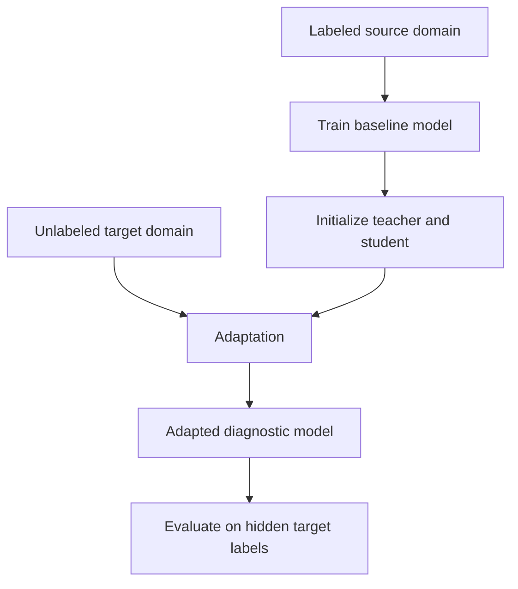
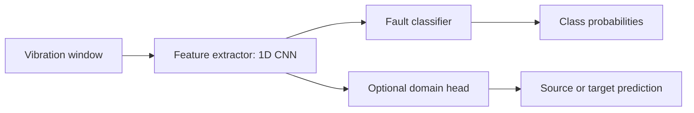

# Implementation of Label-Free Teacher-Student Commissioning for Vibration-Signal-Based Fault Detection

Status: working thesis guide and project roadmap  
Audience: beginner-friendly, written for the student who will implement and explain the work  
Main goal: understand the research idea, build the system, run experiments, and write the thesis  

---

## 0. What This Document Is

This document is your starting map for the thesis:

> **Implementation of Label-Free Teacher-Student Commissioning for Vibration-Signal-Based Fault Detection**

The thesis topic can sound difficult because it combines several areas:

- mechanical fault diagnosis,
- vibration signal processing,
- neural networks,
- domain adaptation,
- pseudo-labeling,
- teacher-student learning,
- experimental machine learning,
- engineering implementation.

The good news is that the main idea is not mystical. We can reduce it to one practical story:

> We train a fault detection model using labeled vibration data from one machine or operating condition. Then we install, or "commission", the diagnostic model on a new machine or new operating condition where we do not have labels. Instead of asking a human to label the new data, we use the model itself, carefully, to adapt to the new unlabeled data.

This is why the thesis says **label-free commissioning**.

In industry, when a diagnostic system is moved to a new motor, bearing, gearbox, load, speed, sensor location, or environment, the data distribution changes. A model trained in the lab can perform worse on the new object. But labeling new faults is expensive, slow, and sometimes impossible because real failures are rare. So the thesis asks:

> Can a teacher-student adaptation procedure improve bearing fault detection on new unlabeled target vibration data?

This document explains the concept, the possible solution, the literature direction, the dataset plan, the implementation plan, and the experiments.

---

## 1. The Thesis in One Page

### 1.1 The Problem

Rolling bearings are common machine elements. They support rotating shafts in motors, pumps, fans, gearboxes, compressors, and many industrial machines. When a bearing starts to fail, it often creates characteristic vibration patterns.

We want an algorithm that can look at a vibration signal and classify the machine condition, for example:

- normal bearing,
- inner race fault,
- outer race fault,
- ball fault.

The simple approach is supervised learning:

1. collect vibration data,
2. label each signal as normal or faulty,
3. train a neural network,
4. test on similar data.

The problem is that real machines do not always give us similar data. If the model was trained on one condition and deployed on another, the signal distribution may change.

Examples of changes:

- different motor load,
- different rotational speed,
- different sensor position,
- different fault severity,
- different bearing type,
- different background noise,
- different gearbox or mechanical structure,
- different sampling frequency,
- different data acquisition hardware.

This is called **domain shift**.

### 1.2 Source and Target Domains

In this thesis:

- **Source domain** means the data we train on with labels.
- **Target domain** means the new data we want to adapt to, without using labels during adaptation.

Example using the CWRU bearing dataset:

- source domain: data collected at motor load 0 hp,
- target domain: data collected at motor load 2 hp.

The model sees labels in the source domain. It sees only raw vibration windows in the target domain. Target labels are hidden during adaptation and used only at the end for evaluation.

### 1.3 Why Teacher-Student?

The teacher-student paradigm uses two models:

- a **student model**, which is actively trained,
- a **teacher model**, which gives pseudo-labels or stable predictions.

The teacher is often an exponential moving average of the student. This means the teacher changes more slowly than the student and usually produces more stable predictions.

The target data has no labels. So the teacher predicts labels for target samples. These predicted labels are called **pseudo-labels**. The student is trained to match the teacher, especially on high-confidence target samples.

In simple words:

> The teacher says: "I am quite confident this target signal looks like an outer race fault."  
> The student learns from that target signal as if it had a label, but only if the teacher is confident enough.

### 1.4 The Main Research Question

The research question can be written like this:

> Does teacher-student adaptation with unlabeled target vibration signals improve fault detection accuracy under domain shift compared with a source-only baseline?

This can be split into smaller questions:

- Does the source-only model fail when load/speed/domain changes?
- Do pseudo-labels help or hurt?
- Does consistency learning improve robustness?
- Does a teacher model produce better pseudo-labels than using the student directly?
- Does confidence thresholding reduce wrong pseudo-labels?
- Does calibration help choose better pseudo-labels?
- Which target classes are most difficult after adaptation?

### 1.5 The Engineering Product

The engineering part is a prototype diagnostic system. It does not have to be an industrial product with a graphical user interface. A clean research prototype is enough, but it should be structured.

The system should include:

- dataset preparation,
- signal segmentation,
- preprocessing,
- neural model definition,
- supervised source training,
- teacher-student adaptation,
- evaluation,
- plots and reports,
- reproducible experiment configuration.

The thesis should show not only that the method works, but also that you built a coherent pipeline that someone else could run.

---

## 2. Essential Concepts Explained Simply

### 2.1 What Is a Rolling Bearing?

A rolling bearing is a mechanical component that allows a shaft to rotate with less friction. It usually contains:

- inner race,
- outer race,
- rolling elements such as balls or rollers,
- cage,
- lubricant.

Common bearing faults include:

- damage on the inner race,
- damage on the outer race,
- damage on the rolling element,
- looseness,
- wear,
- lubrication problems.

In benchmark datasets, especially CWRU, faults are often artificially created using electrical discharge machining. This creates controlled defects of known type and size.

### 2.2 Why Vibration Signals?

A rotating machine creates vibrations. A healthy machine has a certain vibration pattern. A damaged bearing changes that pattern because the rolling elements hit or pass over defects. These events create impulses and frequency components in the vibration signal.

For example:

- an inner race defect may create periodic impacts related to shaft rotation,
- an outer race defect may create impacts at a characteristic bearing frequency,
- a ball defect may create a different repeating pattern,
- load and speed change the signal amplitude and frequency content.

The raw vibration signal is usually a time series:

```text
x[0], x[1], x[2], ..., x[N-1]
```

Each value is an acceleration measurement from a sensor.

### 2.3 What Is Fault Detection vs Fault Diagnosis?

These words are sometimes used loosely.

- **Fault detection** asks: is the machine normal or faulty?
- **Fault diagnosis** asks: what kind of fault is it?
- **Fault classification** usually means assigning one of several classes.

Your thesis title says "fault detection", but the proposed experiments can use multi-class classification:

- normal,
- inner race fault,
- outer race fault,
- ball fault.

In the text, we can explain that the implemented system performs detection and classification. Detection can also be derived from the classification output by grouping all fault classes as "fault".

### 2.4 What Is a Domain?

In machine learning, a domain is a data distribution. In vibration diagnosis, a domain may correspond to one operating condition or one machine configuration.

Examples:

- domain A: bearing data at 0 hp load,
- domain B: bearing data at 1 hp load,
- domain C: bearing data at 2 hp load,
- domain D: bearing data at 3 hp load.

Even if the classes are the same, the signals can look different. This causes domain shift.

### 2.5 What Is Domain Shift?

Domain shift means:

> The training data and deployment data are not drawn from exactly the same distribution.

In a perfect supervised learning scenario, training and test data are similar. But in practical commissioning, the new machine may produce data with different amplitude, noise, speed, load, or frequency content.

A model can accidentally learn domain-specific patterns instead of true fault patterns.

Example:

- During training, all inner race fault examples happen to have high amplitude.
- In the target domain, outer race faults also have high amplitude because load is higher.
- The model may confuse amplitude with fault type.

Domain adaptation tries to reduce this problem.

### 2.6 What Does Label-Free Mean?

Label-free does not mean no labels are used anywhere.

In this thesis, the usual meaning should be:

- source labels are available,
- target labels are not used for adaptation,
- target labels may be used only after training for evaluation.

This is important. The model is not fully unsupervised. It is trained using labeled source data and adapted using unlabeled target data.

A clear sentence for the thesis:

> The term label-free commissioning refers to the absence of target-domain labels during adaptation. Source-domain labels are still used for initial supervised training.

### 2.7 What Is Commissioning?

Commissioning means putting a system into operation on a new object or in a new environment.

For this thesis, commissioning means:

1. train a diagnostic model in a source setting,
2. receive unlabeled vibration data from a new target setting,
3. adapt the model using this unlabeled target data,
4. evaluate or deploy the adapted model.

This matches the practical industrial story:

> A company has an existing diagnostic model trained on previous machines. Now it installs sensors on a new machine. It wants the diagnostic system to work without waiting for labeled fault examples from that new machine.

---

## 3. Where This Thesis Fits in Machine Learning

There are several related learning settings. It is important not to mix them.

| Setting | Source labels? | Target labels during training? | Target data during training? | Example |
|---|---:|---:|---:|---|
| Supervised learning | yes | yes | yes | Train and test on same labeled dataset |
| Unsupervised learning | no | no | yes | Cluster vibration signals without labels |
| Semi-supervised learning | some | some | yes | A few labeled target signals plus many unlabeled target signals |
| Unsupervised domain adaptation | yes | no | yes | Train on labeled source, adapt with unlabeled target |
| Source-free domain adaptation | source model only | no | yes | No access to original source data during adaptation |
| Domain generalization | yes | no | no target data | Train on multiple sources, hope it works on unseen target |
| Test-time adaptation | usually source model only | no | streaming target | Adapt online during deployment |

Your thesis is closest to:

> **Unsupervised domain adaptation for fault diagnosis**, with a teacher-student adaptation mechanism.

If we choose to avoid using source data during target adaptation, then it becomes closer to source-free domain adaptation. But the thesis objective says "trained on source data and adapted to new vibration signals without labels from the target object", so using source data during adaptation is allowed unless the supervisor says otherwise.

Recommended choice for the first implementation:

> Use labeled source data during initial training. During adaptation, train on source labeled batches and target unlabeled batches together. This is simpler, stable, and suitable for a BSc thesis.

Possible extension:

> Add source-free adaptation later, where only the trained source model and unlabeled target data are available.

---

## 4. Literature Foundation

This section explains the literature you should understand first. It is not the final literature review, but it gives the structure.

### 4.1 Rolling Bearing Fault Diagnosis

Traditional bearing diagnosis often uses signal processing and expert features:

- time-domain statistics,
- RMS,
- kurtosis,
- crest factor,
- envelope analysis,
- FFT spectrum,
- wavelet transform,
- characteristic fault frequencies.

Deep learning approaches often use:

- raw time signal with 1D CNN,
- FFT magnitude with 1D CNN or MLP,
- spectrogram with 2D CNN,
- wavelet scalogram with 2D CNN,
- autoencoders,
- recurrent networks,
- transformers.

For this thesis, the most practical baseline is a 1D CNN using either:

- raw vibration windows, or
- FFT magnitude of windows.

Raw 1D CNN is simpler and very common. FFT can be added as a comparison if time permits.

### 4.2 Domain Adaptation in Fault Diagnosis

Domain adaptation is important in fault diagnosis because machines operate under different conditions. A model trained under one load may not work equally well under another load.

Common domain adaptation methods include:

- domain-adversarial neural networks,
- discrepancy minimization such as CORAL or MMD,
- pseudo-labeling,
- teacher-student learning,
- self-training,
- contrastive learning,
- source-free adaptation.

The domain-adversarial idea is:

> Learn features that are useful for fault classification but make it difficult to tell whether a feature came from source or target.

The teacher-student idea is:

> Use a teacher model to generate stable pseudo-labels for unlabeled target data, and train the student to be consistent with the teacher.

### 4.3 Teacher-Student Learning

The teacher-student idea appears in many forms:

- knowledge distillation,
- Mean Teacher,
- pseudo-labeling,
- consistency regularization,
- FixMatch-style confidence thresholding.

In Mean Teacher, the teacher weights are an exponential moving average of the student weights. This makes the teacher smoother. If the student changes suddenly after one batch, the teacher changes slowly.

The update is:

```text
teacher_weights = alpha * teacher_weights + (1 - alpha) * student_weights
```

Typical alpha values:

- 0.99,
- 0.995,
- 0.999.

Higher alpha means slower teacher updates.

### 4.4 Pseudo-Labels

A pseudo-label is a predicted label used as if it were true.

Example:

```text
target signal -> teacher model -> probabilities

normal: 0.02
inner race: 0.05
outer race: 0.90
ball: 0.03

pseudo-label = outer race
confidence = 0.90
```

If confidence is high enough, we train the student using this pseudo-label.

Risk:

> If pseudo-labels are wrong, the model can reinforce its own mistakes.

Protection mechanisms:

- confidence threshold,
- class-wise thresholds,
- teacher EMA,
- calibration,
- weak/strong augmentations,
- balanced pseudo-label selection,
- slow ramp-up of target loss.

### 4.5 Consistency Learning

Consistency learning means:

> The model should make similar predictions for different versions of the same signal.

For vibration signals, augmentations may include:

- small Gaussian noise,
- random amplitude scaling,
- random time shift,
- random crop,
- masking a small part of the signal,
- weak jitter,
- frequency-domain perturbation if using FFT.

Example:

```text
original target window
weakly augmented version -> teacher prediction
strongly augmented version -> student prediction
student should match teacher
```

This helps because the model learns stable fault patterns instead of fragile details.

### 4.6 Calibrated Adaptive Teacher

One important paper in your bibliography is:

Forest, F. and Fink, O., "Calibrated Adaptive Teacher for Domain-Adaptive Intelligent Fault Diagnosis," Sensors, 2024. DOI: 10.3390/s24237539.

The paper proposes a calibrated adaptive teacher approach for domain-adaptive intelligent fault diagnosis. The key ideas relevant to your thesis are:

- teacher-student adaptation,
- pseudo-labeling on target data,
- confidence-based pseudo-label selection,
- calibration of model confidence,
- domain adaptation for rotating machinery diagnosis.

The official code repository is:

[EPFL-IMOS/CAT on GitHub](https://github.com/EPFL-IMOS/CAT)

This repository should be one of the first codebases to inspect when we start implementation.

Important note:

> We do not need to reproduce the paper perfectly for the BSc thesis. We can implement a simplified version inspired by it, then compare it with baselines.

### 4.7 Source-Free Domain Adaptation Paper

The second bibliography item is:

Yu, A., Cai, B., Wu, Q., Garcia, M. M., Li, J., and Chen, X., "Source-free domain adaptation method for fault diagnosis of rotation machinery under partial information," Reliability Engineering & System Safety, 2024. DOI: 10.1016/j.ress.2024.110181.

This paper is relevant because it studies source-free domain adaptation for rotating machinery fault diagnosis. In source-free adaptation, the original source data may not be available during target adaptation. Only the trained source model and unlabeled target data are available.

For your thesis, this can be discussed as a related and more restrictive setting.

Recommended position:

> The main thesis implementation can use unsupervised domain adaptation with source and target data. Source-free adaptation can be included in the literature review and perhaps as an optional extension if time allows.

### 4.8 Other Important Literature Directions

You should also read or cite work related to:

- Mean Teacher for semi-supervised learning,
- FixMatch for pseudo-labeling and consistency,
- Domain-Adversarial Neural Networks,
- CORAL or Deep CORAL,
- bearing fault diagnosis with CNNs,
- domain adaptation in mechanical fault diagnosis,
- CWRU-based experimental protocols.

Useful references:

- Mean Teacher: Tarvainen and Valpola, 2017.
- Domain-Adversarial Neural Networks: Ganin et al., JMLR 2016.
- FixMatch: Sohn et al., NeurIPS 2020.
- Deep CORAL: Sun and Saenko, 2016.
- CWRU Bearing Data Center official dataset pages.

---

## 5. Proposed Thesis Idea

### 5.1 Core Idea

The core idea is:

> Build a bearing fault classifier using labeled source-domain vibration data. Then adapt it to an unlabeled target domain using a teacher-student procedure. The teacher generates pseudo-labels for confident target samples, and the student learns from both labeled source data and unlabeled target data under consistency constraints.

This gives a realistic commissioning scenario:

1. We already have a model trained from historical data.
2. We connect a sensor to a new machine.
3. We collect target vibration signals.
4. We do not label the target signals.
5. The model adapts using target signal structure.
6. We test whether performance improves.

### 5.2 Proposed Algorithm Name

For the thesis, we can call the method:

> Label-Free Teacher-Student Commissioning (LFTSC)

This is not necessarily a published method name. It can be our implementation name.

Alternative names:

- Teacher-Student Domain Adaptation for Bearing Fault Detection,
- Label-Free Commissioning by Adaptive Teacher,
- Pseudo-Label Teacher-Student Adaptation.

The first name is short and thesis-friendly.

### 5.3 Recommended Scope

For a BSc thesis, the scope should be ambitious but controllable.

Recommended main implementation:

- dataset: CWRU bearing dataset,
- classes: normal, inner race fault, outer race fault, ball fault,
- domains: motor loads 0, 1, 2, 3 hp,
- model: 1D CNN,
- source training: supervised cross-entropy,
- adaptation: teacher-student pseudo-labeling with EMA teacher,
- optional: domain-adversarial loss or CORAL,
- evaluation: source-only baseline vs adapted model.

Optional extensions if time allows:

- FFT input representation,
- calibration,
- class-wise pseudo-label thresholds,
- source-free adaptation variant,
- comparison with CAT repository behavior,
- gearbox dataset comparison.

---

## 6. Proposed System Architecture

### 6.1 High-Level Pipeline

```mermaid
flowchart LR
    A["Raw vibration files"] --> B["Dataset loader"]
    B --> C["Window segmentation"]
    C --> D["Preprocessing"]
    D --> E["Source training"]
    E --> F["Source-only model"]
    F --> G["Teacher-student adaptation"]
    G --> H["Adapted model"]
    H --> I["Evaluation"]
    I --> J["Reports and plots"]
```



### 6.2 Commissioning View



### 6.3 Model View



The classifier predicts the fault class. The optional domain head is used only if we implement adversarial domain adaptation.

---

## 7. Dataset Plan: CWRU Bearing Dataset

### 7.1 Why CWRU?

The Case Western Reserve University Bearing Data Center dataset is one of the most widely used public datasets for rolling bearing fault diagnosis.

Official dataset page:

[CWRU Bearing Data Center](https://engineering.case.edu/bearingdatacenter/welcome)

Official apparatus description:

[CWRU Apparatus and Procedures](https://engineering.case.edu/bearingdatacenter/apparatus-and-procedures)

Reasons to use CWRU:

- public and widely known,
- contains normal and faulty bearing data,
- includes different motor loads,
- includes different fault locations,
- includes different fault diameters,
- easy to compare with existing literature,
- many GitHub repositories already use it.

### 7.2 Important CWRU Details

According to the official CWRU Bearing Data Center pages:

- The test stand includes a motor, torque transducer, dynamometer, and control electronics.
- Faults were introduced into bearings using electrical discharge machining.
- Fault locations include inner race, ball, and outer race.
- Fault diameters include values such as 0.007, 0.014, 0.021, 0.028, and 0.040 inches depending on subset.
- Motor loads include 0, 1, 2, and 3 horsepower.
- Motor speeds differ slightly with load.
- Data are provided in MATLAB `.mat` files.
- Drive-end bearing data are often sampled at 12 kHz, with some data also available at 48 kHz.
- Accelerometers were placed at locations such as the drive end and fan end.

For the first thesis implementation, use a controlled subset:

- sampling: 12 kHz drive-end data,
- classes: normal, inner race, ball, outer race,
- fault diameter: one or two selected severities, for example 0.007 inch and/or 0.014 inch,
- domains: load conditions 0, 1, 2, 3 hp.

### 7.3 Recommended First Experimental Setup

Use four classes:

| Class ID | Class name |
|---:|---|
| 0 | normal |
| 1 | inner race fault |
| 2 | ball fault |
| 3 | outer race fault |

Use load as domain:

| Domain ID | Load |
|---:|---|
| A | 0 hp |
| B | 1 hp |
| C | 2 hp |
| D | 3 hp |

Example transfer tasks:

| Transfer | Meaning |
|---|---|
| 0 -> 1 | Train on 0 hp, adapt/test on 1 hp |
| 0 -> 2 | Train on 0 hp, adapt/test on 2 hp |
| 0 -> 3 | Train on 0 hp, adapt/test on 3 hp |
| 1 -> 3 | Train on 1 hp, adapt/test on 3 hp |
| 3 -> 0 | Train on 3 hp, adapt/test on 0 hp |

Do not do too many at first. Start with:

1. 0 -> 1,
2. 0 -> 2,
3. 0 -> 3.

Then expand if the pipeline is stable.

### 7.4 Segmentation

Vibration recordings are long time series. Neural networks usually train on fixed-length windows.

Example:

```text
raw signal length = 120000 samples
window length = 1024 samples
step = 512 samples
```

This creates many windows:

```text
window 1: samples 0 to 1023
window 2: samples 512 to 1535
window 3: samples 1024 to 2047
...
```

Recommended first settings:

- window length: 1024 or 2048,
- overlap: 50 percent for training,
- no leakage between train/test partitions.

The leakage point is extremely important.

Wrong:

> Split windows randomly after generating overlapping windows from the same recording.

This can cause near-identical windows to appear in both train and test. The model looks excellent but the evaluation is unrealistic.

Better:

> Split by file or by non-overlapping recording region before generating overlapping windows.

For a BSc thesis, at minimum document the split clearly and avoid mixing heavily overlapping windows across train/test.

### 7.5 Normalization

Possible normalization methods:

- per-window z-score,
- source-domain mean and standard deviation,
- per-recording normalization,
- robust normalization using median and interquartile range.

Recommended first method:

> Normalize each window to zero mean and unit standard deviation.

This reduces amplitude differences and makes training easier.

But for domain adaptation, amplitude can contain useful fault information. So in the thesis, note that normalization is a design choice.

Alternative:

> Compute normalization statistics from the source training set and apply them to source and target.

This is more standard machine learning practice. We can test both if time allows.

### 7.6 Target Labels

During adaptation:

- target labels must not be used,
- target labels must not be used for hyperparameter tuning,
- target labels must not be used to select the best checkpoint.

At evaluation:

- target labels are used to calculate accuracy, F1 score, confusion matrix, and other metrics.

This distinction is central to the thesis.

---

## 8. Signal Representations

### 8.1 Raw Time-Domain Signal

The simplest representation is the raw vibration window.

Shape example:

```text
batch_size x channels x window_length
32 x 1 x 1024
```

Advantages:

- simple,
- no manual feature extraction,
- 1D CNN can learn local patterns,
- easy to implement.

Disadvantages:

- may require more data,
- can be sensitive to phase shifts,
- sometimes harder to interpret.

### 8.2 FFT Magnitude

The FFT converts the time signal into frequency content.

Advantages:

- bearing faults often produce frequency signatures,
- less sensitive to exact time position of impulses,
- common in vibration analysis.

Disadvantages:

- loses time localization,
- preprocessing choices matter,
- may hide non-stationary behavior.

### 8.3 Spectrogram

A spectrogram represents frequency content over time. It can be used as an image input to a 2D CNN.

Advantages:

- rich representation,
- useful for non-stationary signals.

Disadvantages:

- more preprocessing,
- more hyperparameters,
- heavier model,
- less necessary for first implementation.

### 8.4 Recommendation

First implementation:

> Use raw time-domain windows with a 1D CNN.

Second experiment if time allows:

> Add FFT magnitude windows and compare.

This is enough for a strong thesis because the main research is domain adaptation, not signal representation.

---

## 9. Baseline Model

### 9.1 Baseline Goal

The baseline answers:

> What happens if we train only on labeled source data and directly test on target data?

This is the most important comparison. If the adapted method improves over source-only, the thesis has a meaningful result.

### 9.2 Suggested 1D CNN

A reasonable 1D CNN:

```text
Input: 1 x 1024 vibration window

Conv1D block:
  Conv1D 1 -> 32
  BatchNorm
  ReLU
  MaxPool

Conv1D block:
  Conv1D 32 -> 64
  BatchNorm
  ReLU
  MaxPool

Conv1D block:
  Conv1D 64 -> 128
  BatchNorm
  ReLU
  MaxPool

Global average pooling
Dense layer
Classifier output: 4 classes
```

This is not too large and should train quickly.

### 9.3 Baseline Training Loss

Use cross-entropy loss on source labels:

```text
L_source = CE(student(source_x), source_y)
```

The model learns to classify source-domain windows.

### 9.4 Source-Only Evaluation

After training:

1. test on source test set,
2. test directly on target test set,
3. record performance.

Expected behavior:

- source test accuracy may be high,
- target test accuracy may drop because of domain shift.

This drop motivates adaptation.

---

## 10. Teacher-Student Adaptation

### 10.1 Notation

Let:

```text
D_s = labeled source dataset
D_t = unlabeled target dataset
x_s = source signal window
y_s = source label
x_t = target signal window
student = model being trained
teacher = exponential moving average of student
```

The source batch contains labels. The target batch does not.

### 10.2 Adaptation Loop

The adaptation loop:

1. Load a source batch with labels.
2. Load a target batch without labels.
3. Train student on source labels.
4. Ask teacher to predict target labels.
5. Keep only confident target pseudo-labels.
6. Train student to match pseudo-labels on target signals.
7. Optionally train consistency between weak and strong augmentations.
8. Update teacher weights as EMA of student weights.

### 10.3 Pseudo-Code

```python
teacher = copy(student)
freeze_gradients(teacher)

for epoch in adaptation_epochs:
    for source_batch, target_batch in loader:
        xs, ys = source_batch
        xt = target_batch

        xt_weak = weak_augment(xt)
        xt_strong = strong_augment(xt)

        with no_grad:
            teacher_probs = teacher(xt_weak)
            confidence, pseudo_label = max_probability(teacher_probs)
            mask = confidence >= threshold

        source_loss = cross_entropy(student(xs), ys)

        if any(mask):
            target_loss = cross_entropy(student(xt_strong[mask]), pseudo_label[mask])
        else:
            target_loss = 0

        total_loss = source_loss + lambda_target * target_loss

        update_student(total_loss)
        update_teacher_ema(teacher, student)
```

### 10.4 Loss Function

The total loss can be:

```text
L_total = L_source + lambda_target * L_pseudo
```

Where:

```text
L_source = supervised cross-entropy on labeled source data
L_pseudo = cross-entropy on confident pseudo-labeled target data
```

If using consistency loss:

```text
L_total = L_source + lambda_target * L_pseudo + lambda_consistency * L_consistency
```

Where consistency may be:

```text
L_consistency = KL(student(strong_aug_target), teacher(weak_aug_target))
```

### 10.5 Confidence Threshold

The teacher may produce probabilities like:

```text
[0.25, 0.30, 0.22, 0.23]
```

This is not confident. We should not trust it.

But if it produces:

```text
[0.01, 0.02, 0.95, 0.02]
```

Then it is probably more useful.

Use a threshold:

```text
if max_probability >= tau:
    accept pseudo-label
else:
    ignore target sample
```

Possible thresholds:

- 0.70,
- 0.80,
- 0.90,
- 0.95.

Recommended first value:

> tau = 0.90

If too few target samples are accepted, lower to 0.80.

### 10.6 Class-Wise Thresholds

A problem can occur:

> The teacher is confident mostly for easy classes and ignores hard classes.

Then adaptation becomes biased.

Class-wise thresholds allow different thresholds for each class.

Example:

```text
normal threshold = 0.95
inner race threshold = 0.85
outer race threshold = 0.90
ball threshold = 0.80
```

This is more advanced. It can be part of the full method if the simple method works.

### 10.7 Calibration

Neural networks can be overconfident. A model may say 0.99 probability and still be wrong.

Calibration tries to make confidence more meaningful.

Temperature scaling is a simple calibration method:

```text
softmax(logits / T)
```

If T is greater than 1, probabilities become softer. If T is less than 1, probabilities become sharper.

In a strict label-free target setting, we cannot calibrate using target labels. We can calibrate using a source validation set, or use methods designed for domain adaptation.

For the first implementation:

> Calibration can be discussed and optionally implemented after the basic teacher-student pipeline works.

### 10.8 Why Teacher Instead of Student Directly?

The student is updated every batch. Its predictions can fluctuate.

The teacher is an averaged model, so it is more stable.

This stability matters because pseudo-labels can cause feedback loops. If the student makes a wrong prediction and immediately trains on it, the error can grow. The teacher reduces this instability.

### 10.9 What Can Go Wrong?

Teacher-student adaptation is not guaranteed to help.

Common failure modes:

- source model is too weak,
- target domain is too different,
- pseudo-labels are wrong,
- threshold is too low,
- threshold is too high and almost no target data is used,
- class imbalance grows during adaptation,
- model collapses to predicting one class,
- target contains classes absent from source,
- target data preprocessing differs from source.

The thesis should report these honestly. A good thesis does not need perfect results. It needs a careful method, correct experiments, and intelligent analysis.

---

## 11. Optional Domain-Adversarial Component

### 11.1 Idea

A domain-adversarial neural network learns features that:

- help classify faults,
- hide whether data came from source or target.

It has:

- feature extractor,
- fault classifier,
- domain classifier.

The domain classifier tries to predict:

```text
source or target?
```

The feature extractor is trained through a gradient reversal layer so that it makes domain prediction difficult.

### 11.2 Why It Might Help

If source and target features become more similar, the classifier may generalize better.

### 11.3 Why It Might Hurt

If domain alignment is too strong, it may align wrong classes together.

Example:

- source inner race features align with target ball fault features,
- classifier becomes worse.

Therefore, this should be a baseline or optional component, not the only method.

### 11.4 Recommended Use

Implement in this order:

1. source-only baseline,
2. simple pseudo-label teacher-student,
3. teacher-student with consistency,
4. optional DANN or CORAL comparison.

---

## 12. Experiments

### 12.1 Main Experimental Question

The main experiment should answer:

> Does teacher-student adaptation improve target-domain fault classification compared with a source-only model?

### 12.2 Methods to Compare

Minimum methods:

| Method | Description |
|---|---|
| Source-only | Train on labeled source, test on target without adaptation |
| Pseudo-label self-training | Student generates pseudo-labels without EMA teacher |
| Teacher-student | EMA teacher generates pseudo-labels for target |
| Teacher-student + consistency | Teacher on weak augmentation, student on strong augmentation |

Optional methods:

| Method | Description |
|---|---|
| DANN | Domain-adversarial adaptation |
| CORAL | Align second-order feature statistics |
| Target-supervised upper bound | Train with target labels, only as a reference ceiling |
| CAT-inspired full method | Teacher-student plus calibration and adaptive thresholds |

Important:

> The target-supervised result is not a fair label-free method. It is only an upper bound showing what might be possible if labels existed.

### 12.3 Domain Transfers

Recommended first transfer tasks:

| Task | Source | Target |
|---|---|---|
| T1 | 0 hp | 1 hp |
| T2 | 0 hp | 2 hp |
| T3 | 0 hp | 3 hp |

Additional tasks:

| Task | Source | Target |
|---|---|---|
| T4 | 1 hp | 2 hp |
| T5 | 1 hp | 3 hp |
| T6 | 2 hp | 3 hp |
| T7 | 3 hp | 0 hp |

Start small. Expand only after the pipeline is stable.

### 12.4 Metrics

Use multiple metrics:

- accuracy,
- balanced accuracy,
- macro F1 score,
- per-class precision,
- per-class recall,
- confusion matrix,
- expected calibration error if calibration is studied,
- pseudo-label coverage,
- pseudo-label accuracy for analysis only.

Pseudo-label coverage means:

```text
accepted pseudo-labels / all target samples
```

Pseudo-label accuracy means:

```text
correct pseudo-labels / accepted pseudo-labels
```

But pseudo-label accuracy uses hidden target labels, so it must be reported only as offline analysis, not used during training.

### 12.5 Repeated Runs

Neural network results can vary because of random initialization and random batches.

Run each experiment with multiple seeds:

- seed 0,
- seed 1,
- seed 2.

Better if time allows:

- 5 seeds.

Report:

```text
mean +/- standard deviation
```

### 12.6 Tables to Include in Thesis

Main result table:

| Transfer | Source-only | Teacher-student | TS + consistency | Best improvement |
|---|---:|---:|---:|---:|
| 0 -> 1 | ... | ... | ... | ... |
| 0 -> 2 | ... | ... | ... | ... |
| 0 -> 3 | ... | ... | ... | ... |

Ablation table:

| Variant | Accuracy | Macro F1 | Coverage |
|---|---:|---:|---:|
| no adaptation | ... | ... | ... |
| pseudo-label only | ... | ... | ... |
| EMA teacher | ... | ... | ... |
| EMA + consistency | ... | ... | ... |
| EMA + consistency + calibration | ... | ... | ... |

Pseudo-label analysis:

| Epoch | Coverage | Pseudo-label accuracy | Target accuracy |
|---:|---:|---:|---:|
| 1 | ... | ... | ... |
| 5 | ... | ... | ... |
| 10 | ... | ... | ... |

### 12.7 Plots to Include

Useful plots:

- training loss curves,
- source validation accuracy,
- target test accuracy after each adaptation epoch,
- confusion matrices,
- t-SNE or UMAP of learned features,
- pseudo-label confidence histogram,
- pseudo-label coverage over epochs,
- calibration reliability diagram if calibration is included.

Be careful with t-SNE and UMAP:

> They are visualization tools, not proof. Use them to support explanation, not as the main evidence.

---

## 13. Implementation Plan

### 13.1 Recommended Repository Structure

```text
thesis/
  README.md
  requirements.txt
  configs/
    baseline_cwru.yaml
    ts_cwru.yaml
  data/
    raw/
    processed/
    manifests/
  src/
    datasets/
      cwru.py
      transforms.py
    models/
      cnn1d.py
      domain_head.py
    training/
      train_source.py
      adapt_teacher_student.py
      losses.py
      ema.py
    evaluation/
      metrics.py
      plots.py
      report.py
    utils/
      seed.py
      logging.py
      config.py
  experiments/
    results/
    logs/
  notebooks/
    01_dataset_exploration.ipynb
    02_result_analysis.ipynb
  thesis/
    figures/
    tables/
```

This structure separates data, models, training, evaluation, and thesis outputs.

### 13.2 Main Scripts

Script 1:

```text
prepare_cwru.py
```

Purpose:

- download or locate CWRU files,
- load MATLAB files,
- extract signals,
- create windowed datasets,
- write metadata manifests.

Script 2:

```text
train_source.py
```

Purpose:

- train baseline model on source labels,
- save checkpoint,
- save metrics.

Script 3:

```text
adapt_teacher_student.py
```

Purpose:

- load source checkpoint,
- create teacher and student,
- adapt using source and unlabeled target batches,
- save adapted checkpoint.

Script 4:

```text
evaluate.py
```

Purpose:

- evaluate checkpoint on source and target test sets,
- produce metrics,
- produce confusion matrix.

Script 5:

```text
make_report.py
```

Purpose:

- collect experiment results,
- generate tables,
- export plots.

### 13.3 Configuration Example

```yaml
dataset:
  name: cwru
  sampling_rate: 12000
  sensor_location: drive_end
  classes: [normal, inner_race, ball, outer_race]
  fault_diameter: 0.007
  source_load: 0
  target_load: 3
  window_length: 1024
  window_step: 512
  normalization: per_window_zscore

model:
  name: cnn1d
  channels: [32, 64, 128]
  kernel_size: 7
  dropout: 0.1

training:
  batch_size: 64
  epochs: 50
  learning_rate: 0.001
  optimizer: adam
  seed: 0

adaptation:
  epochs: 20
  ema_alpha: 0.99
  pseudo_threshold: 0.90
  lambda_target: 1.0
  weak_augmentation: [jitter_small]
  strong_augmentation: [jitter, scaling, shift]
```

### 13.4 Experiment Naming

Use clear experiment IDs:

```text
cwru_raw_1024_load0_to_load3_sourceonly_seed0
cwru_raw_1024_load0_to_load3_ts_tau090_seed0
cwru_raw_1024_load0_to_load3_ts_consistency_tau090_seed0
```

This matters later when results accumulate.

### 13.5 Reproducibility

Record:

- Python version,
- PyTorch version,
- CUDA version if used,
- random seed,
- dataset files used,
- preprocessing settings,
- train/test split,
- model hyperparameters,
- adaptation hyperparameters,
- commit hash if using git.

The thesis should include enough information for someone else to reproduce the experiment.

---

## 14. Engineering Requirements

### 14.1 Functional Requirements

The system should:

- load CWRU vibration data,
- segment signals into windows,
- assign labels for source and evaluation,
- define source and target domains,
- train a baseline classifier,
- evaluate source-only performance,
- adapt using teacher-student learning,
- evaluate adapted model,
- generate plots and tables.

### 14.2 Non-Functional Requirements

The system should be:

- reproducible,
- modular,
- understandable,
- configurable,
- reasonably fast,
- documented.

### 14.3 Testing Requirements

Unit tests or sanity checks should verify:

- data loader returns correct shapes,
- labels match expected class IDs,
- source and target domains are not mixed accidentally,
- train/test split does not leak obvious duplicates,
- model forward pass works,
- loss is finite,
- one training batch updates student weights,
- EMA update changes teacher weights correctly,
- evaluation metrics are computed correctly.

### 14.4 Minimal Smoke Test

Before running full experiments, run a tiny test:

- one source load,
- one target load,
- 100 windows per class,
- 2 training epochs,
- 1 adaptation epoch.

If this fails, do not run full experiments.

---

## 15. Analysis Plan

### 15.1 What We Hope to See

The ideal result:

- source-only performs well on source,
- source-only drops on target,
- teacher-student adaptation improves target performance,
- consistency improves stability,
- pseudo-label coverage grows during adaptation,
- confusion matrix becomes cleaner.

Example story:

> The source-only model achieved high accuracy on the source domain but showed reduced performance on target domains with different loads. The teacher-student adaptation improved target-domain accuracy by using confident pseudo-labels from unlabeled target signals. The largest improvements appeared in transfers with moderate domain shift, while the hardest transfer still showed confusion between ball and outer race faults.

### 15.2 What If Results Are Not Good?

This is possible. It does not mean the thesis fails.

Possible explanations:

- CWRU load shift may be too easy or too artificial,
- pseudo-label threshold may be wrong,
- model may already generalize very well,
- target shift may not be strong enough,
- adaptation may overfit,
- labels may be imbalanced,
- preprocessing may remove useful information,
- source and target split may be flawed.

If teacher-student does not improve, the thesis can still analyze:

- when it helps,
- when it hurts,
- why pseudo-label quality matters,
- what practical limitations exist.

### 15.3 Important Scientific Discipline

Do not tune hyperparameters using target test labels.

Correct:

- decide threshold values before final evaluation,
- use source validation,
- report all transfer tasks,
- run multiple seeds.

Incorrect:

- test many thresholds on target test set and report only the best,
- use target labels to stop adaptation,
- remove bad transfers from the final table.

The thesis will be stronger if it is honest and systematic.

---

## 16. Risk Register

| Risk | Why it matters | Mitigation |
|---|---|---|
| Data leakage | Results become unrealistically high | Split carefully before overlapping windows |
| Source-only already near perfect | Adaptation improvement may be small | Use harder transfers or different fault sizes |
| Wrong pseudo-labels | Adaptation can hurt | Use high threshold, EMA teacher, monitor coverage |
| Class imbalance | Model may prefer common classes | Balance windows per class |
| Target labels accidentally used | Violates label-free setting | Separate adaptation and evaluation code |
| Too many experiments | Thesis becomes unmanageable | Start with 3 transfers and 3 methods |
| Repository code does not run | Common with research repos | Use repos for reference, build own minimal pipeline |
| CWRU too overused | Literature may criticize it | Discuss limitation and focus on method implementation |
| Domain shift too small | Hard to show benefit | Test larger load gaps and sensor/fault-size shifts |
| Overcomplicated method | Hard to debug | Build source-only first, then adaptation |

---

## 17. Literature Review Structure

Your literature review can be organized like this:

### 17.1 Condition Monitoring and Bearing Fault Diagnosis

Explain:

- why bearings matter,
- what vibration analysis is,
- traditional signal processing,
- deep learning for fault diagnosis.

### 17.2 Domain Shift in Fault Diagnosis

Explain:

- why trained models fail under new conditions,
- load/speed/sensor/domain changes,
- source and target domains,
- industrial commissioning problem.

### 17.3 Domain Adaptation Methods

Explain:

- feature alignment,
- adversarial adaptation,
- discrepancy-based methods,
- pseudo-labeling,
- source-free adaptation.

### 17.4 Teacher-Student and Consistency Learning

Explain:

- Mean Teacher,
- EMA teacher,
- pseudo-label confidence,
- weak/strong augmentation,
- consistency regularization.

### 17.5 Recent Fault Diagnosis Papers

Discuss:

- Calibrated Adaptive Teacher,
- source-free domain adaptation for rotating machinery,
- other recent domain-adaptive fault diagnosis papers.

### 17.6 Research Gap

Possible gap statement:

> Many fault diagnosis methods show high accuracy on benchmark datasets, but practical commissioning on a new object is difficult because target labels are unavailable. This thesis focuses on implementing and experimentally evaluating a label-free teacher-student adaptation pipeline for vibration-signal-based bearing fault detection under controlled domain shifts.

---

## 18. Paper Reading Template

For every paper, fill this table:

| Field | Notes |
|---|---|
| Citation | Author, title, year |
| Problem | What problem does it solve? |
| Dataset | What data did they use? |
| Source/target setup | What is the domain shift? |
| Labels used | Are target labels used? |
| Model | What neural network or method? |
| Adaptation method | How does it adapt? |
| Main result | What improved? |
| Limitations | What is weak or unclear? |
| Useful for thesis | What can we reuse or discuss? |

This will make the literature review much easier to write.

---

## 19. GitHub Code Search Plan

The supervisor asked to go to GitHub and try to download code for label-free teacher-student commissioning or related methods.

When we start coding, search for:

- calibrated adaptive teacher fault diagnosis,
- teacher student domain adaptation fault diagnosis,
- bearing fault diagnosis domain adaptation pytorch,
- CWRU domain adaptation pytorch,
- source-free domain adaptation fault diagnosis,
- mean teacher fault diagnosis,
- DANN bearing fault diagnosis CWRU.

Priority repositories:

1. [EPFL-IMOS/CAT](https://github.com/EPFL-IMOS/CAT)
2. repositories implementing DANN for CWRU,
3. repositories implementing Mean Teacher in PyTorch,
4. repositories implementing CWRU dataset loaders.

### 19.1 Repository Audit Checklist

For each repository:

- Is there a paper?
- Is there a license?
- Is there a requirements file?
- Is the dataset included or expected separately?
- Does it support CWRU?
- Does it use PyTorch or TensorFlow?
- Is the code readable?
- Does it run with current Python?
- Does it use target labels during training?
- Does it have clear source/target splits?
- Can we reproduce at least one result?

### 19.2 Important Warning

Many GitHub research repositories are difficult to run. This is normal.

The thesis should not depend completely on someone else's repository. The best approach is:

1. inspect related repositories,
2. learn useful design choices,
3. run what is practical,
4. build our own simplified and well-documented implementation.

This is also better academically because you can explain every part of your system.

---

## 20. Proposed 10-Week Schedule

Your original schedule is good but compressed. Here is a clearer version.

### Week 1: Topic Understanding and Literature Collection

Tasks:

- understand bearing fault diagnosis,
- read CWRU dataset documentation,
- collect papers on teacher-student learning,
- collect papers on domain adaptation for fault diagnosis,
- create literature matrix.

Deliverables:

- 10-15 papers listed,
- first literature notes,
- initial thesis problem statement.

### Week 2: Literature Review Draft

Tasks:

- read core papers deeply,
- summarize CAT paper,
- summarize source-free paper,
- summarize Mean Teacher and DANN,
- draft literature review section.

Deliverables:

- literature review skeleton,
- definitions of source, target, domain shift, commissioning.

### Week 3: Dataset Preparation

Tasks:

- download CWRU data,
- inspect `.mat` file structure,
- define class mapping,
- define source and target domains,
- implement segmentation,
- create train/test split.

Deliverables:

- dataset loader,
- dataset statistics table,
- sample signal plots.

### Week 4: Signal Representations and Baseline Model

Tasks:

- implement raw time-domain input,
- optionally implement FFT input,
- implement 1D CNN,
- run smoke tests,
- train first baseline.

Deliverables:

- working model,
- first source-only results.

### Week 5: Baseline Experiments

Tasks:

- run baseline on selected transfers,
- tune only using source validation,
- generate confusion matrices,
- record results.

Deliverables:

- source-only result table,
- baseline discussion.

### Weeks 6-7: Teacher-Student Adaptation

Tasks:

- implement EMA teacher,
- implement pseudo-labeling,
- implement confidence threshold,
- implement target consistency,
- run adaptation experiments.

Deliverables:

- adapted model,
- comparison with baseline,
- pseudo-label coverage analysis.

### Week 8: Stabilization and Optional Methods

Tasks:

- fix bugs,
- add DANN/CORAL or calibration if feasible,
- repeat experiments with seeds,
- improve plots and report generation.

Deliverables:

- reliable experiment pipeline,
- ablation results.

### Week 9: Final Numerical Experiments

Tasks:

- run final experiments,
- collect all metrics,
- create final tables,
- create final figures.

Deliverables:

- final results folder,
- thesis-ready tables and figures.

### Week 10: Thesis Writing and Editing

Tasks:

- write methodology,
- write experimental setup,
- write results analysis,
- write limitations,
- finalize conclusion.

Deliverables:

- complete thesis draft,
- final corrections.

---

## 21. Longer Roadmap Because We Have Time

Since you said we have lots of time, the project can be done in a calmer and better way:

### Phase A: Understanding

Goal:

> Become comfortable with the idea before coding seriously.

Actions:

- read this guide,
- draw the source-target-teacher-student process,
- explain the thesis in your own words,
- collect 10 papers,
- write a one-page summary.

### Phase B: Dataset Mastery

Goal:

> Understand CWRU deeply enough to avoid bad experiments.

Actions:

- inspect raw signals,
- plot examples per class,
- check sample rates,
- check loads,
- check fault diameters,
- understand `.mat` fields,
- create a clean data manifest.

### Phase C: Baseline

Goal:

> Build a simple model that works.

Actions:

- train 1D CNN,
- evaluate source and target,
- verify no leakage,
- produce confusion matrices.

### Phase D: Adaptation

Goal:

> Add teacher-student learning without breaking the baseline.

Actions:

- add EMA,
- add pseudo-labels,
- add threshold,
- add consistency,
- compare fairly.

### Phase E: Scientific Analysis

Goal:

> Understand why results happen.

Actions:

- inspect pseudo-labels,
- inspect confidence,
- inspect class-wise errors,
- inspect feature plots,
- compare transfers.

### Phase F: Thesis Writing

Goal:

> Turn the implementation into a clear academic document.

Actions:

- write method,
- write experiments,
- write results,
- write limitations,
- write conclusion.

---

## 22. What the Final Thesis Could Claim

A realistic positive claim:

> The implemented teacher-student commissioning procedure improved target-domain bearing fault classification compared with the source-only baseline on selected CWRU load-transfer tasks, showing that unlabeled target vibration data can support label-free adaptation under operating-condition shift.

A realistic mixed claim:

> Teacher-student adaptation improved performance in some transfer tasks but not all. The results show that pseudo-label quality and confidence selection are critical for successful label-free commissioning.

A realistic negative claim:

> The implemented teacher-student method did not consistently improve over the source-only baseline. Analysis showed that high baseline accuracy, pseudo-label errors, and limited domain shift in the selected CWRU setup reduced the benefit of adaptation. The thesis identifies practical limitations and suggests improvements such as calibration and class-balanced pseudo-label selection.

All three are acceptable if supported by experiments. The best thesis is not the one with perfect numbers. It is the one with correct reasoning.

---

## 23. Proposed Thesis Chapter Structure

### Chapter 1: Introduction

Include:

- motivation,
- bearing fault diagnosis,
- domain shift problem,
- label-free commissioning,
- objective,
- research questions,
- engineering goal,
- thesis structure.

### Chapter 2: Background and Related Work

Include:

- vibration-based fault diagnosis,
- deep learning for bearing diagnosis,
- domain adaptation,
- teacher-student learning,
- pseudo-labeling,
- CAT and source-free adaptation papers.

### Chapter 3: Methodology

Include:

- problem formulation,
- source and target domains,
- data preprocessing,
- baseline model,
- teacher-student adaptation,
- losses,
- pseudo-label threshold,
- evaluation protocol.

### Chapter 4: Implementation

Include:

- software architecture,
- dataset loader,
- model architecture,
- training scripts,
- experiment configuration,
- reproducibility.

### Chapter 5: Experiments and Results

Include:

- dataset setup,
- domain transfers,
- metrics,
- baseline results,
- adaptation results,
- ablation study,
- confusion matrices,
- pseudo-label analysis.

### Chapter 6: Discussion

Include:

- interpretation,
- why method helps or fails,
- limitations,
- practical commissioning implications.

### Chapter 7: Conclusions

Include:

- summary,
- answers to research questions,
- engineering achievements,
- future work.

---

## 24. Methodology Text Draft

This is a draft paragraph that can later be adapted into the thesis.

> The proposed diagnostic system follows an unsupervised domain adaptation setting. A labeled source-domain dataset is used to train an initial fault classifier, while target-domain vibration signals are assumed to be available without labels during commissioning. The model consists of a one-dimensional convolutional feature extractor and a classification head. After supervised source training, a teacher-student adaptation stage is performed. The teacher network is initialized from the source-trained model and updated as an exponential moving average of the student network. For each unlabeled target batch, the teacher generates class probability estimates. Target samples whose maximum predicted probability exceeds a predefined confidence threshold are assigned pseudo-labels. The student is then optimized using supervised source classification loss and pseudo-label loss on confident target samples. Optionally, weak and strong signal augmentations are applied to enforce prediction consistency. The final adapted student model is evaluated on held-out target-domain labels that are not used during training or adaptation.

---

## 25. Research Questions and Hypotheses

### RQ1

Does a source-trained bearing fault classifier lose performance when evaluated under a different operating load?

Expected:

> Yes, target performance may decrease compared with source performance, depending on the transfer difficulty.

### RQ2

Does teacher-student adaptation improve target-domain performance without target labels?

Expected:

> It should improve performance when the teacher produces sufficiently accurate pseudo-labels.

### RQ3

How does confidence threshold affect adaptation?

Expected:

> A low threshold increases target usage but may include wrong pseudo-labels. A high threshold improves pseudo-label quality but may ignore too much target data.

### RQ4

Does consistency learning improve robustness?

Expected:

> Consistency can improve stability by making predictions less sensitive to small signal perturbations.

### RQ5

Which classes are most difficult under domain shift?

Expected:

> Some fault types may be confused more often, especially if their signal patterns are similar or if one class has fewer confident pseudo-labels.

---

## 26. Glossary

| Term | Meaning |
|---|---|
| Bearing | Mechanical component supporting rotating motion |
| Fault detection | Identifying whether a system is faulty |
| Fault diagnosis | Identifying the type of fault |
| Vibration signal | Time series measured by an accelerometer |
| Domain | Data distribution, often an operating condition |
| Source domain | Labeled training domain |
| Target domain | New domain for adaptation/deployment |
| Domain shift | Difference between source and target distributions |
| Label-free | No target labels used during adaptation |
| Commissioning | Adapting/deploying system on a new machine |
| Pseudo-label | Model-generated label for unlabeled data |
| Teacher model | Stable model that generates pseudo-labels |
| Student model | Model updated by training |
| EMA | Exponential moving average |
| Consistency loss | Loss encouraging stable predictions under perturbations |
| Confidence threshold | Minimum probability required to accept pseudo-label |
| CWRU | Case Western Reserve University bearing dataset |
| 1D CNN | One-dimensional convolutional neural network |
| Cross-entropy | Standard classification loss |
| DANN | Domain-adversarial neural network |
| CORAL | Correlation alignment method |

---

## 27. Beginner Explanation: The Whole Thesis as a Story

Imagine you have a doctor who learned to diagnose patients in one hospital. The doctor is good there. But now the doctor moves to a different hospital where the measurement devices are slightly different, the patients are different, and the data looks different. The doctor still knows medicine, but the environment changed.

In this thesis:

- the doctor is the neural network,
- the old hospital is the source domain,
- the new hospital is the target domain,
- the disease is the bearing fault,
- the medical measurements are vibration signals,
- the missing labels are the lack of confirmed fault examples on the new machine.

The teacher-student method says:

> Let the old model begin carefully diagnosing the new unlabeled data. Trust it only when it is confident. Use those confident cases to train a new adapted model. Keep the teacher stable so it does not panic after every small update.

That is the idea.

The solution is not magic. It is a careful training recipe:

1. Train source model.
2. Copy it into teacher and student.
3. Use teacher to label confident target examples.
4. Train student on source labels and target pseudo-labels.
5. Update teacher slowly from student.
6. Evaluate on hidden target labels.

The research value is in showing whether this recipe works for vibration-based bearing fault detection under domain shift.

---

## 28. Immediate Next Steps When We Start

When you say "start", the next practical steps should be:

1. Create a project repository structure.
2. Download or prepare the CWRU dataset.
3. Inspect the official CAT GitHub repository.
4. Create a CWRU data manifest.
5. Implement a simple loader and plot sample signals.
6. Train a source-only CNN on one transfer.
7. Verify the baseline.
8. Add teacher-student adaptation.

The first real milestone is not the advanced adaptation method. The first milestone is:

> A clean source-only baseline that can train and evaluate correctly.

Everything else depends on that.

---

## 29. References and Useful Links

Primary thesis bibliography:

1. F. Forest and O. Fink, "Calibrated Adaptive Teacher for Domain-Adaptive Intelligent Fault Diagnosis," Sensors, vol. 24, no. 23, article 7539, 2024. DOI: [10.3390/s24237539](https://doi.org/10.3390/s24237539)
2. A. Yu, B. Cai, Q. Wu, M. M. Garcia, J. Li, and X. Chen, "Source-free domain adaptation method for fault diagnosis of rotation machinery under partial information," Reliability Engineering & System Safety, vol. 248, article 110181, 2024. DOI: [10.1016/j.ress.2024.110181](https://doi.org/10.1016/j.ress.2024.110181)

Dataset:

- [CWRU Bearing Data Center](https://engineering.case.edu/bearingdatacenter/welcome)
- [CWRU Apparatus and Procedures](https://engineering.case.edu/bearingdatacenter/apparatus-and-procedures)

Important related works:

- [Domain-Adversarial Training of Neural Networks, JMLR](https://www.jmlr.org/papers/v17/15-239.html)
- [Mean Teacher, NeurIPS 2017](https://papers.nips.cc/paper/2017/hash/68053af2923e00204c3ca7c6a3150cf7-Abstract.html)
- [FixMatch, NeurIPS 2020](https://papers.nips.cc/paper/2020/hash/06964dce9addb1c5cb5d6e3d9838f733-Abstract.html)
- [Deep CORAL, arXiv](https://arxiv.org/abs/1607.01719)

Code:

- [EPFL-IMOS/CAT](https://github.com/EPFL-IMOS/CAT)

---

## 30. Final Guidance

The thesis should not try to be everything at once. The best path is:

1. Understand the commissioning problem.
2. Build a correct source-only baseline.
3. Add teacher-student adaptation.
4. Run fair experiments.
5. Analyze results honestly.
6. Write clearly.

The strongest version of the thesis is not just:

> "I used a neural network and got high accuracy."

The stronger version is:

> "I studied the practical problem of adapting a bearing fault detector to a new unlabeled operating condition. I implemented a reproducible teacher-student commissioning pipeline and experimentally evaluated whether unlabeled target vibration signals can improve robustness under domain shift."

That is a real thesis idea.

