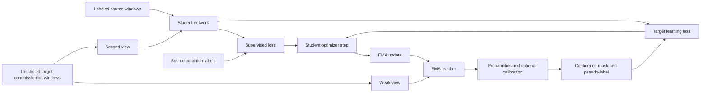

# Research Companion and Implementation Blueprint

## Implementation of Label-Free Teacher–Student Commissioning for Vibration-Signal-Based Fault Detection

**Language:** English  
**Prepared for:** a BSc student learning the topic and planning the implementation  
**Research and repository inspection date:** 6 September 2026  
**Document type:** explanatory research guide, evidence map, experiment specification, and working notebook  
**Status:** research and planning; no new model was trained and no experimental performance was measured while preparing this document

This guide expands the earlier thesis roadmap. It combines verified literature and public code inspection with an original proposed implementation and evaluation plan. A statement about a published method is accompanied by a source. Numerical examples and suggested settings are explicitly examples or proposals, not results obtained for your thesis.

The literature search covered the two papers in your thesis proposal; the foundations of teacher–student learning, domain adaptation, and calibration; official bearing datasets; public implementations; and selected newer work available by the date above. This is a substantial research collection, not a claim that every relevant paper has been found. Some publisher pages exposed only abstracts and excerpts. Those limitations are identified where they matter.

The central recommendation is to build a small, understandable CWRU experiment first, establish a trustworthy evaluation protocol, and then add teacher–student adaptation one component at a time. A successful thesis does not require every proposed method to improve accuracy. It requires a correctly implemented system and credible evidence about when adaptation helps, when it fails, and what the result means.

---

## Contents

1. [How to read this guide](#1-how-to-read-this-guide)
2. [Your thesis explained through a concrete story](#2-your-thesis-explained-through-a-concrete-story)
3. [What the title commits you to](#3-what-the-title-commits-you-to)
4. [The mechanical problem](#4-the-mechanical-problem)
5. [Understanding a vibration signal](#5-understanding-a-vibration-signal)
6. [Signal representations and their tradeoffs](#6-signal-representations-and-their-tradeoffs)
7. [The machine-learning vocabulary](#7-the-machine-learning-vocabulary)
8. [Source and target domains](#8-source-and-target-domains)
9. [The most important commissioning assumptions](#9-the-most-important-commissioning-assumptions)
10. [CWRU: facts, strengths, and limitations](#10-cwru-facts-strengths-and-limitations)
11. [Preparing CWRU correctly](#11-preparing-cwru-correctly)
12. [Splitting data without misleading yourself](#12-splitting-data-without-misleading-yourself)
13. [Paderborn and gearbox extensions](#13-paderborn-and-gearbox-extensions)
14. [The proposed baseline](#14-the-proposed-baseline)
15. [Teacher–student learning step by step](#15-teacherstudent-learning-step-by-step)
16. [The proposed mathematical objective](#16-the-proposed-mathematical-objective)
17. [Confidence, calibration, and pseudo-label quality](#17-confidence-calibration-and-pseudo-label-quality)
18. [Alternative methods worth comparing](#18-alternative-methods-worth-comparing)
19. [What the two supervisor-selected papers contribute](#19-what-the-two-supervisor-selected-papers-contribute)
20. [Verified repositories and code audit](#20-verified-repositories-and-code-audit)
21. [How to reproduce and then adapt existing code](#21-how-to-reproduce-and-then-adapt-existing-code)
22. [The experimental matrix](#22-the-experimental-matrix)
23. [Metrics and what they actually tell you](#23-metrics-and-what-they-actually-tell-you)
24. [Model selection without target labels](#24-model-selection-without-target-labels)
25. [Ablations, sensitivity, and statistical reasoning](#25-ablations-sensitivity-and-statistical-reasoning)
26. [Engineering architecture and implementation contract](#26-engineering-architecture-and-implementation-contract)
27. [Debugging and failure analysis](#27-debugging-and-failure-analysis)
28. [Commissioning as an engineering workflow](#28-commissioning-as-an-engineering-workflow)
29. [Research questions, hypotheses, and contribution](#29-research-questions-hypotheses-and-contribution)
30. [A milestone-based work plan](#30-a-milestone-based-work-plan)
31. [Writing the thesis and preparing the defense](#31-writing-the-thesis-and-preparing-the-defense)
32. [Reusable research and experiment templates](#32-reusable-research-and-experiment-templates)
33. [Annotated literature map](#33-annotated-literature-map)
34. [Source register](#34-source-register)
35. [Glossary](#35-glossary)
36. [Questions to resolve with the supervisor](#36-questions-to-resolve-with-the-supervisor)
37. [Your first practical session](#37-your-first-practical-session)

---

## 1. How to read this guide

You do not need to understand every equation on your first reading. Read in several passes, with a different purpose each time.

**First pass: understand the story.** Read Sections 2–3, 7–9, 15, and 29. You should be able to explain what the source machine is, what the target machine is, why their vibration data differ, and how a teacher supplies provisional labels.

**Second pass: understand the evidence.** Read Sections 10–13, 19–20, and 33. This connects the thesis idea to actual datasets, papers, and code. Notice that a repository supporting CWRU does not establish that a paper's headline results were obtained on CWRU.

**Third pass: understand the implementation.** Read Sections 14–18, 21, and 26–28. You should then be able to follow the path of one vibration window through preprocessing, a neural network, a pseudo-label decision, a loss, and a model update.

**Fourth pass: understand the experiment.** Read Sections 12 and 22–25 carefully. Experimental design is part of the scientific contribution. A complicated algorithm with a weak split is less informative than a simple algorithm with a clearly defined test.

**Fifth pass: turn the work into a thesis.** Use Sections 29–32 and 36–37 as working documents. Fill in decisions and measured results as the project progresses.

Keep a separate page called `Questions I cannot yet explain`. When a term is unclear, write down the term and the exact question. For example, “Why can the teacher improve if it is only an average of the student?” is a much better learning target than “I do not understand machine learning.”

The sections below contain many possible extensions because you asked for a broad resource. They are not all mandatory. The core project is deliberately smaller than the full reading list.

## 2. Your thesis explained through a concrete story

Imagine a laboratory motor containing a rolling bearing. An accelerometer records its vibration. In the laboratory, we know which experiments used a healthy bearing and which used a bearing with a particular defect. These known answers are the labels.

We divide the long recording into shorter pieces. Each piece is a sequence of acceleration measurements. A learning algorithm receives many sequences and their known labels. It gradually learns relationships between the signal and the bearing condition.

Now imagine using the resulting model on another operating condition. Perhaps the motor carries a larger load. The shaft speed changes slightly, amplitudes change, and the mechanical response changes. The new signals may still come from the same kinds of faults, but they no longer look exactly like the training examples.

The original classifier may work well, moderately well, or badly. We have to measure this. A performance drop is a possibility, not an assumption that every source–target pair must satisfy.

At commissioning time, the new vibration recordings are available but their condition labels are unavailable. We cannot simply perform ordinary supervised fine-tuning. Instead, we ask the trained model to make provisional predictions. A slowly changing teacher model provides these predictions. When a prediction is sufficiently trustworthy, the student learns from it. The student also learns that small, meaningful changes to the same signal should not change its predicted condition.

For example, the teacher might assign a target window the probabilities:

```text
healthy:          0.03
inner-race fault: 0.91
rolling-element:  0.04
outer-race fault: 0.02
```

If the confidence threshold is 0.90, the provisional label is accepted as “inner-race fault.” This is a made-up example. A probability of 0.91 does not prove that the prediction is correct. Learning from confidently wrong predictions is one of the main risks you will investigate.

After commissioning, we freeze the chosen model and evaluate it using target recordings with labels that were withheld from adaptation. We compare the result with the original model and simpler alternatives. We also inspect which classes improved and how often adaptation caused deterioration.

The research question is therefore a testable one:

> Under a clearly specified source–target shift, does learning from unlabeled target vibration data improve a trained fault classifier, and which parts of the teacher–student procedure explain the change?

## 3. What the title commits you to

### 3.1 Implementation

You are expected to build working software, understand its main components, and document how it is used. It is acceptable to reuse research code, but you must identify what was reused, what was modified, and what you implemented yourself.

Implementation includes the apparently ordinary details: reading files, checking sample rates, generating reproducible splits, saving the correct model, and producing a report. These details determine whether a published equation becomes a usable system.

### 3.2 Label-free

For the intended thesis, “label-free” should mean **no true target condition labels are used during adaptation or selection of the deployable model**. Labeled source data are still allowed during initial training.

This is different from learning without labels anywhere. It is also different from using a few target labels, which would be a semi-supervised target setting. The presence of target labels inside a public benchmark is not a contradiction: the evaluator may use them after the method is fixed.

There are several routes through which labels influence a system. Labels can train weights, choose hyperparameters, fit a temperature, select a checkpoint, define a fault threshold, or influence a human's decision about which run to report. A strict label-free claim must account for all of these routes.

### 3.3 Teacher–student

The student is the model directly optimized by the training algorithm. The teacher supplies learning targets. In the proposed core system, teacher and student have the same architecture, and teacher weights are an exponential moving average of student weights.

This differs from the common model-compression setting in which a large teacher trains a smaller student. Your main motivation is stable adaptation, not reducing model size.

### 3.4 Commissioning

Commissioning is the process of preparing and checking a diagnostic model for use under a target operating situation. For this thesis, a practical interpretation is:

1. Deliver a model trained using the source data.
2. Collect a bounded amount of unlabeled target vibration data.
3. Check compatibility and signal quality.
4. Adapt the model using that commissioning data.
5. Select the model using an allowed rule.
6. Freeze it and evaluate on later or independently held-out target data.

An offline commissioning experiment is a manageable first scope. Continuous adaptation during long-term operation is a separate extension with additional issues such as drift, ordering, and forgetting.

### 3.5 Fault detection versus fault diagnosis

Fault detection answers “Is there evidence of a fault?” Fault diagnosis additionally asks “Which fault type is present?” A four-class classifier can provide both:

```text
Detection: healthy / faulty
Diagnosis: healthy / inner race / rolling element / outer race
```

A ten-class CWRU task usually distinguishes fault location and defect size. This is yet another label definition. These tasks should never share an unlabeled accuracy table as though they were identical.

For the core project, use four condition classes and also report binary detection metrics derived from them. A separate ten-class run can support comparison with the existing CWRU implementation.

### 3.6 Experimental verification

Verification means showing that the prototype implements the intended algorithm and testing its behavior under a defined protocol. Public-dataset experiments are valid numerical experiments. They do not establish field performance on a newly purchased industrial machine.

Your final claim should name the actual dataset and shift. “Improved classification across the tested CWRU operating conditions” is a defensible form of claim. “Works on all new machines without labels” would require much broader evidence.

## 4. The mechanical problem

A rolling bearing usually contains inner and outer raceways, rolling elements, and a cage. As the shaft rotates, contacts move across the raceways. Local damage can disturb those contacts and excite the surrounding structure.

The measured vibration is not the defect itself. It is the combined response of the defect excitation, the bearing and housing, transmission paths, mounting, sensor, acquisition electronics, and other machine components. This explains why the same broad fault category can produce different signals in different installations.

The bearing-diagnostics tutorial by Randall and Antoni is a useful mechanical foundation, especially for understanding impulsive excitation, structural resonance, and envelope analysis. Read it alongside the neural-network literature so that signal processing decisions have a physical interpretation. [Bearing diagnostics tutorial](https://doi.org/10.1016/j.ymssp.2010.07.017)

### 4.1 A useful measurement model

An illustrative model is:

\[
x(t) = h(t) * s_{fault}(t) + s_{other}(t) + n(t),
\]

where `*` denotes convolution, `s_fault` is fault-related excitation, `h` describes the structural response, `s_other` contains other deterministic vibrations, and `n` represents noise.

This equation is a teaching model, not an exact identification of every physical process. Its value is that it separates several reasons why the observed signal can change. A new sensor mounting changes the measurement path. A speed change alters event timing. A load change can alter contact forces. Electrical noise affects the measurement without changing the mechanical fault.

### 4.2 Characteristic frequencies

For a simplified rolling-bearing kinematic model with a stationary outer ring, define:

- `f_r`: shaft rotational frequency in hertz;
- `n`: number of rolling elements;
- `d`: rolling-element diameter;
- `D`: pitch diameter;
- `phi`: contact angle.

Common idealized frequencies are:

\[
BPFO = \frac{n f_r}{2}\left(1-\frac{d}{D}\cos\phi\right),
\]

\[
BPFI = \frac{n f_r}{2}\left(1+\frac{d}{D}\cos\phi\right),
\]

\[
FTF = \frac{f_r}{2}\left(1-\frac{d}{D}\cos\phi\right),
\]

\[
BSF = \frac{D f_r}{2d}\left[1-\left(\frac{d}{D}\cos\phi\right)^2\right].
\]

These are reference frequencies, not requirements that every faulty recording contain a perfectly isolated spectral peak. Slip, modulation, changing speed, loading, and resonance affect observations. A rolling-element defect may produce prominent components at twice the spin frequency; frequency tables may use different conventions.

CWRU supplies bearing-specific frequency ratios. For its drive-end bearing, the listed inner- and outer-ring ratios are 5.4152 and 3.5848 times shaft frequency. At an illustrative 1,800 rpm, `f_r = 30 Hz`, giving approximately 162.46 Hz and 107.54 Hz. The 1,800 rpm calculation is an illustration; use the actual recording speed in analysis. [CWRU bearing information](https://engineering.case.edu/bearingdatacenter/bearing-information)

### 4.3 What a neural network might learn

A network may learn useful patterns such as repeated impulses or spectral relationships. It may also exploit shortcuts: overall amplitude, a recording-specific noise pattern, a sensor signature, or a preprocessing artifact.

You cannot determine which explanation is true from high accuracy alone. Inspect spectra, compare normalizations, hold out meaningful groups, and test conditions that break plausible shortcuts.

## 5. Understanding a vibration signal

### 5.1 Sampling rate

Sampling rate `f_s` tells us how many measurements are recorded per second. A signal with 12,000 measurements per second has a sampling interval of approximately 83.33 microseconds.

A window of `L` samples has duration:

\[
T = L/f_s.
\]

Calculated examples for 12 kHz data:

| Window length | Duration | FFT bin spacing `f_s/L` |
|---:|---:|---:|
| 1,024 | 0.0853 s | 11.7188 Hz |
| 2,048 | 0.1707 s | 5.8594 Hz |
| 4,096 | 0.3413 s | 2.9297 Hz |
| 8,192 | 0.6827 s | 1.4648 Hz |

Longer windows contain more cycles and offer finer frequency-bin spacing. They also increase latency, may reduce the number of independent examples, and may combine changing conditions within one input.

The table describes FFT bin spacing. Actual ability to distinguish neighboring components also depends on the observation duration, window function, signal-to-noise ratio, and estimator. Zero-padding gives a denser frequency grid but does not create additional measured information.

### 5.2 Nyquist frequency and resampling

For a sampling rate of 12 kHz, the Nyquist frequency is 6 kHz. Frequencies above the usable acquisition band cannot be recovered simply by changing the array size.

If a record is truly sampled at 48 kHz and must be converted to 12 kHz, low-pass filtering is needed before decimation to suppress aliasing. Taking every fourth sample without appropriate filtering is not a sound general preprocessing rule. SciPy's `resample_poly` implements a filtering-based conversion; its parameters, padding behavior, and edge effects should be documented. [SciPy resample_poly](https://docs.scipy.org/doc/scipy/reference/generated/scipy.signal.resample_poly.html)

### 5.3 Time samples are not independent training examples

A recording containing one million samples is not one million independent labeled observations. Adjacent values are related by dynamics and sampling. Likewise, hundreds of windows from one recording are not hundreds of independent machines.

Keep three quantities separate: samples per window, windows per recording, and independent recordings or bearing specimens. They answer different questions.

### 5.4 Basic descriptive features

Useful first measurements include mean, standard deviation, root mean square, peak-to-peak amplitude, crest factor, and kurtosis. For a window `x_1,...,x_L`:

\[
RMS = \sqrt{\frac{1}{L}\sum_i x_i^2},
\qquad
CF = \frac{\max_i |x_i|}{RMS+\epsilon}.
\]

Kurtosis is based on the fourth central moment divided by the squared variance. State whether your implementation returns Pearson kurtosis or excess kurtosis. A large value can indicate rare strong excursions, but it does not uniquely identify a bearing fault.

Keep physical-amplitude plots from the original signal even if the neural network later receives normalized data. Per-window standardization largely removes amplitude information, so RMS measured after that transformation cannot answer the same physical question as RMS measured before it.

## 6. Signal representations and their tradeoffs

The representation is the form in which the network receives a vibration window. It is a substantive experimental choice.

| Representation | What it exposes | What can be lost or obscured | Recommended role |
|---|---|---|---|
| Raw time window | Shape, transients, temporal ordering | Frequency structure may be harder to learn | Primary implementation |
| FFT magnitude | Global frequency distribution | Phase and event timing | Main representation comparison |
| Power spectral density | Energy distribution with averaging | Short events can be smoothed | Inspection and optional baseline |
| Envelope spectrum | Modulation of a selected carrier band | Depends on band and preprocessing | Physically informed analysis |
| STFT spectrogram | Frequency changes through time | Resolution tradeoff and larger input | Later extension |
| Wavelet representation | Localized multiscale structure | Wavelet and scale choices matter | Optional extension |
| Handcrafted feature vector | Compact interpretable statistics | Discards much of the waveform | Classical baseline |

### 6.1 Raw time-domain input

For one accelerometer and a window of 2,048 samples, the logical input is a vector of length 2,048. A typical deep-learning batch has shape `[batch, channel, time]`, such as `[64, 1, 2048]`.

“Raw” usually means no explicit frequency transform. It does not necessarily mean completely untouched data. Detrending, resampling, windowing, and normalization must still be declared.

### 6.2 FFT magnitude

The discrete Fourier transform expresses the window as a combination of frequency components. For real-valued input, a real FFT returns the nonnegative-frequency bins. Its magnitude can be used as a feature vector.

Document whether you subtract the mean, apply a Hann window, divide by window length, retain the Nyquist bin, or use a logarithm. A vector containing 1,024 frequency bins is not necessarily generated from a 1,024-sample time window. Compare physical observation durations as well as tensor shapes.

If you use `log(1 + magnitude)`, specify the scale entering the logarithm. The transform is numerically convenient but changes the relative importance of weak and strong components.

### 6.3 Power spectral density

Welch estimation averages periodograms from segments. This can produce a more stable description of spectral energy, while sacrificing some resolution depending on segment length. Save `fs`, segment length, overlap, window, and scaling with the plot. [SciPy Welch documentation](https://docs.scipy.org/doc/scipy/reference/generated/scipy.signal.welch.html)

Do not call FFT magnitude a power spectral density unless you actually compute and normalize the relevant quantity. Units and scaling help prevent that confusion.

### 6.4 Envelope analysis

A practical analysis route is to choose a physically justified frequency band, filter the signal, calculate its analytic signal, take the magnitude as an envelope, and inspect the envelope spectrum. SciPy provides the analytic-signal operation through `hilbert`. [SciPy Hilbert transform](https://docs.scipy.org/doc/scipy/reference/generated/scipy.signal.hilbert.html)

For your thesis, a useful original experiment would compare what an envelope plot reveals before and after changing operating condition. This can help explain why the learned classifier encounters a shift. Do not choose a different band for each hidden target class by inspecting its labels; that would inject unavailable information into preprocessing.

### 6.5 STFT and wavelets

A spectrogram is a two-dimensional array indexed by time and frequency. A two-dimensional CNN can process it. This does not automatically make the method better than a one-dimensional CNN.

If the spectrogram has a larger time context, more parameters, or different augmentation, an improvement cannot be attributed solely to “using images.” Match comparisons carefully. Start with raw windows and FFT magnitude so that representation comparisons remain understandable.

### 6.6 Augmentation should represent a plausible nuisance

Augmentation creates another view of the same underlying example. It is useful only if the condition label should remain unchanged.

| Candidate transformation | Possible interpretation | Issue to investigate |
|---|---|---|
| Small additive noise | Measurement interference | Large noise can erase fault evidence |
| Modest amplitude scaling | Gain variation | Can conflict with severity information |
| Small shift or crop | Different observation start | Cropping may remove informative events |
| Mild masking | Brief missing information | Long masks can change the task |
| Resampling or time warping | Speed-related change | Changes physical frequency relationships |
| Sign reversal | Sensor polarity change | Only appropriate if polarity is irrelevant |
| Arbitrary segment permutation | No simple general physical interpretation | Can destroy periodicity and temporal structure |

Treat these as candidate hypotheses. Plot examples and test them on labeled source validation data before using them to generate pseudo-label supervision. The augmentation strength is part of the experiment, not a harmless implementation detail.

## 7. The machine-learning vocabulary

A **feature** is a numerical description useful for prediction. It may be a handcrafted statistic or an internal neural-network activation.

A **model** maps an input to an output. A classifier maps a vibration window to probabilities or scores for condition classes.

A **parameter** is learned during optimization, such as a convolutional filter coefficient. A **hyperparameter** is a setting chosen outside that optimization, such as learning rate, window length, or confidence threshold.

A **loss** is a numerical objective minimized during training. Low training loss means the model fits the training objective; it does not necessarily mean it generalizes.

A **batch** is a set of examples processed together. An **epoch** is a pass through a defined training dataset. When source and target datasets have different sizes, one adaptation epoch needs an explicit definition.

**Validation** supports decisions such as selecting a source model or setting allowed hyperparameters. **Testing** estimates performance after those decisions are fixed. A dataset called `test` inside someone else's code may function as validation if it influences model selection.

**Overfitting** occurs when a model learns details that help on available training observations but do not transfer to new observations of interest. Splitting highly related windows into training and test can conceal it.

A **baseline** is a meaningful reference method. A source-only baseline is essential because it measures what happens without target adaptation. A control trained for the same additional number of source updates helps determine whether a gain is just extra training.

An **ablation** removes or changes one component to test its role. Removing confidence filtering while keeping all other settings fixed is an ablation. Comparing unrelated architectures with different splits is not a clean ablation of confidence filtering.

## 8. Source and target domains

Write labeled source data as:

\[
D_s = \{(x_i^s,y_i^s)\}_{i=1}^{N_s},
\]

and the unlabeled target commissioning set as:

\[
U_t = \{x_j^t\}_{j=1}^{N_t}.
\]

The target evaluator separately holds condition labels. They are not part of `U_t` as supplied to the adaptation algorithm.

### 8.1 Different learning settings

| Setting | Labeled source training | Source examples during adaptation | Target condition labels during adaptation | Target observations available before deployment |
|---|---|---|---|---|
| Source-only | Yes | No adaptation | No | Not used for adaptation |
| Unsupervised domain adaptation | Yes | Usually yes | No | Yes |
| Source-free domain adaptation | Yes | No | No | Yes |
| Semi-supervised target adaptation | Yes | Depends | Some | Yes |
| Domain generalization | Yes | Training only | No | Not used during training |
| Test-time adaptation | Yes | Often no | No | Available as inference proceeds |

These terms describe what information is available, not merely the name of a loss function. DANN is a foundational example of adaptation using source labels and unlabeled target observations. SHOT explicitly studies adaptation with the trained source model but without source examples. [DANN](https://www.jmlr.org/papers/v17/15-239.html), [SHOT](https://proceedings.mlr.press/v119/liang20a.html)

### 8.2 Types of shift

An input shift changes observed signals. A class-prior shift changes the proportions of healthy and faulty conditions. A class-set change introduces missing or previously unseen categories. These changes have different consequences.

Consider a laboratory dataset balanced across four conditions and a target machine that is healthy almost all the time. A training objective that forces target predictions to be evenly distributed across four classes can create false faults. That objective's class-balance assumption would be wrong even if it worked well on the laboratory benchmark.

Consider a new target fault absent from the source data. A four-class softmax classifier must still assign its probability mass to its four known outputs. High confidence alone does not establish that the new signal belongs to one of those classes.

### 8.3 Transductive and inductive evaluation

In a transductive experiment, the unlabeled observations being evaluated may have been available during adaptation. That can be a valid stated protocol.

In an inductive commissioning experiment, adaptation uses one target collection and evaluation uses separate target observations. This better matches a system commissioned today and applied to subsequent measurements.

Choose one as the primary protocol and identify it in every result table. For this thesis, the proposed primary protocol is inductive commissioning. A paper-compatible transductive or random-window experiment can be retained as a separately labeled comparison.

## 9. The most important commissioning assumptions

### 9.1 Is the source dataset available at commissioning?

The thesis wording does not definitively resolve this. The proposed core experiment uses labeled source data together with unlabeled target data during adaptation. This is a direct match to the first supervisor-selected paper's general setting.

If the intended engineering story permits only a delivered model and new target signals, the main setting should instead be source-free. Do not describe an algorithm that still accesses source recordings as source-free.

You can investigate both, but begin with one. Changing information access changes the problem, the baselines, and the allowed calibration procedure.

### 9.2 Which conditions occur in commissioning data?

A conventional closed-set adaptation benchmark often contains every source fault category in the target adaptation pool. A newly installed industrial bearing may provide only healthy commissioning recordings.

These are different practical situations. The presence of unlabeled faults in a benchmark pool is useful for studying adaptation, but it should not be silently treated as a realistic fact about every commissioning deployment.

The recommended study contains two clearly named scenarios: a mixed-condition target pool as the core benchmark and an optional healthy-dominated or healthy-only commissioning stress test. In the latter, a benchmark curator may construct the pool with labels, but the adaptation method receives only signals. That simulates a declared target composition; it does not prove that unlabeled healthy-only data can be identified automatically.

### 9.3 Are all target classes already known?

The core study should assume the same broad condition classes in both domains. This is closed-set adaptation. Unknown-fault detection requires a different evaluation, including unknown samples and an explicit rejection decision.

### 9.4 What remains stable during commissioning?

For the initial implementation, assume a bounded target operating condition and compatible measurement channels. Long-term nonstationary target streams are an extension.

### 9.5 Can success be known without target labels?

Unlabeled monitoring can reveal failures such as numerical instability, abrupt prediction collapse, or an empty accepted-pseudo-label set. It cannot generally certify target accuracy. A confident, stable, wrong classifier is possible.

This is an important limitation to state plainly. In the benchmark, hidden labels let the researcher quantify that gap between operational indicators and actual diagnostic quality.

## 10. CWRU: facts, strengths, and limitations

CWRU is a sensible starting point because it is directly related to bearing vibration diagnosis and is supported by relevant research code. It should be treated as a controlled benchmark with documented limitations.

### 10.1 Verified acquisition context

The official apparatus page describes a motor test stand with a torque transducer/encoder and dynamometer, artificially introduced local defects, accelerometers at different locations, and MATLAB files. It reports both 12 kHz acquisition and 48 kHz acquisition for some drive-end experiments. The documented small defect diameters include 0.007, 0.014, and 0.021 inches. [CWRU apparatus](https://engineering.case.edu/bearingdatacenter/apparatus-and-procedures)

The official data index explains the channel suffixes: `DE` for drive-end acceleration, `FE` for fan-end acceleration, `BA` for base acceleration, and `RPM` for rotational speed. These are sensor or metadata identifiers, not fault labels. [CWRU data index](https://engineering.case.edu/bearingdatacenter/download-data-file)

The nominal baseline conditions are:

| Proposed domain name | Load | Approximate baseline speed |
|---|---:|---:|
| D0 | 0 hp | 1,797 rpm |
| D1 | 1 hp | 1,772 rpm |
| D2 | 2 hp | 1,750 rpm |
| D3 | 3 hp | 1,730 rpm |

These values come from the official baseline table. Actual file metadata should be retained instead of replacing every recorded speed with a nominal value. [CWRU normal baseline](https://engineering.case.edu/bearingdatacenter/normal-baseline-data)

### 10.2 A subtle metadata inconsistency

The official apparatus prose and the 12 kHz download table describe the outer-race clock positions relative to the load zone differently. Preserve the explicit clock-position label, such as `@6`, in the manifest and cite the exact table used. Do not silently convert it into “in the load zone” without resolving the convention. [Apparatus description](https://engineering.case.edu/bearingdatacenter/apparatus-and-procedures), [12 kHz download table](https://engineering.case.edu/bearingdatacenter/12k-drive-end-bearing-fault-data)

### 10.3 Four classes and ten classes

Our proposed four-class task combines different defect sizes within broad locations:

```text
0: healthy
1: inner-race fault
2: rolling-element fault
3: outer-race fault
```

A common ten-class task uses one healthy class and three defect sizes for each of three fault locations. It asks a finer question, partly involving severity. Performance numbers cannot be compared directly across these label definitions.

The exact label order in reused code must be inspected. A neural-network output index has no physical meaning until it is connected to a saved class map.

### 10.4 Why a cross-load result has limited scope

Hendriks, Dumond, and Knox explain that conventional CWRU cross-load splits can reuse the same physical bearings across conditions. Such a test does not establish generalization to independent bearing specimens. Their alternative framework emphasizes independent bearings. This is a major reason to qualify a CWRU commissioning claim. [Towards better benchmarking](https://doi.org/10.1016/j.ymssp.2021.108732)

Smith and Randall also provide a detailed analysis of CWRU records and identify measurement issues and anomalies. Their study is a critical companion to the download page, not the original source of the dataset. [CWRU benchmark study](https://doi.org/10.1016/j.ymssp.2015.04.021)

Our methodological conclusion is to use cross-load CWRU as an initial operating-condition experiment, then add a stronger grouping or second dataset if practical. Report the independence unit honestly in both cases.

## 11. Preparing CWRU correctly

### 11.1 Preserve raw data and create a manifest

Keep downloaded recordings immutable. Derived windows and normalized arrays belong in a different directory. A manifest connects a result to its source file and acquisition assumptions.

Recommended fields:

```text
record_id
relative_raw_path
download_url
sha256
dataset
sensor_channel
fault_location
fault_diameter_inch
outer_race_clock_position
load_hp
rpm_recorded
sampling_rate_hz
sampling_rate_evidence
bearing_group_id
acquisition_group_id
number_of_raw_samples
duration_seconds
quality_flags
```

Some metadata may be unknown. Use an explicit `unknown` field. Do not invent bearing identifiers that imply known independent specimens. When a group is inferred from documentation, record the inference and its limitations.

### 11.2 Read MATLAB variables explicitly

Use `scipy.io.loadmat` for compatible MATLAB files, inspect keys, and select the intended channel. Handle unsupported MATLAB formats separately if encountered. Never concatenate every numeric field, because fields may contain different sensors or metadata. [SciPy loadmat](https://docs.scipy.org/doc/scipy/reference/generated/scipy.io.loadmat.html)

A reader should return both the signal and metadata. It should fail with a clear message if the requested channel is absent, contains no samples, or is not a one-dimensional measurement after a justified reshape.

### 11.3 Audit sampling rates, especially normal recordings

Do not infer a sampling rate merely because a loader class or folder contains `12k`. The healthy files are stored separately in many distributions. Verify per-record acquisition information for healthy and faulty data before combining them.

The inspected CAT time-domain loader segments arrays but does not perform sample-rate harmonization. That observation does not establish the true rate of every file. It means our preparation stage must resolve and record it independently. [Inspected CAT CWRU loader](https://github.com/EPFL-IMOS/CAT/blob/354cf94aef4f0afd1f81d7ef645bd40ffc68d8d5/datasets/CWRU.py)

If a rate remains unresolved, classify it as unresolved and avoid interpreting its frequency axis as verified. A rate mistake changes both observation duration and the physical meaning of the FFT bins.

### 11.4 Segment after defining split boundaries

For a recording region containing `N` samples, window length `L`, and stride `S`, the number of complete windows is:

\[
N_w = \max\left(0, 1+\left\lfloor\frac{N-L}{S}\right\rfloor\right).
\]

Store each window's record ID, start index, end index, and split. Reject a window that crosses a split boundary.

For initial development, use non-overlapping evaluation windows. Training overlap can be studied later, but it must remain within the training region and be identical across compared methods.

### 11.5 Choose normalization deliberately

Three useful options are:

| Policy | How statistics are obtained | Interpretation |
|---|---|---|
| Source-global standardization | Fit on source training samples only | Preserves relative amplitude shifts |
| Per-window standardization | Compute from each individual input | Emphasizes shape over absolute amplitude |
| Target-aware standardization | Fit using allowed target commissioning observations | Adds a form of unsupervised adaptation |

For source-global normalization:

\[
\widetilde{x} = (x-\mu_s)/(\sigma_s+\epsilon).
\]

For per-window normalization, the corresponding mean and standard deviation are calculated within that window. This does not require its condition label. It is a different representation, however, and can remove information relevant to severity or detection.

Do not fit preprocessing on the final target test set for the proposed inductive protocol. Fit operations must use the data allowed at the relevant stage. The scikit-learn guidance on data leakage explains this general principle. [Common pitfalls](https://scikit-learn.org/stable/common_pitfalls.html)

### 11.6 Perform a data quality review

Inspect at least one record from every chosen class and condition. Check for non-finite values, near-constant channels, suspicious clipping, unexpected lengths, duplicate content, and inconsistent units or rates.

Flag anomalous records and define an exclusion rule before viewing method performance. A low-performing record is not automatically a bad record. Excluding difficult recordings after seeing results changes the experimental question.

## 12. Splitting data without misleading yourself

### 12.1 The hierarchy of observations

```text
Dataset
  Machine or rig
    Bearing specimen or defensible bearing group
      Recording session / operating condition
        Contiguous time region
          Window
            Individual time samples
```

A split at one level cannot automatically support a claim about a higher level. Separate windows from the same record can assess held-out windows, but not independent machines.

### 12.2 Overlap leakage

Suppose window A uses raw indices 0–2047 and window B uses 1024–3071. They share half their samples. If A is in training and B is in test, part of the test signal has already been observed during training.

The solution is to define partitions before generating windows and ensure that no retained training and test window share raw indices. If filters or resampling operate across partition boundaries, they can also transfer information. For temporal partitions, process regions separately with a documented edge policy, or account for filter support and remove affected boundary samples.

### 12.3 Dependence without literal overlap

Non-overlapping windows from the same recording still share the same bearing, mounting, acquisition chain, and operating period. Randomly distributing them can yield an optimistic estimate of the question “How will this work on a new bearing?”

Group-aware splitting is designed for data with this kind of structure. A grouping algorithm does not create independent groups when the dataset has only one relevant specimen or recording per class. [Grouped cross-validation guidance](https://scikit-learn.org/stable/modules/cross_validation.html)

### 12.4 Proposed primary partition

The desired partition is:

```text
Source:
    source_train         labels allowed for optimization
    source_validation    labels allowed for declared selection
    source_calibration   labels allowed for temperature fitting, if used

Target:
    target_commissioning inputs allowed for adaptation
    target_test          untouched observations; labels held by evaluator
```

Distinct source calibration and validation sets are preferable when enough independent data exist. If they must be shared, disclose that choice and do not call the shared set an independent source test.

Where sufficient recordings or specimens exist, divide at that group level. Where CWRU does not provide enough independent groups for the desired class/domain definition, use a declared temporal-block fallback and explicitly limit the claim.

### 12.5 Temporal-block fallback

An illustrative fallback is to assign an early region to commissioning and a later region to testing, with an unused gap. The gap prevents shared windows and reduces local dependence, but it does not create a new bearing or acquisition session.

Choose the gap using the signal-processing support and an analysis of temporal dependence. One window length is an easy starting engineering rule, not a guarantee of statistical independence. Record the actual sample and time boundaries.

### 12.6 A recent relevant benchmark

Knap, Jachymczyk, and Lalik's July 2026 PHM paper introduces fixed CWRU and Paderborn scenarios with recording-level separation and repeated-seed follow-up. It is particularly relevant to protocol design. Its accompanying code is an additional reference for organizing experiments; its existence does not automatically validate a different custom split. [2026 benchmark paper](https://doi.org/10.36001/phme.2026.v9i1.4924), [pdm-bench code](https://github.com/1Sensor/pdm-bench)

## 13. Paderborn and gearbox extensions

### 13.1 Why Paderborn is the preferred second dataset

The official Paderborn collection includes vibration and motor-current measurements, with healthy bearings, artificially damaged bearings, and bearings damaged through accelerated lifetime tests. The download page identifies 6 healthy, 12 artificially damaged, and 14 lifetime-damaged bearing cases. The collection is therefore useful for studying damage provenance and bearing identity as well as operating condition. [Paderborn data center](https://mb.uni-paderborn.de/kat/forschung/bearing-datacenter), [Paderborn data cases](https://mb.uni-paderborn.de/kat/forschung/bearing-datacenter/data-sets-and-download)

The dataset publication by Lessmeier and colleagues explains its design, measurement setup, and recording organization. Read that document when constructing the manifest. A preprocessed mirror may omit metadata needed for a defensible grouping. [Original dataset paper](https://mb.uni-paderborn.de/fileadmin-mb/kat/PDF/Veroeffentlichungen/20160703_PHME16_CM_bearing.pdf)

For our proposed extension, choose a documented vibration channel and broad fault classes. Construct source and target groups using actual operating-condition and bearing metadata. If fault categories are represented by only one physical bearing, acknowledge that the class and specimen identity may be confounded.

The official site specifies attribution and noncommercial conditions for the dataset. Preserve the dataset citation and provenance in the project documentation. [Paderborn data terms](https://mb.uni-paderborn.de/kat/forschung/bearing-datacenter)

### 13.2 Reproducing CAT on Paderborn is a separate label task

The CAT paper's Paderborn experiment uses 13 bearing-code classes with different damage characteristics. It is not automatically the same as a healthy-versus-faulty or four-location task. Its reported Paderborn results should therefore be tied to that particular label definition. [CAT paper, experimental setup](https://arxiv.org/html/2312.02826v2)

A faithful reproduction should inspect the paper's table, the selected loader, and the actual measured channel. A thesis extension that changes classes, sensors, or grouping should be described as an adaptation of the method to a new protocol.

### 13.3 SEU gearbox data

The author-associated `cathysiyu/Mechanical-datasets` repository describes Southeast University gearbox measurements from a drivetrain simulator, with two operating settings and multiple recorded channels. It contains both bearing and gear subsets. Its CWRU collection uses fan-end signals, which should not be confused with our proposed drive-end CWRU input. [Mechanical datasets repository](https://github.com/cathysiyu/Mechanical-datasets)

For a gearbox extension, preserve the selected channel and distinguish gear faults from bearing faults. Gear-mesh frequencies depend on tooth counts and rotational speeds. Bearing-frequency interpretations cannot be transferred directly to a gear classifier.

Because gearboxes can introduce overlapping mechanical signatures, the extension would test a new diagnostic problem. It is useful after the bearing pipeline is stable, but it should not delay the core thesis.

### 13.4 Other datasets

CAT and UDTL list support for additional collections including JNU and PHM 2009. Their availability in a loader is a starting point for inspection, not a guarantee of correct current download paths or suitable commissioning splits. [CAT repository](https://github.com/EPFL-IMOS/CAT), [UDTL repository](https://github.com/ZhaoZhibin/UDTL)

Run-to-failure datasets can support degradation or remaining-useful-life research, but that is a different target from closed-set fault classification. A time-to-failure label should not be treated as an inner-race/outer-race label without justified ground truth.

## 14. The proposed baseline

### 14.1 Begin with a small diagnostic system

The initial baseline should load a prepared window, predict its class, and produce a reproducible evaluation report. The goal is to establish a trustworthy reference before target adaptation adds moving parts.

A proposed architecture is:

```text
Input: one vibration channel
    -> Conv1D block, 16 channels
    -> Conv1D block, 32 channels
    -> Conv1D block, 64 channels
    -> global average pooling
    -> linear classification head
Output: K unnormalized class scores
```

This is our suggested starting architecture, not a description of the exact CAT backbone. Use modest kernels and strides that leave enough temporal resolution. Save the complete architecture configuration and parameter count.

Each convolutional block may include normalization and a nonlinearity. If BatchNorm is used, its running statistics become part of the model state and the adaptation design. GroupNorm is a possible alternative, but then an AdaBN comparison is no longer directly applicable to that architecture.

### 14.2 Source training

Train the baseline using source inputs and their condition labels. Track source training loss and source validation performance. Use the source validation set for declared model-selection decisions.

When training finishes, save a checkpoint, preprocessing state, label map, split manifest, and configuration. Evaluate the fixed model on the target test through the evaluation pipeline.

For exploratory development, use a development transfer task. Once you repeatedly inspect its target scores, treat it as development evidence rather than an untouched final test. Reserve other target tasks or a separate held-out collection for final claims.

### 14.3 A classical baseline

Build a feature vector from a small declared set of time and spectral statistics, standardize features on source training data, and fit a simple classifier such as an SVM or logistic regression.

This gives a computationally inexpensive point of comparison. It may also reveal that a transfer task is easy because a few simple statistics separate the classes. That is useful evidence about the benchmark.

Do not tune classical and neural baselines using different information privileges. If one sees target labels through tuning and the other does not, the comparison is not measuring the intended methodological difference.

### 14.4 A continued-source-training control

Teacher–student adaptation usually adds optimization steps after source pretraining. A useful control continues ordinary source training for the same update budget. It asks whether the gain comes from using target observations or simply from training longer.

A second useful control maintains an EMA model during source-only training. It helps distinguish the effect of weight averaging from the effect of target learning.

## 15. Teacher–student learning step by step

The historical Mean Teacher method uses weight averaging to produce consistency targets. FixMatch provides a complementary confidence-filtered weak/strong augmentation pattern. They were developed in semi-supervised learning, so using their ingredients under a domain shift is a methodological adaptation that must be evaluated. [Mean Teacher](https://arxiv.org/abs/1703.01780), [FixMatch](https://research.google/pubs/fixmatch-simplifying-semi-supervised-learning-with-consistency-and-confidence/)

### 15.1 Initialization

First train a competent source classifier. Copy its weights into two separate model instances. The instances begin with equal values but must not share the same parameter objects.

If the teacher and student are actually the same Python object, updating the student also changes the teacher immediately. That would remove the intended temporal averaging.

### 15.2 The teacher predicts a weak view

Take a target commissioning window and produce a weakly modified version. The teacher predicts class probabilities for it. Do this without gradient tracking.

The weak view should retain most of the original signal information. A teacher whose input is severely corrupted may generate poor labels even when the original window was recognizable.

### 15.3 The acceptance decision

Find the largest predicted class probability and its class. Accept the pseudo-label only if it satisfies the declared rule. A first implementation can use a fixed threshold.

Illustrative four-class examples:

| Teacher probabilities | Predicted class | Confidence | Accepted at 0.90? |
|---|---:|---:|---|
| `[0.94, 0.02, 0.02, 0.02]` | 0 | 0.94 | Yes |
| `[0.06, 0.82, 0.08, 0.04]` | 1 | 0.82 | No |
| `[0.02, 0.03, 0.04, 0.91]` | 3 | 0.91 | Yes |
| `[0.25, 0.25, 0.25, 0.25]` | Tie-dependent | 0.25 | No |

These are invented numbers for explanation. They illustrate the decision rule, not its accuracy.

### 15.4 The student predicts a second view

Apply another label-preserving transformation to the same underlying window. The student is trained to predict the accepted class from this second view.

The views must remain paired. Shuffling the teacher targets independently from student inputs would train on unrelated pseudo-labels.

### 15.5 Retain source supervision in the UDA version

In the proposed source-access core method, every adaptation step also includes labeled source examples. This anchors the classifier to known condition semantics while it learns from target data.

This anchor reduces one route to drift but cannot guarantee improvement. If target pseudo-labels are systematically wrong or the source task itself is poorly specified, the combined objective can still produce a worse target classifier.

### 15.6 Update the teacher slowly

After a student optimizer step, update the teacher by:

\[
\theta_T \leftarrow \alpha\theta_T + (1-\alpha)\theta_S.
\]

For an illustrative scalar parameter, if the old teacher value is 2, the new student value is 4, and `alpha = 0.9`, the new teacher value is 2.2. The teacher moves toward the student without replacing its previous state completely.

The rough averaging horizon is of order `1/(1-alpha)` updates. Thus 0.99 suggests about 100 updates, while 0.999 suggests about 1,000. This is a heuristic interpretation of exponentially decaying weights, not an exact number of retained models. Batch size and update count affect the practical timescale.

### 15.7 Why learning can occur without an independent expert

At initialization, the teacher has no extra information beyond the trained student. The method can still change the solution because it combines target-data structure, perturbation consistency, source supervision, optimization, and temporal averaging.

The process relies on useful assumptions: some initial predictions must be informative, transformations must preserve meaning, and the target structure should be related to the source categories. If these assumptions fail, repeated self-training can strengthen an incorrect decision boundary.

### 15.8 A diagram of the proposed core method



The hidden target-test labels are absent from this diagram because they belong to a different evaluation process.

## 16. The proposed mathematical objective

This section specifies an understandable custom starting method. It is not a claim to reproduce every term, schedule, or normalization in CAT.

### 16.1 Symbols

| Symbol | Meaning |
|---|---|
| `K` | Number of condition classes |
| `B_s`, `B_t` | Source and target batch sizes |
| `z_S(x)`, `z_T(x)` | Student and teacher logits |
| `p_S(x)`, `p_T(x)` | Class probability vectors |
| `a_w`, `a_s` | Weak and second/strong transformations |
| `tau` | Pseudo-label confidence threshold |
| `m_i` | Acceptance indicator for target example i |
| `lambda_u` | Weight on target pseudo-label learning |
| `lambda_c` | Weight on optional soft consistency |
| `alpha` | Teacher EMA coefficient |
| `T_cal` | Positive calibration temperature |

Logits are unrestricted model scores. Softmax converts them into positive probabilities summing to one:

\[
p_k = \frac{\exp(z_k)}{\sum_{j=1}^{K}\exp(z_j)}.
\]

Use numerically stable library implementations. Avoid manually exponentiating very large scores.

### 16.2 Source supervised loss

For source examples with known class indices:

\[
L_s = -\frac{1}{B_s}\sum_{i=1}^{B_s}\log p_S(y_i^s\mid x_i^s).
\]

If the true class receives probability 0.90, its contribution is approximately 0.105. If it receives probability 0.10, the contribution is approximately 2.303. These calculated examples explain why confidently wrong predictions are penalized strongly.

In a typical PyTorch implementation, a cross-entropy function receives logits and integer class labels; an extra softmax before it would change the intended computation. Confirm the exact API in the installed version during implementation.

### 16.3 Teacher target and confidence mask

Define:

\[
q_i = \operatorname{softmax}(z_T(a_w(x_i^t))/T_{cal}),
\]

\[
\hat{y}_i=\arg\max_k q_{ik},
\qquad c_i=\max_k q_{ik},
\qquad m_i=\mathbf{1}[c_i\geq\tau].
\]

Set `T_cal = 1` when calibration is disabled. Treat `q`, the selected class, and the acceptance mask as detached teacher outputs.

### 16.4 Masked pseudo-label loss

A simple batch-normalized choice is:

\[
L_u = -\frac{1}{B_t}\sum_{i=1}^{B_t}m_i\log p_S(\hat{y}_i\mid a_s(x_i^t)).
\]

Rejected examples contribute zero to this term. If no target examples are accepted, the target pseudo-label loss is zero. In the source-access version, source supervision still supplies an update.

An alternative divides by `max(1, sum_i m_i)`. These definitions are not interchangeable. With the first, the effective target contribution decreases when acceptance is low. With the second, a few accepted examples can carry the full target weight. Choose one, document it, and keep it fixed across comparisons.

### 16.5 Optional soft consistency

Hard pseudo-labeling asks the student to match one selected class. Soft consistency asks it to match the teacher's probability distribution, for example through:

\[
L_c = \frac{1}{B_t}\sum_i m_i D_{KL}\left(q_i\;\|\;p_S(a_s(x_i^t))\right).
\]

Another possible distance is mean squared error between probability vectors. These are candidate designs, not obligations to add multiple redundant losses.

Hard pseudo-label learning on two different views is already a form of consistency learning. Therefore, the first implementation can use `L_s + lambda_u L_u` and study soft consistency as a separate variant. Adding both at once would make the benefit harder to attribute.

### 16.6 Total core objective

The proposed minimal objective is:

\[
L_{core}=L_s+\lambda_u L_u.
\]

A declared extension is:

\[
L_{extended}=L_s+\lambda_u L_u+\lambda_c L_c.
\]

Introduce target learning after source warm-up, or gradually increase its weight. A proposed linear ramp is `lambda_u(t) = lambda_max * min(1, t/ramp_steps)`. This is a design choice to test, not a literature-derived optimum.

### 16.7 Pseudocode

```python
# Specification only: helper functions and data interfaces must be implemented.
# target_loader supplies signals and IDs, never true target condition labels.

student = load_source_checkpoint()
teacher = deep_copy(student)
disable_gradients(teacher)

for step in range(adaptation_steps):
    source_x, source_y = next_source_batch()
    target_x, target_ids = next_target_batch()

    teacher.eval()
    with no_gradient_tracking():
        weak_x = weak_augmentation(target_x)
        teacher_logits = teacher(weak_x)
        q = softmax(teacher_logits / temperature)
        confidence, pseudo_y = max_probability_and_class(q)
        mask = confidence >= threshold

    student.train()
    source_logits = student(source_x)
    target_logits = student(second_augmentation(target_x))

    source_loss = cross_entropy(source_logits, source_y)
    per_example_target_loss = cross_entropy(
        target_logits, pseudo_y, reduction="none"
    )
    target_loss = mean(mask * per_example_target_loss)
    total_loss = source_loss + target_weight(step) * target_loss

    optimizer.zero_grad()
    total_loss.backward()
    optimizer.step()

    update_teacher_parameters_by_ema(teacher, student, alpha)
    apply_declared_teacher_buffer_policy(teacher, student)
    log_unlabeled_adaptation_statistics()

save_final_checkpoint_using_predeclared_rule()
```

The source and target forward passes in this sketch may update BatchNorm statistics differently from one combined forward pass. The real implementation must choose and document the batching policy. Pseudocode is useful because it exposes these decisions before they become hidden defaults.

### 16.8 Teacher buffers and normalization

BatchNorm models contain running means and variances as well as trainable parameters. Averaging parameters alone does not define what happens to these buffers. Copying student buffers, averaging floating-point buffers, or estimating separate teacher statistics are different algorithms.

For an initial custom implementation, a manageable declared policy is EMA for trainable parameters and copying BatchNorm running buffers from the student after each step. Preserve integer counters as integers. This is a proposed engineering choice; compare alternatives only if normalization behavior becomes a research focus.

The teacher normally runs in evaluation mode when generating targets. If dropout-based uncertainty is deliberately enabled, describe that exception and distinguish it from accidentally leaving the teacher in training mode. [PyTorch BatchNorm documentation](https://docs.pytorch.org/docs/stable/generated/torch.nn.BatchNorm1d.html)

### 16.9 The source-free version

Removing source access removes `L_s`. It also removes the possibility of recalibrating the evolving teacher on stored source examples unless your source-free definition explicitly allows that information.

An initial source-fitted temperature may be packaged with the model, but it may become inappropriate as weights change. A frozen source classifier, parameter regularization toward the source checkpoint, or a separately justified target objective can help retain source knowledge. These require their own implementation and comparison.

Do not assume that the custom UDA objective becomes a strong source-free method merely by deleting the source loss. Use a method designed for source-free adaptation as a reference, such as SHOT or the bearing-specific SDALR implementation. [SHOT](https://proceedings.mlr.press/v119/liang20a.html), [SDALR paper](https://arxiv.org/abs/2503.08749)

## 17. Confidence, calibration, and pseudo-label quality

### 17.1 Confidence and correctness are different

A confidence value describes a model's output, not an observed probability of correctness for that particular signal. Under a shift, the relationship between confidence and correctness may deteriorate.

Calibration asks whether predicted probabilities correspond to observed frequencies over suitable collections of predictions. For example, among many predictions around 0.8 confidence, an approximately calibrated model would be correct about 80% of the time. This is a population-level property, not a guarantee for each prediction. [Calibration of modern neural networks](https://proceedings.mlr.press/v70/guo17a.html)

### 17.2 Temperature scaling

A positive scalar temperature rescales logits before softmax. Larger temperatures usually soften the distribution; smaller temperatures sharpen it. Because division by the same positive scalar preserves score ordering, temperature scaling alone does not change the argmax class of fixed logits.

It can nevertheless change adaptation: different confidences pass the acceptance threshold, producing different student updates. This distinction explains how calibration integrated into training can affect later accuracy even though post-processing a fixed classifier's logits does not change its predicted class.

### 17.3 A worked selection example

Suppose three target windows have uncalibrated confidences 0.97, 0.93, and 0.88. At a 0.90 threshold, two are accepted. After a declared temperature transformation, their illustrative confidences become 0.90, 0.81, and 0.70. Only the first is accepted.

We cannot conclude that the remaining pseudo-label is correct without evaluation labels. What changed is the training set selected by the algorithm. Our experiment should measure whether the new selection improves pseudo-label precision, final accuracy, or neither.

### 17.4 Where the temperature comes from

For the source-access core study, fit temperature using labeled source calibration observations and a predeclared objective such as negative log likelihood. The general method is described by Guo and colleagues. [Temperature scaling reference](https://proceedings.mlr.press/v70/guo17a.html)

A source-fitted temperature does not guarantee target calibration. Transferable Calibration, or TransCal, explicitly studies calibration under domain adaptation and provides a relevant advanced comparison. [TransCal](https://papers.nips.cc/paper/2020/hash/df12ecd077efc8c23881028604dbb8cc-Abstract.html)

Fitting a temperature to true target labels would define a label-informed oracle. It can be useful as a separately labeled retrospective diagnostic, but it cannot be included in the label-free deployable result.

### 17.5 Precision versus coverage

Pseudo-label **coverage** is the fraction of target inputs accepted. It can be measured without true target labels. Pseudo-label **precision** is the fraction of accepted labels that are correct. It requires evaluation labels.

A higher threshold may increase precision and reduce coverage, but even that relationship is not guaranteed under severe miscalibration. A very confident wrong cluster may survive every threshold while useful uncertain examples are rejected.

After the method is frozen, plot acceptance coverage against pseudo-label precision using held-back labels. During adaptation, log only coverage, confidence distributions, predicted class counts, and other allowed statistics. Retrospective correctness analysis should not feed back into training decisions.

### 17.6 Class-dependent thresholds

Some classes may have lower confidence than others. FlexMatch studies adapting class-wise acceptance thresholds based on learning status. It is a useful foundation for understanding why one global threshold can unevenly select classes. [FlexMatch](https://proceedings.neurips.cc/paper/2021/hash/995693c15f439e3d189b06e89d145dd5-Abstract.html)

For your custom study, begin with a global threshold. If you later implement adaptive thresholds, log the threshold and accepted count for each class. Do not use true target class counts to decide how many pseudo-labels each class should receive.

An adaptive threshold may improve coverage of a difficult class, or it may admit more wrong labels. That tradeoff is exactly what the ablation should reveal.

### 17.7 Uncertainty beyond maximum probability

Optional indicators include entropy, disagreement between augmented views, teacher–student disagreement, or variation across stochastic predictions. Each adds assumptions and sometimes additional forward passes.

Agreement is not proof of correctness. Two views can agree on the same mistake, and a teacher and student with closely related weights can share a systematic bias. Evaluate whether an uncertainty measure predicts errors rather than merely producing attractive distributions.

## 18. Alternative methods worth comparing

### 18.1 Source-only

Use the source-trained classifier unchanged. This answers how much adaptation is needed and prevents a misleading claim based only on a high adapted accuracy.

### 18.2 AdaBN

Adaptive Batch Normalization changes normalization statistics using target observations. It is a relevant inexpensive reference because a shift may partly involve feature means and variances. The original work presents it as a practical domain-adaptation mechanism. [AdaBN](https://arxiv.org/abs/1603.04779)

Our comparison should use only the target commissioning pool to estimate target statistics, then freeze them for inductive testing. Declare batch sizes and statistics-estimation behavior. Accidentally recalculating statistics on the final test stream would change the information budget.

### 18.3 CORAL

Deep CORAL aligns second-order feature statistics between source and target. It is a useful contrast to pseudo-label methods because its alignment objective does not require target condition predictions. [Deep CORAL](https://arxiv.org/abs/1607.01719)

A common loss form is proportional to the squared Frobenius distance between source and target feature covariance matrices:

\[
L_{CORAL}=\frac{1}{4d^2}\|C_s-C_t\|_F^2.
\]

Match this loss to the implementation being reproduced. In our analysis, a central limitation to test is that matching marginal feature statistics may still align the wrong classes.

### 18.4 MMD and DAN

Deep Adaptation Networks use distribution-matching objectives based on kernel mean embeddings. MMD-style alignment is a useful optional baseline if already available in a reused framework. [DAN](https://proceedings.mlr.press/v37/long15.html)

For a beginner project, implementing both CORAL and multiple kernel variants may add little compared with implementing one carefully. Choose based on reproducibility and the hypothesis being tested.

### 18.5 DANN

A domain classifier predicts whether features came from source or target. The feature extractor is trained to support source fault classification while making domain discrimination harder. Gradient reversal implements the opposing domain objective for the feature extractor. [DANN](https://www.jmlr.org/papers/v17/15-239.html)

One convenient notation is:

\[
\min_{F,C}\; L_s-\lambda_d L_{domain},
\qquad \min_D\;L_{domain}.
\]

Here `F` is the feature extractor, `C` the condition classifier, and `D` the domain classifier. In code using a gradient-reversal layer, the domain loss is commonly added with a positive value while the layer reverses the feature gradient. Applying a second manual sign reversal would be wrong.

Our experiment should not interpret a 50% domain-classifier accuracy as sufficient evidence of good diagnosis. The features could be class-aligned, collapsed, or simply difficult for that particular discriminator.

### 18.6 SHOT

SHOT freezes the source hypothesis/classifier and adapts its feature extractor using target information maximization and pseudo-labeling. It is a foundational source-free reference. [SHOT](https://proceedings.mlr.press/v119/liang20a.html)

Its official implementation targets image benchmarks. A bearing comparison would require a signal loader and suitable backbone. It is a methodological reference, not a verified CWRU command.

A diversity-promoting information-maximization term requires special care when commissioning data are strongly imbalanced. A tendency toward broad predicted class coverage can conflict with healthy-dominated target operation.

### 18.7 Tent

Tent adapts a model at test time using prediction entropy and selected normalization parameters. The official repository provides reference code. [Tent repository](https://github.com/DequanWang/tent)

For this thesis, decide whether a Tent-style comparison adapts only during commissioning or continuously during testing. These choices produce different experiments. Retain time order when studying an online stream.

### 18.8 CoTTA

CoTTA addresses continual test-time shifts using averaged predictions and partial restoration toward source weights to limit error accumulation and forgetting. It is relevant to a future long-term commissioning extension. [CoTTA paper](https://openaccess.thecvf.com/content/CVPR2022/html/Wang_Continual_Test-Time_Domain_Adaptation_CVPR_2022_paper.html)

It should not be treated as a drop-in bearing-specific method. Transformations and architectures from visual benchmarks must be reconsidered for vibration signals.

### 18.9 Minimum Class Confusion

Minimum Class Confusion is another adaptation objective available in the CAT code. Its original paper is useful if that option is included in a reproduction. [MCC](https://arxiv.org/abs/1912.03699)

For the custom core method, leave it disabled initially. Adding adversarial alignment, confidence adaptation, calibration, consistency, and confusion minimization at once makes it difficult to explain which ingredient matters.

### 18.10 Minimum useful comparison set

The recommended initial method set is source-only, continued source training, simple pseudo-label self-training, EMA teacher–student, and one non-pseudo-label adaptation baseline such as AdaBN or CORAL. Add calibration and DANN as the next stage.

If source-free commissioning becomes the primary requirement, reorganize the comparison around source-only, a simple source-free baseline, and a relevant source-free method. Do not compare methods with different source-data access as if their constraints were identical.

## 19. What the two supervisor-selected papers contribute

### 19.1 Forest and Fink: Calibrated Adaptive Teacher

**Verified publication:** Florent Forest and Olga Fink, *Sensors*, 24(23), 7539, 2024, DOI 10.3390/s24237539.

CAT combines teacher–student self-training with domain-adversarial learning and calibrates teacher confidence during adaptation. It uses adaptive pseudo-label selection and evaluates time- and frequency-domain Paderborn tasks. Its public code is the closest implementation starting point found for this thesis. The paper is source-access UDA, not automatically source-free commissioning. [CAT publication](https://doi.org/10.3390/s24237539), [Accessible author manuscript](https://arxiv.org/html/2312.02826v2)

**How we should use it:** identify the exact experimental configuration, reproduce a small runnable case, and then implement an explicitly documented CWRU protocol. A custom EMA teacher with a fixed threshold is a simpler baseline inspired by this research area; it should not be renamed CAT.

**Questions for your reading notes:** What information fits the calibration? Which signals and labels define the benchmark? When does each loss become active? Which components are essential to the claimed improvement? Which reported numbers are averages over tasks or seeds?

### 19.2 Yu and colleagues: source-free adaptation under partial information

**Verified publication:** Aobo Yu, Bolin Cai, Qiujie Wu, Miguel Martínez García, Jing Li, and Xiangcheng Chen, *Reliability Engineering & System Safety*, 248, 110181, 2024, DOI 10.1016/j.ress.2024.110181.

The accessible publisher abstract and excerpts describe a source-free method using multireceptive-field graph convolution, neighborhood-based contrastive learning, and information maximization. Source recordings are unavailable during target adaptation. This supports the engineering motivation for delivering a pretrained model without the original dataset. [Publisher record and accessible description](https://www.sciencedirect.com/science/article/pii/S0951832024002552)

**Evidence limit:** this research pass inspected the publisher's accessible material, not a verified full implementation of the paper. No author-verified public repository was located in this search. That means code availability remains unresolved; it does not prove the authors have never released code.

The title's phrase “partial information” should not be automatically interpreted as the specific machine-learning assumption that target classes form a strict subset of source classes. Check the formal problem definition in the full paper before using that terminology.

**How we should use it:** contrast source-access and source-free commissioning and identify which source information remains available at deployment.

## 20. Verified repositories and code audit

The repositories below were inspected as research sources on 6 September 2026. They were not installed or trained for this document. A README claim is distinguished from a source-code observation.

### 20.1 Repository shortlist

| Repository | Connection to thesis | What was verified | Suggested priority |
|---|---|---|---|
| [EPFL-IMOS/CAT](https://github.com/EPFL-IMOS/CAT) | Supervisor-selected teacher–student paper | README, repository tree, and selected training/data code | First reproduction target |
| [ZhaoZhibin/UDTL](https://github.com/ZhaoZhibin/UDTL) | Fault-diagnosis transfer baselines | README and supported method/data descriptions | Baseline reference |
| [BdLab405/SDALR](https://github.com/BdLab405/SDALR) | Bearing-specific source-free pseudo-label reliability | Author-linked repository and README | Source-free extension |
| [1Sensor/pdm-bench](https://github.com/1Sensor/pdm-bench) | CWRU/Paderborn benchmark organization | Paper and README | Protocol and reporting reference |
| [CuriousAI/mean-teacher](https://github.com/CuriousAI/mean-teacher) | EMA teacher foundation | Official project repository | Learning/reference code |
| [google-research/fixmatch](https://github.com/google-research/fixmatch) | Confidence-based consistency foundation | Official project repository | Learning/reference code |
| [tim-learn/SHOT](https://github.com/tim-learn/SHOT) | Source-free foundation | Official project repository | Optional adaptation reference |
| [DequanWang/tent](https://github.com/DequanWang/tent) | Test-time adaptation | Official project repository | Optional lightweight reference |
| [cathysiyu/Mechanical-datasets](https://github.com/cathysiyu/Mechanical-datasets) | Gearbox extension and dataset provenance | README | Later data extension |

### 20.2 CAT snapshot

The GitHub API returned the following `main` commit during inspection:

```text
354cf94aef4f0afd1f81d7ef645bd40ffc68d8d5
```

Use this commit to understand the observations below. A future repository update may behave differently. Before running code, record the actual checked-out commit and any local modifications.

The repository has separate entry points for source training, single-model adaptation, and teacher–student adaptation. Its README identifies an MIT license and supplies a Paderborn example. [CAT README](https://github.com/EPFL-IMOS/CAT)

### 20.3 CWRU loader findings

The inspected time-domain loader declares 10 classes, selects the drive-end signal, makes complete non-overlapping windows of 1,024 samples, and performs stratified random 80/20 splits after window generation. It expects numeric MATLAB filenames under separate healthy and fault directories. It does not implement a recording- or specimen-group holdout in this path. [CWRU loader at inspected commit](https://github.com/EPFL-IMOS/CAT/blob/354cf94aef4f0afd1f81d7ef645bd40ffc68d8d5/datasets/CWRU.py)

**Implication for our implementation:** preserve the original split when documenting a compatibility run, then create a distinct protocol for commissioning claims. Converting to four classes also requires an explicit relabeling change. Merely changing the classifier output size would not correctly remap the dataset.

### 20.4 Target-validation-based checkpoint saving

In the inspected teacher–student training utility, when `save_weights` is enabled, checkpoint-saving logic within the `target_val` phase compares `epoch_acc` with `best_acc`. Using that comparison to choose the final deployable model would give target labels a selection role. [Checkpoint code around line 827](https://github.com/EPFL-IMOS/CAT/blob/354cf94aef4f0afd1f81d7ef645bd40ffc68d8d5/utils/train_utils_combines_ts.py#L827)

This observation does not show that every target label is used for gradient optimization, nor does it establish which selection rule generated all published results. It identifies a concrete code path that must be handled in our strict protocol.

**Proposed change for our experiment:** use a fixed final step or another predeclared permitted rule, and place label-based target scoring in a separate evaluator. Retain any target-oracle checkpoint analysis under an explicit oracle heading.

### 20.5 Calibration code distinguishes source fitting from an oracle

The inspected calibration utility fits the `TempScaling` branch using source validation logits and labels. Its `Oracle` branch fits using target training labels. The utility also calculates labeled target calibration metrics. [Calibration code](https://github.com/EPFL-IMOS/CAT/blob/354cf94aef4f0afd1f81d7ef645bd40ffc68d8d5/utils/calibration.py#L141)

**Implication:** not every occurrence of a target-label tensor means it trains the model; labels may be used only for diagnostics. Follow the data flow. For our implementation, remove target-label-dependent diagnostics from the adaptation process so they cannot influence manual decisions, and keep the oracle option outside the deployable method.

### 20.6 Environment and device observations

The inspected requirements file lists several packages without version pins. The CWRU loader imports additional scientific packages, including pandas, NumPy, and SciPy. Record a working environment explicitly rather than treating the requirements file as a complete reproducibility record. [Requirements file](https://github.com/EPFL-IMOS/CAT/blob/354cf94aef4f0afd1f81d7ef645bd40ffc68d8d5/requirements.txt)

The self-training code contains a direct `.cuda()` allocation in adaptive-threshold initialization. This creates a potential CPU-execution problem on that path. A full device audit and an actual smoke test are needed before claiming CPU support. [Self-training utility](https://github.com/EPFL-IMOS/CAT/blob/354cf94aef4f0afd1f81d7ef645bd40ffc68d8d5/utils/self_training.py#L45)

The training entry point has defaults for another dataset and parses the transfer task in a nontrivial way. Always pass the chosen dataset explicitly and inspect the printed resolved configuration. [Teacher–student entry point](https://github.com/EPFL-IMOS/CAT/blob/354cf94aef4f0afd1f81d7ef645bd40ffc68d8d5/train_advanced_ts.py)

### 20.7 UDTL

UDTL accompanies a survey and comparative study of unsupervised transfer learning for intelligent fault diagnosis. Its README documents CWRU examples for a source baseline, AdaBN, DANN, and MMD-style methods, and records an older Python/PyTorch environment. It is useful for learning how several baselines share a data and model interface. [UDTL README](https://github.com/ZhaoZhibin/UDTL)

Use it as a reference, and audit its splits, selection criteria, and dependencies just as carefully as CAT. An old environment description is not a recommendation to install obsolete packages directly into a general-purpose Python environment.

### 20.8 SDALR: a newer source-free candidate

The March 2025 arXiv paper links directly to `BdLab405/SDALR`. Its README documents PU and JNU data preparation and source-training/adaptation scripts. It specifies Python 3.11.10 and PyTorch 2.4.1. CWRU support was not established from the README, so a CWRU port would require additional work. [SDALR repository](https://github.com/BdLab405/SDALR)

The README uses a different displayed paper title and contains incomplete paper links; use the arXiv record as the verified publication pointer. The GitHub API did not identify a license during inspection. That leaves reuse permissions to be resolved before redistribution of derived code, rather than inferred from public visibility.

### 20.9 pdm-bench

This repository provides scenario configurations, classical and neural pipelines, and result summarization. Its README describes Python 3.10–3.12 support and shell-based runner scripts. Its CWRU helper uses a Kaggle distribution rather than directly downloading the official CWRU files. [pdm-bench README](https://github.com/1Sensor/pdm-bench)

For our Windows project, we can learn from the organization without adopting every script or download route. Preserve provenance if using a repackaged dataset. The benchmark code is not itself a teacher–student implementation.

## 21. How to reproduce and then adapt existing code

### 21.1 Keep three activities distinguishable

**Compatibility run:** establish that the downloaded code can execute using its expected input format.

**Reproduction:** match a published experimental setup closely enough to compare results, including classes, representation, split, hyperparameters, and metric aggregation.

**Thesis experiment:** evaluate a documented method under our commissioning protocol, potentially changing the dataset or selection rule.

These activities may share code, but they answer different questions. Running CAT on four-class CWRU with new grouped splits is not an exact reproduction of its 13-class Paderborn table.

### 21.2 Proposed sequence

1. Create an isolated environment and record Python, package, hardware, and driver information.
2. Obtain the repository and record the commit.
3. Read its license, README, argument parser, loader, and training loop.
4. Prepare a minimal correctly structured subset.
5. Run command help and inspect resolved arguments.
6. Execute one forward pass and one optimizer step.
7. Run one short source-training job.
8. Run one short adaptation job with unlabeled-input logging.
9. Audit labels, normalization, split boundaries, and checkpoint selection.
10. Run the frozen experimental configuration and preserve all outputs.

### 21.3 Useful first commands

These are commands to use during the future implementation session, not commands already executed for this document:

```powershell
git clone https://github.com/EPFL-IMOS/CAT.git
Set-Location CAT
git rev-parse HEAD
python train_base.py --help
python train_advanced_ts.py --help
```

An isolated Python environment and compatible dependencies must exist before running the Python entry points. On PowerShell, quote paths containing spaces. Avoid copying Linux backslash line continuations into a PowerShell command.

Do not publish a “guaranteed working CWRU command” before an actual run verifies argument parsing, filenames, classes, and device behavior. The next practical task should produce that command together with a run log.

### 21.4 What to record when reproduction differs

A discrepancy can come from data versions, split generation, preprocessing, seed, optimizer settings, architecture, checkpoint selection, or package behavior. Preserve the original and modified configuration so that differences can be explained.

Classify the outcome precisely: “script executes,” “short run completed,” “paper configuration reconstructed,” or “reported result reproduced within observed variation.” Each is a useful milestone, but they are not equivalent.

## 22. The experimental matrix

An experiment should answer a question that was written down before the result was known. This prevents an endless search for a combination of settings that happens to produce a large improvement.

### 22.1 Core experiment definition

The proposed first complete study uses CWRU, a documented drive-end channel, four broad condition classes, and operating-condition transfers. The source has labels. The target commissioning pool supplies signals only. A separate target test collection supplies the final evaluation.

Use the same source checkpoint, target pool, test observations, preprocessing, and random-seed pairing for methods being directly compared. Save a configuration for each run. An experiment name such as `cwru_D0_D3_fourclass_ts_seed03` is useful, but the name must point to a complete configuration rather than replace it.

### 22.2 Transfer tasks

With four domains, there are twelve directed transfers between different domains:

| Source | Target tasks |
|---|---|
| D0 | D1, D2, D3 |
| D1 | D0, D2, D3 |
| D2 | D0, D1, D3 |
| D3 | D0, D1, D2 |

A direction matters: D0 to D3 need not behave like D3 to D0. Source data quality, class balance, and initial confidence may differ.

Start with one development transfer, then a small declared set of transfers, then the full matrix if resources permit. Repeated inspection makes the development transfer part of development. Reserve an appropriate final evaluation for claims about generalization of the chosen procedure.

### 22.3 Proposed experiment families

| ID | Question | Main comparison | Priority |
|---|---|---|---|
| E01 | Can the data/model pipeline learn the source task? | Classical model and small CNN | Essential |
| E02 | What happens under operating-condition shift? | Source-only across transfers | Essential |
| E03 | Do target pseudo-labels add value? | Continued source training versus self-training | Essential |
| E04 | Does an EMA teacher add value? | Self-training versus EMA teacher–student | Essential |
| E05 | Does confidence filtering help? | Thresholded versus unfiltered target learning | Essential |
| E06 | Does another adaptation mechanism explain the gain? | Teacher–student versus AdaBN or CORAL | Essential |
| E07 | Does calibration improve selection? | Teacher–student with/without source-fitted temperature | Recommended |
| E08 | Does representation change transfer behavior? | Raw time versus FFT magnitude | Recommended |
| E09 | How much commissioning data is needed? | Fixed target-data budgets | Recommended |
| E10 | What if commissioning is healthy-dominated? | Mixed versus skewed target pools | Recommended extension |
| E11 | Can adaptation work without source examples? | Source-free references | Scope-dependent |
| E12 | Do conclusions hold beyond the initial benchmark? | Paderborn or gearbox extension | Optional |

### 22.4 A manageable first method set

Use five or six methods before considering a large benchmark: source-only, continued source training, direct pseudo-label self-training, EMA teacher–student, one alternative adaptation baseline, and optionally calibrated teacher–student.

For direct self-training, use the current student to generate detached pseudo-labels. Keep augmentations, thresholding, optimization budget, and loss weights aligned with the teacher version. Otherwise the comparison would change several things at once.

### 22.5 Source and target sample budgets

Counts should include both windows and independent recording groups. When comparing target budgets, sample only from the designated commissioning pool. A proposed budget sequence is 5%, 10%, 25%, 50%, and 100% of that pool, using repeated fixed subset seeds.

Do not use hidden target class labels to create perfectly balanced small subsets unless this is explicitly a benchmark-curation scenario. Real unlabeled collection does not know which examples belong to each class. A chronological-prefix budget is often more interpretable for commissioning than a label-balanced random budget, although it can introduce time-order effects that must be discussed.

### 22.6 Noise and robustness experiments

If synthetic noise is used, state whether it affects source training, target commissioning, target testing, or all three. Adding noise only to target testing evaluates robustness after commissioning; adding it to commissioning changes the adaptation problem.

For additive noise, one definition is:

\[
SNR_{dB}=10\log_{10}(P_{signal}/P_{noise}).
\]

Declare how signal power is estimated and whether noise is generated independently per window or consistently over a recording. Synthetic Gaussian noise does not represent every industrial disturbance. Treat it as a controlled sensitivity experiment, not proof of robustness to arbitrary real noise.

### 22.7 A stronger generalization experiment

After the core matrix, consider holding out a defensible bearing group or damage provenance. If the available class structure makes that impossible, use a second dataset with appropriate groups. Never imply that a time-block split solved specimen dependence.

The value of the extension is interpretive: it tests whether a conclusion survives a more demanding shift. An unchanged or reduced gain can be scientifically informative.

## 23. Metrics and what they actually tell you

Use several complementary metrics, but identify one primary metric before comparing methods. For a four-class task with possible imbalance, macro F1 is a reasonable proposed primary metric. Accuracy and balanced accuracy remain useful supporting measures. The standard definitions and averaging conventions are documented by scikit-learn. [Model evaluation documentation](https://scikit-learn.org/stable/modules/model_evaluation.html)

### 23.1 Accuracy

\[
Accuracy = \frac{\text{number of correct predictions}}{\text{number of evaluated predictions}}.
\]

Accuracy is easy to understand. It can be misleading when one class dominates. In an invented target set containing 990 healthy and 10 faulty windows, predicting every window as healthy gives 99% accuracy and detects no faults.

### 23.2 Precision, recall, and F1

For one class treated as positive:

\[
Precision=\frac{TP}{TP+FP},\qquad Recall=\frac{TP}{TP+FN},
\]

\[
F1=\frac{2\,Precision\,Recall}{Precision+Recall}.
\]

Precision asks how often an alarm is correct. Recall asks how many actual faults are detected. F1 combines them, but it does not describe true negatives directly.

For multiple classes, calculate per-class F1 and then the unweighted mean for macro F1. Weighted F1 gives larger classes more influence. Specify the convention and how undefined values are handled when a class has no predictions or no support. A missing class in the evaluation set must be visible in the report.

### 23.3 Balanced accuracy

For a multiclass task, balanced accuracy is the mean recall over the evaluated classes. It prevents a very frequent class from dominating the score in the same way as ordinary accuracy.

Macro F1 and balanced accuracy can rank methods differently because F1 also includes precision. Neither should be selected after seeing which makes the proposed method look better.

### 23.4 Confusion matrix

Use a raw-count matrix and a row-normalized matrix. Label the axes explicitly: true condition and predicted condition. The diagonal contains correct classifications; off-diagonal cells show specific confusions.

For detection, confusing an inner-race fault with an outer-race fault is different from calling a faulty window healthy. The former is a diagnosis error but may still count as a successful binary detection. Report both levels if the thesis uses a multiclass classifier to perform detection.

### 23.5 Deriving a binary fault score

If class 0 is healthy, define the fault score:

\[
s_{fault}(x)=1-p(healthy\mid x).
\]

Choose a declared detection threshold using permitted development information. Report faulty-condition recall and healthy-condition false-positive rate. Do not optimize that threshold on final target labels and still call the decision rule label-free.

ROC AUC evaluates ranking over thresholds. Precision–recall analysis is also useful when faults are rare, and its interpretation depends on prevalence. A high AUC alone does not specify a practical operating threshold.

### 23.6 Calibration metrics

Negative log likelihood penalizes low probability on the true class. A multiclass Brier score measures squared differences between the predicted probability vector and the one-hot true label; specify whether its implementation sums or averages over classes.

Expected calibration error groups predictions into confidence bins and averages the discrepancy between confidence and observed accuracy. Its value depends on binning and sample size. Include a reliability diagram and a proper scoring rule rather than relying on one ECE number alone. [Calibration reference](https://proceedings.mlr.press/v70/guo17a.html)

These metrics require true condition labels. Target calibration scores belong to retrospective evaluation, not to a label-free stopping rule.

### 23.7 Adaptation gain and negative transfer

For a higher-is-better metric `M`, define:

\[
\Delta M = M_{adapted}-M_{source-only}.
\]

Report the change in percentage points when scores are percentages. A change from 80% to 85% is five percentage points, not a 5% relative improvement. The relative improvement is 6.25%.

Negative transfer means adaptation made the chosen metric worse. Count how many task/seed pairs deteriorated, and report the size of the deterioration. An average gain can conceal a serious failure on one transfer.

### 23.8 Engineering metrics

Measure commissioning time, inference latency, parameter count, model size, and peak memory where practical. For latency, specify device, batch size, warm-up, and whether preprocessing is included.

If the system predicts every 0.17 seconds but requires a much longer buffer or several consecutive positive windows to raise an alarm, the actual alert delay is longer than one inference call. Measure the whole declared decision process.

### 23.9 Window, recording, and event metrics

Window-level results are useful for debugging and classification. Recording-level aggregation may better reflect one diagnostic decision per acquisition. Event-level alarms require time-resolved ground truth and an explicit alarm definition.

Do not claim an hourly industrial false-alarm rate by multiplying a window error rate while assuming independent windows. Neighboring predictions are usually dependent, and alarm persistence rules change the event count.

## 24. Model selection without target labels

This is one of the most difficult aspects of the thesis. A training procedure may avoid target labels in its loss while still selecting a model using target accuracy. That is an information advantage unavailable during real label-free commissioning.

### 24.1 Proposed primary selection rule

For the initial study, choose a fixed adaptation budget during development and report the final EMA teacher after that budget. Use the same rule across final transfer tasks. Save intermediate checkpoints for later analysis, but do not choose the best one using final target labels.

This rule may not find the best possible checkpoint. Its advantage is that it is available without target labels and easy to reproduce. That makes it a credible commissioning rule.

### 24.2 Source-based selection

Source validation can select the initial source model and help monitor catastrophic loss of source performance. It may not predict target performance after adaptation. A method can improve on target while worsening on source, or preserve source accuracy while failing on target.

If source validation is used to select an adapted model, define the precise rule and use the same rule for all relevant methods. Avoid combining many criteria through informal judgment after inspecting target scores.

### 24.3 Unlabeled indicators

Possible indicators include acceptance coverage, class distribution, entropy, agreement across views, and parameter drift. They are useful diagnostics. Low entropy does not prove correctness; it can also indicate confident class collapse.

A stopping rule built from these indicators becomes another method to validate. Fix its coefficients and thresholds on permitted development information, and evaluate it separately from a fixed-budget rule. Research on test-time adaptation emphasizes the difficulty of model selection and dependence on the starting model and shift. [On Pitfalls of Test-Time Adaptation](https://proceedings.mlr.press/v202/zhao23d.html)

### 24.4 Oracle analyses

After all deployable results are frozen, the evaluator may calculate the best target-labeled checkpoint, a target-fitted temperature, or a supervised target reference. Label them as oracle or label-informed references.

They are useful for asking whether a method had potential that the practical selection rule could not identify. They are not fair primary competitors to methods operating without that information. A supervised target reference is also not a mathematical upper bound: finite data, optimization, and architecture can make another method score higher in a particular experiment.

### 24.5 A practical label boundary

The adaptation program should receive target signals and IDs, not condition labels. A separate evaluation program joins predictions to labels after the model is fixed. Target prediction files can include IDs, probabilities, and timestamps without exposing labels to the training code.

An effective verification is to remove or scramble target labels in the adaptation environment and confirm that adaptation outputs remain unchanged when all other randomness is controlled. This tests actual information flow rather than relying only on comments claiming that labels are unused.

## 25. Ablations, sensitivity, and statistical reasoning

### 25.1 Repeated runs

Neural training changes with initialization, minibatch order, and augmentation randomness. A single run does not establish a stable advantage. A proposed initial reporting standard is at least three seeds, increasing to five where computationally practical. These are planning choices, not universal statistical requirements.

Keep the split fixed when measuring training variability. If you also vary splits, report that as a separate source of variability. Five training seeds on one set of bearing specimens do not measure variability across five independent machines.

### 25.2 Pair comparisons

Where possible, initialize compared adaptation methods from the same source checkpoint for each seed and use identical commissioning and test sets. Calculate paired score differences. This reduces irrelevant variation in the comparison.

Report all per-task and per-seed scores, the average, standard deviation, and paired difference. Avoid displaying only the best run. For a small number of seeds, uncertainty remains substantial even when a table looks precise.

### 25.3 Confidence intervals and units of independence

A confidence interval depends on what is treated as an independent observation. Bootstrapping thousands of neighboring windows as though each were a separate machine can produce artificially narrow intervals.

When independent recording groups are available, resample those groups and preserve their contained windows. When only one or very few relevant groups exist, state that limitation instead of pretending that a large window count solves it.

Distinguish variation over optimization seeds from uncertainty over machines or operating environments. The final discussion should explain which variability the experiment actually measured.

### 25.4 Proposed ablations

| Ablation | Main question | Controls to preserve |
|---|---|---|
| Remove EMA teacher | Does temporal averaging help? | Source checkpoint, target pool, augmentations, budget |
| Accept all pseudo-labels | Does confidence filtering help? | Same pseudo-label generator and loss weight |
| Use identical target views | Does augmentation consistency help? | Same data and architecture |
| Remove source loss | What is the role of source anchoring? | Identify this as a change in information setting |
| Disable temperature scaling | Does calibration help selection? | Same threshold policy and teacher |
| Replace adaptive threshold with fixed threshold | Is class-dependent selection useful? | Same calibration and update budget |
| Remove adversarial alignment | What does alignment contribute? | Same backbone and target learning |
| Match extra source training | Is the gain due to more optimization? | Comparable update budget |

Do not interpret removal of the source loss as a complete state-of-the-art source-free baseline. It is an ablation of source anchoring and may be a weak source-free method.

### 25.5 Suggested sensitivity ranges

These are candidate development settings, not verified optimal values:

| Setting | Small exploratory range | What to monitor |
|---|---|---|
| Window length | 1,024; 2,048; 4,096 samples | Physical duration, accuracy, latency |
| Confidence threshold | 0.80; 0.90; 0.95 | Coverage, class balance, retrospective precision |
| EMA coefficient | 0.99; 0.995; 0.999 | Stability and response speed |
| Target loss weight | 0.1; 0.5; 1.0 | Source retention and adaptation drift |
| Adaptation learning rate | A small logarithmic range around the source rate | Stability and convergence |
| Commissioning budget | Several fixed fractions or durations | Improvement per unit of collected data |

A complete Cartesian product would rapidly become expensive. Use staged experiments: establish a reasonable baseline configuration, vary one factor for interpretation, and investigate selected interactions only when evidence motivates them.

### 25.6 Ceiling effects and difficult tasks

If source-only accuracy is already near 100%, there is little room to improve accuracy. Calibration, robustness, or data efficiency may still change, but do not manufacture a larger gain by weakening the baseline unfairly.

If the source-only model is extremely poor on target, pseudo-labeling may not have enough correct information to improve. Intermediate-difficulty shifts are often more informative for understanding the mechanism. Report easy and hard cases rather than selecting only favorable transfers.

### 25.7 Representation comparisons

Keep the raw observation interval consistent when comparing time and frequency representations. If a time model sees 0.17 seconds and a spectral model sees 0.68 seconds, the comparison includes extra information as well as a different representation.

Match model capacity and training effort as far as practical. Record unavoidable differences and avoid attributing all gains to a single factor.

## 26. Engineering architecture and implementation contract

The prototype should make the scientific assumptions visible in software. A small well-organized project is sufficient; an elaborate graphical interface is optional.

### 26.1 Proposed directory structure

```text
thesis_project/
    README.md
    configs/
        data/
        models/
        experiments/
    data/
        raw/                 original recordings
        manifests/           metadata and split definitions
        processed/           regenerable arrays
    src/
        data/                readers, validation, windowing
        signal/              preprocessing and representations
        models/              backbones and classifiers
        training/            source training and adaptation
        evaluation/          isolated label-based scoring
        reporting/           figures and tables
    scripts/
        prepare_data.py
        train_source.py
        commission.py
        evaluate.py
        summarize_results.py
    tests/
    runs/
    reports/
    literature/
```

These names describe the proposed structure. The scripts are not yet implemented merely because they appear in this guide.

### 26.2 Dataset interface

A source training item should contain a signal, a source label, and an ID. A target commissioning item should contain a signal and an ID. Evaluation labels should be accessible only through the evaluator's interface.

The metadata layer should know how a window maps back to a recording and its raw index range. That enables overlap checks, grouped aggregation, and investigation of failure cases.

### 26.3 Configuration example

The following is an illustrative configuration to refine during development:

```yaml
experiment:
  name: cwru_d0_to_d3_four_class_ts
  seed: 3
  protocol: inductive_commissioning

data:
  dataset: CWRU
  source_domains: [0]
  target_domains: [3]
  channel: DE
  class_map: four_location_classes
  sampling_rate_policy: verify_then_harmonize
  window_length: 2048
  evaluation_stride: 2048
  normalization: source_global_standardization
  split_manifest: manifests/cwru_protocol_v1.json

model:
  backbone: small_1d_cnn
  channels: [16, 32, 64]
  classes: 4

adaptation:
  source_access: true
  method: ema_teacher_student
  threshold: 0.90
  ema_alpha: 0.99
  target_loss_weight: 0.5
  target_loss_denominator: full_target_batch
  temperature: 1.0
  teacher_buffer_policy: copy_student_buffers
  selection_rule: fixed_final_step
  steps: 1000

evaluation:
  primary_metric: macro_f1
  binary_healthy_class: 0
  use_target_test_for_selection: false
```

The numerical settings above are proposals. A sample configuration should not be presented as a validated recommended operating point.

### 26.4 Checkpoint contents

Save student and teacher state, optimizer and scheduler state if training may resume, preprocessing statistics, label map, configuration, source checkpoint identity, split version, package versions, seed, training step, and the selection rule.

The deployed artifact may need only one model plus preprocessing and class metadata. The research checkpoint can contain more state for reproducibility. Test that reloading produces the same predictions on a fixed input batch.

### 26.5 Logging

During source training, log source loss and allowed validation scores. During adaptation, log source loss, target learning loss, acceptance coverage, confidence summaries, predicted class counts, teacher–student disagreement, learning rate, and elapsed time.

Keep target-label-dependent metrics in a retrospective evaluation report. If a research repository logs target accuracy during training, disable that display for the final strict protocol or isolate it from decisions and explain the arrangement.

### 26.6 Meaningful implementation checks

Tests should verify assumptions that could invalidate the experiment:

1. No retained window spans a split boundary or shares raw samples with another split.
2. The selected signal channel and class map match the manifest.
3. Constant or invalid input does not silently produce non-finite normalized values.
4. Teacher parameters receive no gradients and follow the intended EMA arithmetic.
5. Teacher normalization buffers follow the declared policy.
6. An empty acceptance mask produces a finite loss and valid update behavior.
7. Changing target condition labels cannot affect commissioning outputs.
8. Checkpoint reload preserves predictions under deterministic inference.
9. Metric code gives expected results for hand-constructed confusion matrices.

A short pipeline smoke test verifies that preparation, training, commissioning, evaluation, and reporting connect correctly. It is not a performance experiment.

### 26.7 Reproducibility in practice

Set and record seeds for the libraries and data-loader processes used. Record deterministic settings when enabled and any operations that remain nondeterministic. Matching seeds alone does not guarantee identical results across hardware, software versions, or devices.

Pin the environment after obtaining a working installation. Save both the intended dependency specification and the resolved package versions. A future user should be able to determine which environment produced a reported result.

### 26.8 Compute planning

Measure a short representative run and extrapolate cautiously. Total time depends on the number of methods, transfers, seeds, windows, epochs, and calibration passes. Teacher inference and repeated calibration add work beyond the student optimizer step.

Start with a small subset for debugging, then run the full frozen experiment. If the computer is CPU-only, prioritize a small one-dimensional network and a compact matrix. Do not quote a guaranteed training time before measuring the actual system.

## 27. Debugging and failure analysis

### 27.1 Source training does not learn

Check labels, input shape, signal values, loss inputs, and the learning rate. Try overfitting a tiny labeled source subset. If the model cannot fit a handful of correct examples, adaptation is premature.

A class map mismatch can look like a weak model. For example, output 2 may mean rolling-element fault in one component and outer-race fault in another. Save and inspect one shared mapping.

### 27.2 Source performance is strong but target performance is weak

First check preprocessing compatibility, sample rate, sensor selection, and label semantics. Then inspect whether the source and target differ in physically meaningful ways. A legitimate domain shift and an accidental data-processing mismatch require different solutions.

### 27.3 No pseudo-labels are accepted

Check whether the threshold is reachable, calibration is softening predictions excessively, the teacher checkpoint was loaded, and target inputs use the correct normalization. Log coverage by predicted class.

Lowering the threshold can be investigated on development tasks, but it should not be an automatic reaction to final target performance. If the source model has little reliable target knowledge, an empty selection may accurately reflect the method's limitations.

### 27.4 Almost every pseudo-label is accepted immediately

This may indicate an easy transfer, but it may also indicate severe overconfidence, a broken confidence calculation, or data leakage. Inspect probability distributions and retrospective correctness after the protocol is fixed.

### 27.5 Predictions collapse to one class

Check class imbalance, target loss weight, learning rate, pseudo-label quality, and normalization. An objective promoting confidence can reinforce the majority predicted class.

Do not automatically impose uniform class predictions: a healthy-dominated target may legitimately have very skewed prevalence. The right correction depends on the declared target scenario.

### 27.6 The teacher is unexpectedly worse than the student

Check EMA initialization, update timing, parameter copying, normalization buffers, and evaluation mode. A very slow teacher may lag behind useful changes; an incorrectly initialized teacher may remain poor for many updates.

A correct EMA teacher is not guaranteed to outperform its student on every task. Report both during retrospective analysis, but use the predeclared deployable-model rule.

### 27.7 Accuracy is suspiciously close to perfect

Check for repeated files, overlapping windows, shared specimens, feature columns containing labels, target-informed selection, and inconsistent class definitions. If the checks pass, the task may simply be easy. A ceiling result should be reported as such.

### 27.8 Adaptation improves then deteriorates

This may indicate error accumulation or an overly long adaptation schedule. Plot saved-checkpoint behavior retrospectively and compare it with the fixed selection rule. The difference between an oracle peak and the deployable final model is a meaningful result about commissioning reliability.

### 27.9 A compact diagnosis table

| Observation | Candidate causes | First useful check |
|---|---|---|
| Loss is NaN | Invalid input, zero variance, unstable probabilities | Inspect one raw and normalized batch |
| Excellent train score, poor source validation | Overfitting or group differences | Inspect split groups and tiny-subset behavior |
| Target accuracy worsens while confidence rises | Wrong pseudo-label reinforcement | Retrospective precision/coverage curves |
| CPU job fails in adaptation only | Device-specific allocation | Trace tensor device construction |
| Reloaded model behaves differently | Missing preprocessing or buffers | Compare saved state and fixed-batch outputs |
| One transfer dominates the average | Heterogeneous task difficulty | Report per-transfer paired changes |
| Results change with target batch size | BatchNorm or batch-dependent loss | Freeze or audit statistics policy |

## 28. Commissioning as an engineering workflow

The final prototype should accept a trained source model and a documented target collection, then produce an adapted model and a commissioning report. That report makes the process understandable to another engineer.

### 28.1 Inputs and outputs

Inputs include the source model, source-data access policy, target signal files, sensor metadata, sampling-rate information, preprocessing specification, class map, and commissioning configuration.

Outputs include the selected model, its associated preprocessing state, the configuration used, a data quality report, adaptation diagnostics, runtime information, and a clear record of whether the commissioning job completed successfully.

In an experimental setting, a separate evaluation report adds hidden-label performance. In an operational setting without labels, the commissioning report cannot honestly include measured diagnostic accuracy.

### 28.2 Proposed process

```text
Load source artifact
    -> verify channel, rate, and class compatibility
    -> inspect target signal quality
    -> build the allowed commissioning pool
    -> run the declared adaptation procedure
    -> apply the declared selection rule
    -> freeze model and preprocessing
    -> export model and commissioning report
    -> evaluate separately when reference labels exist
```

If data are incompatible or adaptation becomes numerically invalid, the prototype should report the reason. Keeping the original source model available supports a controlled fallback. That fallback should not be described as known accurate on the target; it is the preserved reference model.

### 28.3 Prediction and alarm aggregation

A classifier predicts a window. A diagnostic system may combine several windows before issuing an alarm. Possible rules include averaging fault scores or requiring a certain number of consecutive positive windows.

Such rules trade sensitivity, false alarms, and delay. Define them on permitted development information and evaluate the complete rule. Do not change persistence after looking at final target labels without labeling the analysis as exploratory.

### 28.4 Offline versus online use

The proposed core model is frozen after commissioning. Online adaptation would update weights while new observations arrive. It introduces questions about whether prediction happens before or after the update, which data enter the current batch, and whether future observations influence earlier decisions.

If you add an online extension, use a chronological stream and a precise predict/update order. Report resets between domains and any memory of previous target observations. The continual-adaptation literature provides ideas, but the evaluation must fit the signal setting. [CoTTA](https://openaccess.thecvf.com/content/CVPR2022/html/Wang_Continual_Test-Time_Domain_Adaptation_CVPR_2022_paper.html)

## 29. Research questions, hypotheses, and contribution

### 29.1 Main question

> Can a teacher–student procedure improve a source-trained bearing condition classifier using unlabeled target commissioning signals under a specified domain shift?

### 29.2 Supporting questions

| Question | Proposed hypothesis | Evidence required |
|---|---|---|
| Does target learning help beyond extra source training? | Some shifts benefit from target observations | Paired comparison with matched training control |
| Does the EMA teacher help? | Averaging improves stability on some tasks | Matched self-training ablation across seeds |
| Does confidence filtering help? | Filtering reduces harmful pseudo-label updates | Coverage, retrospective precision, final metrics |
| Does calibration help? | Better confidence can improve acceptance decisions | Calibration and pseudo-label analyses |
| How much target data is useful? | Benefits change with commissioning budget | Repeated fixed-budget experiments |
| What happens with healthy-dominated target data? | Balanced-pool conclusions may not transfer | Explicit prevalence stress test |
| Does the conclusion survive stronger grouping? | Some gains may depend on the benchmark protocol | Separate specimen/group or dataset experiment |

These are hypotheses to test. They should not be written as conclusions before results exist.

### 29.3 A credible BSc contribution

The thesis can contribute a reproducible prototype, a carefully defined commissioning protocol, an implementation comparison, and an analysis of when adaptation helps or fails. Novelty can lie in evaluation and engineering integration, subject to the supervisor's expectations.

You do not need to invent a new neural architecture merely to make the project valuable. If you introduce a modification, explain the problem it addresses, state the mechanism, compare it with the unmodified method, and report cases where it does not help.

### 29.4 What negative results mean

If the source-only model already performs well, adaptation may offer little benefit. If pseudo-labels are unreliable, it may worsen performance. If source calibration does not transfer, calibrated selection may not help.

These outcomes can still answer the research question when the implementation and experiment are sound. The thesis should explain the observed conditions and limitations rather than remove disappointing runs.

### 29.5 Contribution statement template

> This thesis implements a vibration-based bearing diagnostic prototype with source training and teacher–student commissioning using unlabeled target signals. It evaluates the method under [specified domains and split protocol], compares it with [baselines], and analyzes [pseudo-label selection, calibration, data budget, or another chosen factor]. The conclusions apply to [tested scope], with limitations arising from [dataset and information assumptions].

Fill the brackets only with work actually completed.

## 30. A milestone-based work plan

Use completion criteria as well as dates. We can spend more time learning without losing track of what the project needs to produce.

| Milestone | Work | Concrete completion evidence |
|---|---|---|
| M1: Understand the question | Read the introductory sections and core papers | One-page explanation in your own words |
| M2: Define the protocol | Resolve source access, classes, target composition, and split | Written protocol and manifest schema |
| M3: Understand the signals | Load records, verify metadata, plot representations | Data inspection notebook/report |
| M4: Run a baseline | Train and evaluate a small source model | Reproducible checkpoint and metric report |
| M5: Inspect existing code | Run CAT compatibility checks and record differences | Repository audit and short run log |
| M6: Implement adaptation | Add pseudo-labels, EMA, and diagnostics | Passing checks and one completed adaptation |
| M7: Compare methods | Execute the frozen core matrix | Per-task/per-seed result tables |
| M8: Explain the mechanism | Ablations and selected sensitivity studies | Figures linked to research questions |
| M9: Test an extension | Calibration, stronger grouping, or source-free setting | One complete additional study |
| M10: Write and defend | Assemble methods, results, limitations, and demo | Complete thesis and reproducible package |

### 30.1 Mapping to the original ten-week schedule

The original schedule leaves week 8 unspecified. Use it explicitly for debugging, pilot experiments, and freezing the final protocol. A practical mapping is weeks 1–2 for literature and assumptions; week 3 for data and splits; week 4 for signal representations; week 5 for the baseline; weeks 6–7 for adaptation; week 8 for pilot validation; week 9 for the final experiment matrix; and week 10 for analysis and final editing.

Write methods and literature notes throughout the project. Leaving all writing to week 10 makes it harder to reconstruct why earlier choices were made.

### 30.2 A longer learning route

If time is plentiful, spend an initial learning period on Python arrays, plotting, classification metrics, and a small supervised network. Then work through the core thesis once from start to finish. Add extensions only after the first complete pipeline is documented.

A complete modest experiment teaches more than several unfinished advanced implementations. Once the core is stable, choose an extension according to the most interesting unresolved result.

### 30.3 Weekly working habit

At the end of each week, record what was implemented, what evidence was produced, what failed, what decisions changed, and the next testable question. Preserve unsuccessful runs and their causes. Keep a short list of supervisor decisions that would change the main scope.

## 31. Writing the thesis and preparing the defense

### 31.1 Proposed chapters

| Chapter | Purpose | Evidence or content |
|---|---|---|
| Introduction | Establish the problem and objective | Commissioning motivation and research questions |
| Background and related work | Explain necessary concepts and prior methods | Mechanical diagnosis, domain shift, teacher–student learning |
| Data and experimental protocol | Define what is measured and compared | Manifests, classes, groups, label boundaries |
| System design and implementation | Explain the engineered solution | Modules, model, objective, update algorithm |
| Experiments and results | Present measured evidence | Baselines, repeats, ablations, figures |
| Discussion | Interpret results and scope | Failure analysis, assumptions, practical meaning |
| Conclusions and future work | Answer the research questions | Supported conclusions and specific next work |

### 31.2 What belongs in the methodology

Include the exact class map, source and target definition, sampling rates, signal channel, window length and stride, normalization, split hierarchy, architecture, optimizer, training budget, teacher update, target loss normalization, augmentations, threshold policy, calibration data, model-selection rule, and metrics.

These details allow another person to reproduce the experiment. Put lengthy file manifests and complete configurations in appendices or a linked repository, while keeping the chapter readable.

### 31.3 Useful figures

Prepare a system diagram, a data-split diagram, representative signal and spectral plots, a source-only versus adapted performance comparison, confusion matrices, pseudo-label coverage curves, and one plot addressing the main ablation.

If using a two-dimensional feature projection such as t-SNE or UMAP, explain that it is an exploratory visualization. Apparent clusters in a projection do not prove correct high-dimensional alignment or causal understanding. Fit and display projections consistently across methods.

### 31.4 Reporting results in words

Prefer a precise sentence such as:

> Under protocol P, the adapted method changed macro F1 by [measured value] percentage points relative to source-only, averaged across [tasks and seeds]. The largest deterioration occurred on [task], where [observed diagnostic evidence].

Avoid “the algorithm is highly effective” without specifying a metric, comparator, and scope. Do not turn a correlation between confidence and performance into proof that confidence caused the improvement unless an appropriate ablation supports that interpretation.

### 31.5 Academic attribution

Cite datasets, papers, and code separately. A paper citation credits the method; a repository URL and commit identify the implementation; a dataset citation identifies the measurements. Mark adapted diagrams and reused code according to the applicable license and university requirements.

Use this guide as learning and planning material. The submitted thesis should contain your understanding, your verified implementation details, and your measured findings. Check the university's current rules for documenting assistance and authorship.

### 31.6 Likely defense questions

Be ready to explain why the target is unlabeled, how the teacher is updated, why its predictions may be wrong, what prevents leakage, why the split supports your claim, and how the final model was selected.

Also prepare answers to: Why CWRU? Why these classes? Why this window length? What happens if only healthy target data exist? What changes if source data are unavailable? What does a negative result mean? Which parts of the software did you create or modify?

The strongest answers connect the concept to an actual configuration, diagram, or result from your project.

## 32. Reusable research and experiment templates

### 32.1 Paper reading note

```markdown
# Paper note
Title:
Authors and year:
DOI / primary URL:
Material actually read: abstract / full paper / supplement / code

Problem addressed:
Information available during training and adaptation:
Source and target definitions:
Dataset, channels, classes, and split:
Main idea in my own words:
Loss terms and teacher update:
Pseudo-label selection:
Calibration and model-selection rule:
Baselines and repeated runs:
Main reported finding:
Limitations acknowledged by authors:
Limitations or questions I identified:
Public code and inspected commit:
What this paper changes in my thesis plan:
```

### 32.2 Experiment record

```markdown
# Experiment record
Run ID:
Date:
Research question:
Method and source checkpoint:
Code commit and local changes:
Environment and hardware:
Dataset manifest and split version:
Source / target domains:
Class map and signal representation:
Allowed information during adaptation:
Seed and commissioning subset:
Training/adaptation budget:
Selection rule fixed before evaluation:
Expected artifact paths:

Completion status:
Measured results:
Comparison with paired baseline:
Unexpected observations:
Known limitations:
Next experiment justified by this evidence:
```

### 32.3 Decision record

```markdown
# Methodological decision
Decision:
Reason:
Alternatives considered:
Evidence used:
Was target-label information involved?
Effect on comparability with prior experiments:
Date and protocol version:
```

### 32.4 Result table template

| Task | Method | Seed | Macro F1 | Balanced accuracy | Fault recall | Healthy false-positive rate | Change from paired source-only |
|---|---|---:|---:|---:|---:|---:|---:|
| To be measured | To be measured | — | — | — | — | — | — |

Use an explicit missing marker for results not yet obtained. Never fill an unfinished table with plausible-looking numbers.

### 32.5 Commissioning report template

```markdown
# Commissioning report
Source artifact and version:
Target collection and time range:
Measurement compatibility:
Data quality findings:
Source-data access policy:
Adaptation configuration and duration:
Acceptance coverage and predicted class distribution:
Numerical or process failures:
Selected checkpoint and permitted selection rule:
Exported model and preprocessing state:
Limitations of unlabeled assessment:
Separate labeled evaluation report, if available:
```

## 33. Annotated literature map

Read with a purpose. For each source below, the annotation explains what to extract for this thesis. The list separates established foundations, direct application papers, and newer directions. Publication status and access depth should be recorded in your own literature notes.

### 33.1 Highest-priority reading

**Forest and Fink, 2024 — Calibrated Adaptive Teacher for Domain-Adaptive Intelligent Fault Diagnosis.** This is the direct methodological anchor selected by your supervisor. Use Section 19 and the code audit to prepare your reading questions. Extract the precise information access and experimental setup before trying to match published results. [Publication](https://doi.org/10.3390/s24237539)

**Yu et al., 2024 — Source-free domain adaptation method for fault diagnosis of rotation machinery under partial information.** Read to understand why commissioning may prohibit source-data access. This research pass verified the publisher description but did not obtain an author-verified implementation. The full paper remains necessary before attempting an exact reproduction. [Publication](https://doi.org/10.1016/j.ress.2024.110181)

**Randall and Antoni, 2011 — Rolling element bearing diagnostics—A tutorial.** Read for physical interpretation. Focus on why measured acceleration contains structural response and why an envelope spectrum can expose information that a raw spectrum obscures. This helps you justify signal representations rather than choosing them only by neural-network convention. [Publication](https://doi.org/10.1016/j.ymssp.2010.07.017)

**Smith and Randall, 2015 — Rolling element bearing diagnostics using the Case Western Reserve University data: A benchmark study.** Read before accepting the benchmark as a clean collection of ideal examples. It analyzes diagnostic outcomes and data anomalies. Use it to guide record inspection and to distinguish documented measurement problems from examples that are simply difficult to classify. [Publication](https://doi.org/10.1016/j.ymssp.2015.04.021)

**Hendriks, Dumond, and Knox, 2022 — Towards better benchmarking using the CWRU bearing fault dataset.** Read for the relationship between splitting and claims about new bearings. Its criticism of conventional cross-load evaluation is directly relevant to the word commissioning in your title. Write down which independence level your own split provides. [Publication](https://doi.org/10.1016/j.ymssp.2021.108732)

**Zhao et al. — Applications of Unsupervised Deep Transfer Learning to Intelligent Fault Diagnosis: A Survey and Comparative Study.** The author record identifies the accepted IEEE TIM work and DOI 10.1109/TIM.2021.3116309. Use its taxonomy and comparative framework to organize related work and choose baselines. Its associated UDTL implementation is more directly relevant to vibration data than many image-domain reference implementations. [Author manuscript record](https://arxiv.org/abs/1912.12528)

### 33.2 Learning foundations

**Tarvainen and Valpola, 2017 — Mean teachers are better role models: Weight-averaged consistency targets improve semi-supervised deep learning results.** Understand the distinction between averaging predictions and averaging weights. Then derive the scalar EMA example yourself and identify how teacher targets enter the student loss. [Paper](https://arxiv.org/abs/1703.01780)

**Sohn et al., 2020 — FixMatch: Simplifying Semi-Supervised Learning with Consistency and Confidence.** Focus on the relationship between confidence filtering and two augmented views. For your thesis, the open question is whether chosen signal transformations preserve fault identity under domain shift. Image augmentation choices are not automatically suitable for vibration. [Author publication page](https://research.google/pubs/fixmatch-simplifying-semi-supervised-learning-with-consistency-and-confidence/)

**Zhang et al., 2021 — FlexMatch: Boosting Semi-Supervised Learning with Curriculum Pseudo Labeling.** Read after implementing a fixed threshold. Identify the state used to adapt class-wise thresholds and whether it can be computed without true target labels. It supplies a conceptual reference for investigating unequal pseudo-label coverage across classes. [Proceedings](https://proceedings.neurips.cc/paper/2021/hash/995693c15f439e3d189b06e89d145dd5-Abstract.html)

**Ganin et al., 2016 — Domain-Adversarial Training of Neural Networks.** Understand why the condition classifier and domain classifier have different objectives. Trace the sign of the feature gradient before implementing gradient reversal. Domain confusion alone does not establish useful class alignment. [JMLR](https://www.jmlr.org/papers/v17/15-239.html)

**Sun and Saenko, 2016 — Deep CORAL: Correlation Alignment for Deep Domain Adaptation.** This is an accessible distribution-alignment comparison. Check how covariance is estimated from a batch and how the alignment loss is scaled against supervised classification. [Author manuscript](https://arxiv.org/abs/1607.01719)

**Long et al., 2015 — Learning Transferable Features with Deep Adaptation Networks.** Use it to understand the statistical-discrepancy family of methods. It is useful background even if the thesis implements only one such baseline. [ICML proceedings](https://proceedings.mlr.press/v37/long15.html)

**Guo et al., 2017 — On Calibration of Modern Neural Networks.** Understand calibration as a property of probability estimates. Work through why scalar temperature preserves class ordering and why its fitting dataset matters. [ICML proceedings](https://proceedings.mlr.press/v70/guo17a.html)

**Wang et al., 2020 — Transferable Calibration with Lower Bias and Variance in Domain Adaptation.** Read when you understand ordinary temperature scaling. Its role here is to motivate why calibrating on source observations may not be sufficient under a target shift. [NeurIPS proceedings](https://papers.nips.cc/paper/2020/hash/df12ecd077efc8c23881028604dbb8cc-Abstract.html)

**Liang, Hu, and Feng, 2020 — Do We Really Need to Access the Source Data? Source Hypothesis Transfer for Unsupervised Domain Adaptation.** SHOT is the main foundational reference for a source-free extension. Identify which part of the model is frozen and how target clustering and information maximization provide learning signals. [ICML proceedings](https://proceedings.mlr.press/v119/liang20a.html)

**Li et al. — Revisiting Batch Normalization for Practical Domain Adaptation.** Read to build an inexpensive normalization-based comparator. It also helps explain why normalization buffers can change model behavior even without ordinary weight fine-tuning. [Author manuscript](https://arxiv.org/abs/1603.04779)

### 33.3 Further methods and critical evaluation

**Li et al., 2022 — Cross-Domain Adaptive Teacher for Object Detection.** This supplies background to the Adaptive Teacher lineage discussed by CAT. Its original task is visual object detection. Use it for the methodological idea, while keeping the bearing classifier's representation and objective explicit. [CVPR proceedings](https://openaccess.thecvf.com/content/CVPR2022/html/Li_Cross-Domain_Adaptive_Teacher_for_Object_Detection_CVPR_2022_paper.html)

**Wang et al., 2022 — Continual Test-Time Domain Adaptation.** CoTTA is relevant if the target distribution changes repeatedly after commissioning. Concentrate on error accumulation, forgetting, and the sequential nature of evaluation. It is an optional extension rather than a prerequisite for the core experiment. [CVPR proceedings](https://openaccess.thecvf.com/content/CVPR2022/html/Wang_Continual_Test-Time_Domain_Adaptation_CVPR_2022_paper.html)

**Zhao, Liu, Alahi, and Lin, 2023 — On Pitfalls of Test-Time Adaptation.** Read as a methodological challenge to easy claims of adaptation success. Its evaluation concerns help motivate reporting starting-model quality, shift type, and a valid selection rule. [ICML proceedings](https://proceedings.mlr.press/v202/zhao23d.html)

**Fang et al., 2024 — Source-free unsupervised domain adaptation: A survey.** The publisher DOI is 10.1016/j.neunet.2024.106230. Use the taxonomy to position a proposed source-free extension and identify assumptions about retained source knowledge. A survey is a map; consult the original method papers for exact implementation claims. [Author manuscript record](https://arxiv.org/abs/2301.00265)

**Rosa, Braga, and Silva, 2024 — Benchmarking deep learning models for bearing fault diagnosis using the CWRU dataset: A multi-label approach.** The inspected arXiv record discusses an alternative problem formulation and dataset division. It is useful for questioning whether mutually exclusive broad classes adequately describe the chosen diagnostic task. The thesis should not claim compound-fault recognition without appropriate labeled evidence. [Author manuscript](https://arxiv.org/abs/2407.14625)

**Wu et al., 2025 — Source-free domain adaptation based on label reliability for cross-domain bearing fault diagnosis.** The arXiv work proposes treating reliable and unreliable pseudo-labels differently, using augmentation-based voting. It links to the SDALR repository. This is a relevant newer extension if source-free commissioning becomes central. The inspected record establishes an arXiv version; a later journal status was not verified here. [Author manuscript](https://arxiv.org/abs/2503.08749)

**Knap, Jachymczyk, and Lalik, 2026 — Leakage-Safe, Reproducible Benchmarking for Vibration-Based Fault Diagnosis.** Published in the PHM Society European Conference on 3 July 2026, this is a useful recent protocol reference. Compare its six scenario definitions with your intended commissioning claim and inspect the accompanying benchmark code. [Publication](https://doi.org/10.36001/phme.2026.v9i1.4924)

### 33.4 A practical reading order

Begin with CAT's introduction, the CWRU official documentation, and the physical signal explanations. Next read Mean Teacher and FixMatch while building a source-only model. Read the CWRU benchmarking critiques before freezing the split. Read calibration when confidence filtering is implemented. Study SHOT, the source-free survey, and SDALR only when the source-access decision or an extension requires them.

For every paper, distinguish what the authors demonstrated from what you infer for bearings, CWRU, or commissioning. A method succeeding on image benchmarks supports its relevance as a candidate, not its proven superiority on this thesis task.

## 34. Source register

This register gathers the main resources used in the guide. It contains papers, dataset documentation, software documentation, repositories, and particular code files; these are different kinds of evidence, not 54 independent research studies. Links were inspected or resolved during the research pass dated 6 September 2026. Repository contents and documentation can change after that date.

For CAT, the accessible author manuscript supplied the paper content when the publisher page was rate-limited. For the Yu paper and some other publisher sources, the available evidence was an abstract or publisher excerpt. A bibliography entry is not a claim that every page, supplement, or code path has been read.

### 34.1 Papers and scholarly sources

| ID | Resource | Main role |
|---|---|---|
| R01 | [Forest and Fink, CAT, Sensors 2024](https://doi.org/10.3390/s24237539) · [accessible manuscript](https://arxiv.org/html/2312.02826v2) | Main teacher–student reference |
| R02 | [Yu et al., RESS 2024, 110181](https://www.sciencedirect.com/science/article/pii/S0951832024002552) | Supervisor-selected source-free reference |
| R03 | [Randall and Antoni, bearing diagnostics tutorial](https://doi.org/10.1016/j.ymssp.2010.07.017) | Mechanical interpretation |
| R04 | [Smith and Randall, CWRU benchmark study](https://doi.org/10.1016/j.ymssp.2015.04.021) | Dataset interpretation and anomalies |
| R05 | [Hendriks et al., better CWRU benchmarking](https://doi.org/10.1016/j.ymssp.2021.108732) | Bearing independence and evaluation |
| R06 | [Zhao et al., UDTL survey and comparative study](https://arxiv.org/abs/1912.12528) | Fault-diagnosis transfer taxonomy |
| R07 | [Tarvainen and Valpola, Mean Teacher](https://arxiv.org/abs/1703.01780) | EMA teacher foundation |
| R08 | [Sohn et al., FixMatch](https://research.google/pubs/fixmatch-simplifying-semi-supervised-learning-with-consistency-and-confidence/) | Confidence and view consistency |
| R09 | [Zhang et al., FlexMatch](https://proceedings.neurips.cc/paper/2021/hash/995693c15f439e3d189b06e89d145dd5-Abstract.html) | Class-wise pseudo-label thresholds |
| R10 | [Ganin et al., DANN](https://www.jmlr.org/papers/v17/15-239.html) | Adversarial domain alignment |
| R11 | [Sun and Saenko, Deep CORAL](https://arxiv.org/abs/1607.01719) | Covariance alignment |
| R12 | [Long et al., DAN](https://proceedings.mlr.press/v37/long15.html) | Kernel-based distribution matching |
| R13 | [Guo et al., calibration of neural networks](https://proceedings.mlr.press/v70/guo17a.html) | Temperature scaling and probability quality |
| R14 | [Transferable Calibration, TransCal](https://papers.nips.cc/paper/2020/hash/df12ecd077efc8c23881028604dbb8cc-Abstract.html) | Calibration under domain shift |
| R15 | [Liang et al., SHOT](https://proceedings.mlr.press/v119/liang20a.html) | Source-free adaptation |
| R16 | [Li et al., AdaBN](https://arxiv.org/abs/1603.04779) | Normalization-based adaptation |
| R17 | [Li et al., Cross-Domain Adaptive Teacher](https://openaccess.thecvf.com/content/CVPR2022/html/Li_Cross-Domain_Adaptive_Teacher_for_Object_Detection_CVPR_2022_paper.html) | Adaptive Teacher background |
| R18 | [Wang et al., CoTTA](https://openaccess.thecvf.com/content/CVPR2022/html/Wang_Continual_Test-Time_Domain_Adaptation_CVPR_2022_paper.html) | Continual adaptation |
| R19 | [Zhao et al., On Pitfalls of Test-Time Adaptation](https://proceedings.mlr.press/v202/zhao23d.html) | Evaluation and model-selection limitations |
| R20 | [Fang et al., source-free adaptation survey](https://arxiv.org/abs/2301.00265) | Source-free taxonomy |
| R21 | [Rosa et al., CWRU multi-label approach](https://arxiv.org/abs/2407.14625) | Alternative problem formulation |
| R22 | [Wu et al., label-reliability source-free bearing adaptation](https://arxiv.org/abs/2503.08749) | Newer bearing-specific method |
| R23 | [Knap et al., PHM benchmark 2026](https://doi.org/10.36001/phme.2026.v9i1.4924) | Recent reproducible benchmark |
| R24 | [Minimum Class Confusion](https://arxiv.org/abs/1912.03699) | Optional adaptation objective |
| R25 | [Lessmeier et al., Paderborn dataset paper](https://mb.uni-paderborn.de/fileadmin-mb/kat/PDF/Veroeffentlichungen/20160703_PHME16_CM_bearing.pdf) | Original measurement documentation |

### 34.2 Official dataset documentation

| ID | Resource | Main role |
|---|---|---|
| R26 | [CWRU data index](https://engineering.case.edu/bearingdatacenter/download-data-file) | File families and channel naming |
| R27 | [CWRU apparatus and procedures](https://engineering.case.edu/bearingdatacenter/apparatus-and-procedures) | Acquisition setup |
| R28 | [CWRU normal baseline table](https://engineering.case.edu/bearingdatacenter/normal-baseline-data) | Baseline operating conditions |
| R29 | [CWRU 12 kHz drive-end fault table](https://engineering.case.edu/bearingdatacenter/12k-drive-end-bearing-fault-data) | Fault sizes, locations, and download entries |
| R30 | [CWRU bearing information](https://engineering.case.edu/bearingdatacenter/bearing-information) | Bearing geometry and frequency ratios |
| R31 | [Paderborn data center](https://mb.uni-paderborn.de/kat/forschung/bearing-datacenter) | Dataset provenance and terms |
| R32 | [Paderborn data cases and download](https://mb.uni-paderborn.de/kat/forschung/bearing-datacenter/data-sets-and-download) | Bearing categories and data access |

### 34.3 Repositories

| ID | Resource | Main role |
|---|---|---|
| R33 | [EPFL-IMOS/CAT](https://github.com/EPFL-IMOS/CAT) | Primary reproduction candidate |
| R34 | [ZhaoZhibin/UDTL](https://github.com/ZhaoZhibin/UDTL) | Fault-diagnosis baselines |
| R35 | [BdLab405/SDALR](https://github.com/BdLab405/SDALR) | Source-free extension |
| R36 | [1Sensor/pdm-bench](https://github.com/1Sensor/pdm-bench) | Scenario and reporting framework |
| R37 | [CuriousAI/mean-teacher](https://github.com/CuriousAI/mean-teacher) | Reference teacher implementation |
| R38 | [google-research/fixmatch](https://github.com/google-research/fixmatch) | Reference confidence-consistency implementation |
| R39 | [tim-learn/SHOT](https://github.com/tim-learn/SHOT) | Reference source-free implementation |
| R40 | [DequanWang/tent](https://github.com/DequanWang/tent) | Reference test-time adaptation |
| R41 | [cathysiyu/Mechanical-datasets](https://github.com/cathysiyu/Mechanical-datasets) | Author-associated gearbox data resource |

### 34.4 Software documentation

| ID | Resource | Main role |
|---|---|---|
| R42 | [SciPy loadmat](https://docs.scipy.org/doc/scipy/reference/generated/scipy.io.loadmat.html) | MATLAB data reading |
| R43 | [SciPy resample_poly](https://docs.scipy.org/doc/scipy/reference/generated/scipy.signal.resample_poly.html) | Filtering-based resampling |
| R44 | [SciPy hilbert](https://docs.scipy.org/doc/scipy/reference/generated/scipy.signal.hilbert.html) | Analytic signal and envelope |
| R45 | [SciPy welch](https://docs.scipy.org/doc/scipy/reference/generated/scipy.signal.welch.html) | Spectral-density estimation |
| R46 | [scikit-learn cross-validation](https://scikit-learn.org/stable/modules/cross_validation.html) | Group-aware evaluation |
| R47 | [scikit-learn common pitfalls](https://scikit-learn.org/stable/common_pitfalls.html) | Preprocessing and leakage |
| R48 | [scikit-learn model evaluation](https://scikit-learn.org/stable/modules/model_evaluation.html) | Metrics and averaging conventions |
| R49 | [PyTorch BatchNorm1d](https://docs.pytorch.org/docs/stable/generated/torch.nn.BatchNorm1d.html) | Normalization state and behavior |

### 34.5 Code observations tied to an immutable CAT commit

| ID | Resource | Observation discussed |
|---|---|---|
| R50 | [CWRU loader](https://github.com/EPFL-IMOS/CAT/blob/354cf94aef4f0afd1f81d7ef645bd40ffc68d8d5/datasets/CWRU.py) | Classes, channel, windowing, and split |
| R51 | [Teacher–student training utility](https://github.com/EPFL-IMOS/CAT/blob/354cf94aef4f0afd1f81d7ef645bd40ffc68d8d5/utils/train_utils_combines_ts.py) | EMA, logging, and checkpoint saving |
| R52 | [Calibration utility](https://github.com/EPFL-IMOS/CAT/blob/354cf94aef4f0afd1f81d7ef645bd40ffc68d8d5/utils/calibration.py) | Source-fitted versus oracle calibration |
| R53 | [Self-training utility](https://github.com/EPFL-IMOS/CAT/blob/354cf94aef4f0afd1f81d7ef645bd40ffc68d8d5/utils/self_training.py) | Adaptive-threshold device allocation |
| R54 | [Requirements file](https://github.com/EPFL-IMOS/CAT/blob/354cf94aef4f0afd1f81d7ef645bd40ffc68d8d5/requirements.txt) | Dependency specification |

### 34.6 What remains to verify during practical work

The unresolved items are exact per-file sampling-rate provenance, the final feasible group split for the chosen classes, successful installation and execution of a selected repository, complete reconstruction of its experiment settings, and author-verified code availability for the Yu paper. These are concrete next-work items rather than missing experimental results disguised as conclusions.

## 35. Glossary

| Term | Meaning in this thesis |
|---|---|
| Accelerometer | A sensor that measures acceleration, used here to record machine vibration. |
| Acquisition | The process and equipment used to measure and store a signal. |
| Adaptation | Changing a trained model using information from a target environment. |
| AdaBN | Adaptation based on changing BatchNorm statistics using target data. |
| Adversarial domain learning | Training features to support diagnosis while making source/target discrimination harder. |
| Alarm threshold | A score boundary used to decide whether to issue a fault indication. |
| Aliasing | Misrepresentation of frequencies when sampling or downsampling is inadequate. |
| Architecture | The arrangement of layers and connections in a model. |
| Augmentation | A transformation that creates another training view of a signal. |
| Backbone | The main feature-extracting part of a neural network. |
| Balanced accuracy | Mean recall across classes. |
| Batch | A group of inputs processed together during training or inference. |
| BatchNorm | A normalization layer with trainable parameters and usually running statistics. |
| Bearing specimen | One physical bearing, distinct from its many recorded windows. |
| Benchmark | A defined dataset and evaluation procedure used for comparison. |
| BPFI | Idealized ball-pass frequency associated with the inner race. |
| BPFO | Idealized ball-pass frequency associated with the outer race. |
| BSF | Idealized rolling-element spin frequency. |
| Calibration | Agreement between probability estimates and empirical correctness frequencies. |
| CAT | Calibrated Adaptive Teacher, the method in the Forest and Fink paper. |
| Checkpoint | Saved model state, often with additional training and metadata state. |
| Class map | The correspondence between output indices and physical condition names. |
| Class-prior shift | A change in how frequently the condition classes occur. |
| Closed-set adaptation | Adaptation under an assumption of shared source and target class categories. |
| Commissioning | Preparing, adapting, and checking a diagnostic model for a target situation. |
| Confidence | A model-derived estimate, often the largest predicted class probability. |
| Confirmation bias | Reinforcing existing model mistakes through self-generated learning targets. |
| Confusion matrix | Counts of true-versus-predicted classes. |
| Consistency learning | Encouraging compatible predictions for different views of an example. |
| CORAL | Correlation alignment, a family of feature-statistics matching methods. |
| Cross entropy | A common classification loss that penalizes low probability on the target class. |
| CWRU | Case Western Reserve University, provider of the starting bearing dataset. |
| DANN | Domain-Adversarial Neural Network. |
| Data leakage | Use of information unavailable under the claimed training or deployment setting. |
| DE / FE / BA | Drive-end, fan-end, and base acceleration channel markers in CWRU files. |
| Detection | Deciding whether a fault is present. |
| Diagnosis | Identifying the type or location of a fault. |
| Domain | A data-generating environment or a declared grouping of operating conditions. |
| Domain generalization | Learning to handle new domains without using their observations during training. |
| Domain shift | A difference between source and target data distributions. |
| Drift | Change in the target environment or data distribution over time. |
| ECE | Expected calibration error, a bin-based calibration summary. |
| EMA | Exponential moving average, used to update teacher weights gradually. |
| Envelope | Amplitude variation of a signal or selected frequency-band component. |
| Epoch | One pass through a specified training dataset or a declared adaptation equivalent. |
| Fault prevalence | The fraction of observations or operating time associated with faults. |
| Feature | A numerical representation used for prediction. |
| FFT | Fast Fourier transform, an efficient way to compute a discrete Fourier transform. |
| FTF | Idealized fundamental train/cage frequency. |
| Gradient | Derivative of a loss with respect to a learned quantity. |
| Gradient reversal | A mechanism that changes the sign of the feature gradient from a domain objective. |
| Ground truth | Reference labels used to evaluate correctness. |
| Hyperparameter | A setting chosen outside ordinary parameter optimization. |
| Inductive commissioning | Adapting on a target pool and testing on separate target observations. |
| Inference | Applying a model to obtain predictions. |
| KL divergence | A measure of discrepancy between probability distributions. |
| Label | A known reference class or other supervised target associated with an observation. |
| Logit | An unrestricted model score before conversion to probabilities. |
| Macro F1 | Unweighted average of per-class F1 scores. |
| Manifest | A structured record of data provenance, metadata, and split assignments. |
| MMD | Maximum mean discrepancy, a distribution-comparison measure. |
| Negative transfer | Deterioration caused by adaptation relative to a stated reference. |
| Normalization | A numerical transformation that adjusts signal or feature scale. |
| Open-set problem | A setting in which target observations may include categories unknown during source training. |
| Optimizer | The algorithm that updates model parameters using a loss gradient. |
| Oracle | A comparison given information unavailable to the deployable method. |
| Overfitting | Learning training-specific details that do not generalize to the intended new observations. |
| Paderborn / PU | The second suggested bearing dataset, from Paderborn University. |
| Precision | Fraction of predicted positives that are correct. |
| Pretraining | Initial learning before the adaptation stage. |
| Pseudo-label | A predicted label used as a provisional training target. |
| Pseudo-label coverage | Fraction of target examples accepted for pseudo-label learning. |
| Pseudo-label precision | Correctness fraction among accepted pseudo-labels, requiring labels to measure. |
| Recall | Fraction of actual positives detected. |
| Recording group | A set of related observations kept together in a group-aware split. |
| Resampling | Converting a signal to a different sampling rate. |
| RMS | Root mean square, a measure related to signal amplitude or energy. |
| Sampling rate | Measurements recorded per second. |
| Seed | A value controlling a pseudorandom generator. |
| Self-training | Learning from labels predicted by a model itself or a related model. |
| Source domain | The labeled environment from which the initial diagnostic knowledge is learned. |
| Source-free adaptation | Target adaptation without access to source examples. |
| Source-only | A classifier used without target adaptation. |
| Spectrogram | A representation showing how frequency content changes over time. |
| STFT | Short-time Fourier transform. |
| Stride | Distance between the start indices of successive windows. |
| Student | The model directly optimized during teacher–student training. |
| Target domain | The environment in which the diagnostic model is being commissioned or evaluated. |
| Teacher | The model supplying learning targets to the student. |
| Temperature scaling | Rescaling logits with a positive scalar to adjust confidence. |
| Test-time adaptation | Updating a model using observations available during testing or deployment. |
| Transductive evaluation | Evaluating observations whose unlabeled inputs were available during adaptation. |
| UDA | Unsupervised domain adaptation: labeled source data and unlabeled target data. |
| Validation | Evaluation used to make permitted development or model-selection decisions. |
| Window | A fixed-length segment of a longer signal. |

## 36. Questions to resolve with the supervisor

These are scope decisions to discuss after reading the guide. They do not prevent initial literature study, signal inspection, or a source-only baseline.

1. Does the intended commissioning setting allow source recordings during adaptation, or only the pretrained model?
2. Is the main objective binary detection, four-class fault diagnosis, or the ten-class benchmark used by the existing CWRU loader?
3. Should target commissioning data contain several condition classes, or should healthy-only/healthy-dominated commissioning be central?
4. Is cross-load CWRU sufficient as the first experimental setting, with explicit limitations, or is a second dataset required?
5. Is the expected contribution mainly implementation and analysis, or must a new algorithmic modification be proposed?
6. Should the thesis prioritize reproducing CAT's published Paderborn setup, transferring its method to CWRU, or both?
7. What computing resources, thesis length, submission format, and intermediate deliverables are expected?

Our provisional recommendation is a source-access UDA core with four broad classes, a documented inductive target split, and CWRU operating-condition transfers. Add a ten-class compatibility run if useful for existing code, then select one stronger extension. If source-free access is required, revise the core methods before the final experiment matrix is frozen.

## 37. Your first practical session

The next useful session should produce a small data-understanding artifact and a reproducible starting point.

### 37.1 What to do

First inspect the local Python environment and available hardware. Then select a small official CWRU subset, preserve its download provenance, and inspect MATLAB keys, channel lengths, sample-rate evidence, and speed metadata. Produce a time plot and a correctly labeled spectrum for a healthy and a faulty record.

Next create the first manifest and write the proposed class map and source–target task in plain English. Define the split before creating training and evaluation windows. Confirm that no window crosses a boundary.

Finally build or run a small source-only model and save a complete run record. At this stage, the important outcome is understanding and reproducibility. A performance target should not be invented in advance.

### 37.2 What you should be able to explain afterward

You should be able to identify the sensor channel, state the sampling rate and window duration, explain the four labels, point to the source and target partitions, and describe how the evaluator is kept separate from commissioning.

You should also be able to answer why the first result does or does not say anything about a new physical bearing. That answer will guide the next experiment more effectively than simply asking for a larger model.

### 37.3 Completion checklist for the research phase

- [x] Explain the thesis idea and information-access assumptions.
- [x] Identify relevant primary papers, datasets, and public repositories.
- [x] Inspect selected CAT data, training, calibration, and device code paths.
- [x] Propose a concrete baseline and teacher–student objective.
- [x] Define an experiment matrix, metrics, and label-free selection options.
- [x] Provide an implementation structure, debugging guide, and writing plan.
- [x] Record a source register and unresolved practical verification items.
- [ ] Download and validate the selected experimental recordings.
- [ ] Install and execute a chosen research implementation.
- [ ] Train the baseline and measure target performance.
- [ ] Run adaptation, ablations, and final evaluation.

The unchecked items are the practical research that the thesis will carry out next. This document is the completed research companion and implementation plan; it does not claim that those experiments have already been performed.

---

**End of research companion.** Keep this file as a reference, and maintain a separate versioned protocol and experiment log as actual implementation decisions and measurements accumulate.
