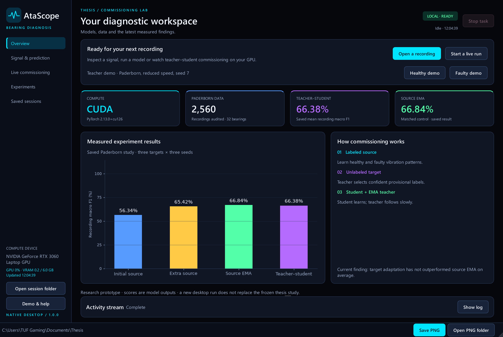
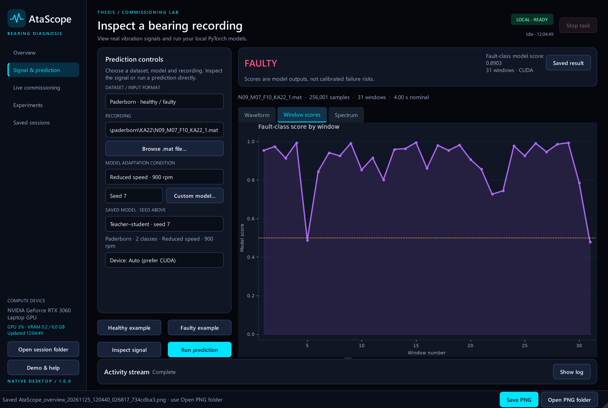
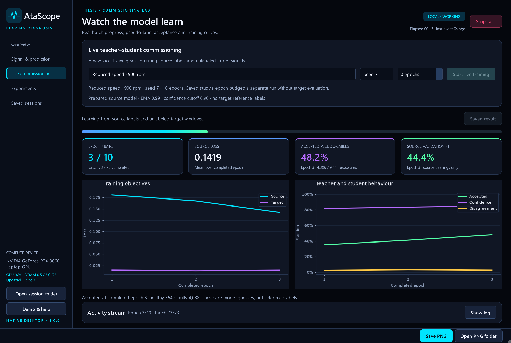

# AtaScope 1.0 native desktop application

Updated: 25 November 2026.

AtaScope is a native Qt Widgets application for this thesis. It opens as a normal
Windows desktop window, with a near-black background and cyan, green, purple and
amber highlights. It uses no web server, localhost page, HTML application or
browser engine. Matplotlib plots are embedded in the native window.

The current palette uses electric cyan, vivid violet, bright green, signal yellow
and blue against the black background. Active navigation, metric-card accents,
progress and plotted series share these colours. The product name is centralized
in `thesisui/branding.py`. The student selected AtaScope as the product name.







## Start it

Double-click **`Launch_AtaScope.bat`** in the project folder:

```text
C:\Users\TUF Gaming\Documents\Thesis\Launch_AtaScope.bat
```

The launcher uses the existing thesis environment. It never installs packages or
downloads anything. If Qt is missing, double-click `Setup_AtaScope_Desktop.bat`
once before launching. The frozen research environment lock is retained; desktop
dependencies are declared separately.
The earlier `Launch_Thesis_UI.bat` filename remains as a compatibility shortcut.

From a VS Code terminal, you can alternatively run:

```powershell
cd "C:\Users\TUF Gaming\Documents\Thesis"
.\.venv\Scripts\python.exe -m pip install -r requirements-desktop.txt
.\.venv\Scripts\python.exe scripts\desktop_app.py
```

### Fresh checkout and teacher demonstration

1. Recreate the Python environment from [START_HERE.md](../START_HERE.md) and install
   the desktop dependencies. Restore published files with
   `.\.venv\Scripts\python.exe scripts\restore_published_results.py`.
2. Place the original `.mat` recordings in the project data directories. Live
   commissioning also needs the frozen Paderborn source checkpoints and the
   prepared, unlabeled target archives; see [the data guide](PADERBORN_START_HERE.md).
   A checkout without data can open the app and view the saved study, but cannot
   run the real demonstration without the required inputs.
3. Open **Overview → Healthy demo → Run prediction**. This selects the Paderborn
   reduced-speed condition, seed 7, the saved teacher–student model and K006.
   Show **Waveform** then **Window scores**. The demo model scores K006 about
   **0.0049** and decides healthy.
4. Select **Faulty example** and run again without changing the model. KA22 scores
   about **0.8903** and is classified faulty. These are two known demo recordings,
   not an independent accuracy study.
5. Open **Live commissioning** and select reduced speed, seed 7 and 10 epochs.
   Start training and explain that the teacher's accepted predictions are
   provisional labels. The progress display runs on real updates. True target
   labels are not used, and acceptance is not accuracy.
6. Show **Saved sessions**, select the completed run and click **Export report ZIP**
   or **Use teacher model**. Then open **Experiments** and compare teacher–student
   with the matched source EMA control. **Save PNG** works on all five views.

## What each screen does

**Overview** shows the actual PyTorch/CUDA device, NVIDIA GPU utilization and
memory telemetry where available, the Paderborn audit count and saved experimental
metrics. Those study metrics are labeled as saved results. They do not animate
or change to impersonate a live training run.

**Signal & prediction** lets you choose a MATLAB recording and a model. Paderborn
uses the existing `vibration_1` loader and binary checkpoints. CWRU uses four-class
checkpoints, an explicit MATLAB channel and an explicitly supplied sample rate.
The healthy/faulty example buttons provide known collection members. Custom model
selection supports compatible trusted project checkpoints. The app checks the
checkpoint's class schema before reading the signal for inference. Known models
display their dataset and adaptation condition. If an identifiable Paderborn
recording filename and the model metadata name different target conditions, the
app reports the mismatch without blocking an intentional cross-condition run.

Press **Inspect signal** to load and check a recording without inference, or
**Run prediction** to preprocess it and execute the model. The app shows a
peak-preserving waveform overview, a first-window spectrum, per-window aggregate
fault scores and a recording-level decision. The graphs use separate **Waveform**,
**Window scores**, and **Spectrum** tabs so the score chart fits independently of
the input controls. The prediction defaults to CUDA when available; select **CPU**
to run inference on the processor. The displayed scores are model outputs, not calibrated failure
risks. The Paderborn window chart marks the fixed 0.5 threshold; CWRU retains its
four-class argmax recording decision.

**Play recording** moves a cursor through the loaded, already recorded waveform
using the nominal time base. It is clearly labeled recorded-data playback. It
does not pretend that a live accelerometer is attached. Embedded Paderborn timing
caveats remain applicable.

**Live commissioning** starts an actual new source-access teacher–student run.
Choose one target, a seed and 1–30 epochs. The default 10 epochs matches the
previous adaptation budget. The screen shows real completed source batches,
elapsed time, source/target losses, accepted pseudo-label counts, teacher
confidence, disagreement and source-validation F1. Curves update when an epoch
finishes; the progress bar updates on actual completed batches.

The source checkpoint, data preparation and implementation provenance are checked
before training. True target labels remain inaccessible through the same scoped
guard. Source-validation values are diagnostic only. The final teacher is saved;
the diagnostic student is also retained. These interactive runs do not perform
target-label evaluation and do not replace or add scientific claims to the
published fixed study.

**Experiments** displays all four methods by target condition with the original
recording-level means and seed standard deviations. Poor results and the matched
EMA comparison remain visible. This screen reads completed results, while the
live screen displays the current interactive session.

**Saved sessions** lists prediction, inspection and training jobs across app
restarts. Select a completed run to read its summary. **Use teacher model** sends
a completed Paderborn teacher to Signal & prediction; failed, cancelled and
incomplete runs cannot add a teacher. The folder browser remembers the last
recording and model directories. AtaScope also saves dataset, seed, condition,
device and commissioning preferences locally on close.

The **Activity stream** logs actual worker stages, epoch metrics, errors and
completion. Open **Show log** if you need details; the current stage remains
visible with the log collapsed. The top-right clock shows elapsed time and how long it has been
since an event arrived, including while imports or provenance checks are running.

## Stop, close and saved files

### One-click PNG export

Click **Save PNG** at the bottom-right of any screen, or press **Ctrl+Shift+S**.
AtaScope saves the current app view directly as a PNG at twice the window's pixel
dimensions. You do not need Windows screenshot tools or a save dialog. **Open PNG
folder** opens the destination in File Explorer:

```text
C:\Users\TUF Gaming\Documents\Thesis\outputs\presentation_exports
```

Every click creates a separate filename with the page name, timestamp and unique
suffix, for example `AtaScope_live_commissioning_<timestamp>_<id>.png`. The status
bar and Activity stream confirm the saved file. Exports contain the visible app
window and current scroll position, not content below the visible viewport or
another application's windows. Maximize AtaScope first for more readable slides.

Save PNG remains available while a worker trains or predicts. Exporting does not
stop, restart or alter that worker, and it does not change the research checkpoints
or saved experimental results. PNGs preserve the view at the moment of export.

### Worker sessions

Only one main worker task runs at once so GPU jobs cannot accidentally pile up.
The native interface remains responsive while the worker loads data or trains.
Use **Stop task** to request cancellation. Training checks the request between
Python training operations; if a worker is stuck during import or a GPU call,
the app stops that worker after a grace period. A cancelled run is marked as
cancelled and does not acquire a completed-model record. Closing during a task
asks whether to stop it first.

Every action gets a unique folder under:

```text
outputs/desktop_sessions/<timestamp>_<action>_<unique id>/
```

Use **Open session folder** to inspect it. Depending on the task, it contains
`events.jsonl`, `job.json`, a prediction report, window probabilities, training
histories, pseudo-label traces and teacher/student checkpoints. Existing frozen
experiment folders are never output destinations for interactive training.

### Export and print a report

On **Saved sessions**, select a completed result and press **Export report ZIP**.
Use **Report folder** to open `outputs/report_exports/`. Open the archive and
print `summary.txt` with a text editor, or inspect the machine-readable files:

- Prediction: `prediction.json` (input/model hashes, decision and scores)
  and `window_scores.csv` (per-window class scores).
- Commissioning: `completed.json`, `run_manifest.json` and `history.csv`.
- Signal inspection: `signal.json` (preprocessing and signal metadata/preview).

Exports do not copy raw dataset files or model weights. They can include absolute
paths, so review the archive before sharing it outside your machine.

## How live progress is connected

`QProcess` runs `scripts/desktop_worker.py` separately from the UI and streams
newline-delimited JSON events. The app does not import PyTorch into its window
process. NVIDIA telemetry is also queried asynchronously.

The frozen `train_run` function is left unchanged. A scoped Python trace observes
its completed source updates and appended history rows. It reads values for
display without changing tensors, random generators, losses or selection rules.
An end-to-end check compares the default observed run against the original saved
teacher state and source batch-sequence hash. It requires exact equality on the
installed software/GPU. Interactive changes to epoch count define a separate
demonstration run, not a reproduction of the original 10-epoch result.

## Validation

```powershell
.\.venv\Scripts\python.exe -m unittest discover -s tests -v
.\.venv\Scripts\python.exe scripts\check_desktop_ui.py --quick
.\.venv\Scripts\python.exe scripts\check_desktop_ui.py
```

The quick check exercises Paderborn and CWRU predictions and inspection. The full
check exercises real CUDA and CPU inference, checks the compact score plot,
rejects incompatible checkpoints and malformed recordings, and runs 10 real
training epochs. It verifies exact teacher tensors and source order against the
frozen run, reopens a completed model in a new window, checks exported report
contents and cancels a second real run when closing the app. It saves PNGs through
the real button, including during training. Both integration checks require the
local datasets and GPU; the unit tests also cover offline report and history logic.
The 1.0 acceptance run passed all 40 unit tests and the quick native UI check at
125% Qt scaling. The compact prediction check uses a 1024 × 670 logical window.

Evidence and screenshots are written to `outputs/desktop_ui_checks/`. The
offscreen test registers Windows fonts explicitly so its rendering matches the
desktop style. It is an actual Qt render, not an HTML mockup.

If startup fails with no console, details are saved in
`outputs/desktop_startup_error.txt`. Reinstall the optional desktop dependency
and use the terminal command above to see the full error.

## Scope

This release is the demo-ready Windows application within the thesis scope. It
starts from prepared source checkpoints; fitting the source model remains a
separate research command. Continuous sensor acquisition, a standalone installer
and industrial certification are outside the release. To run on another computer,
set up the project and the required datasets there first. Live runs and the UI do
not change the frozen experiment or establish that target adaptation improves it.
