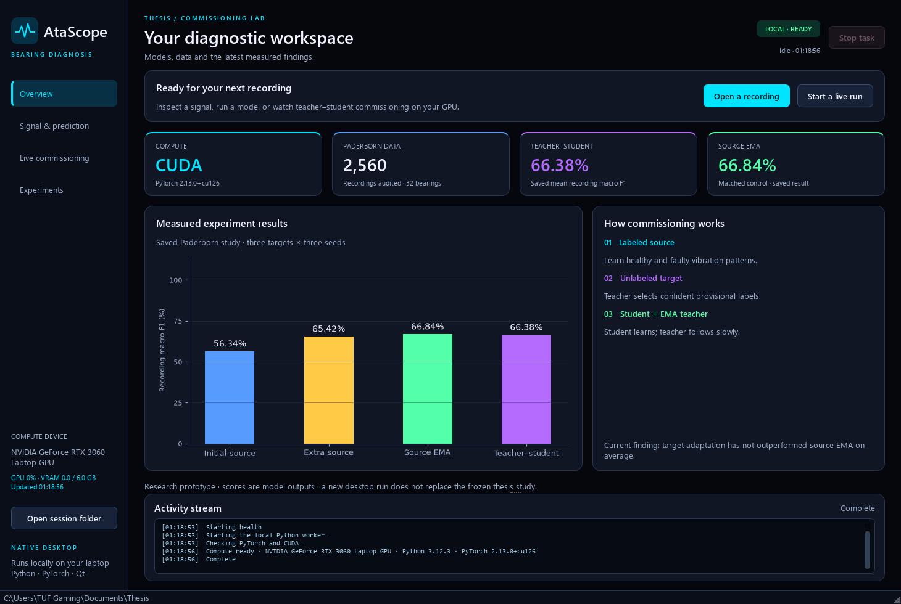
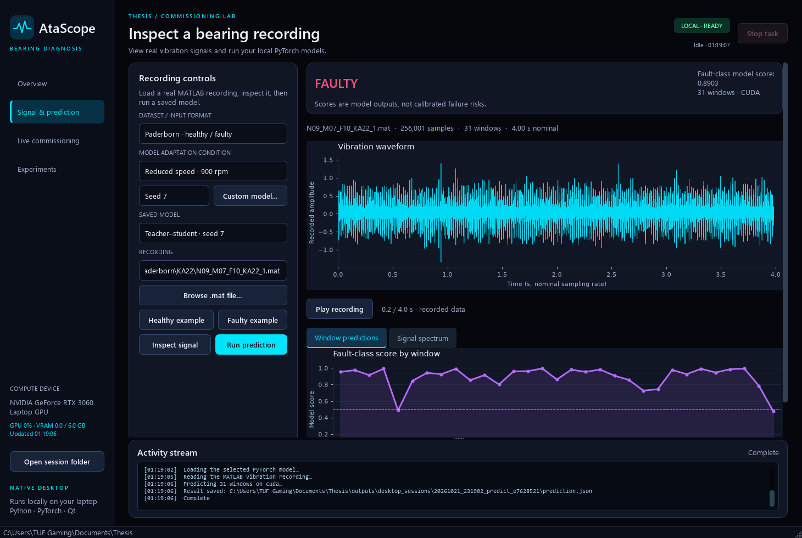
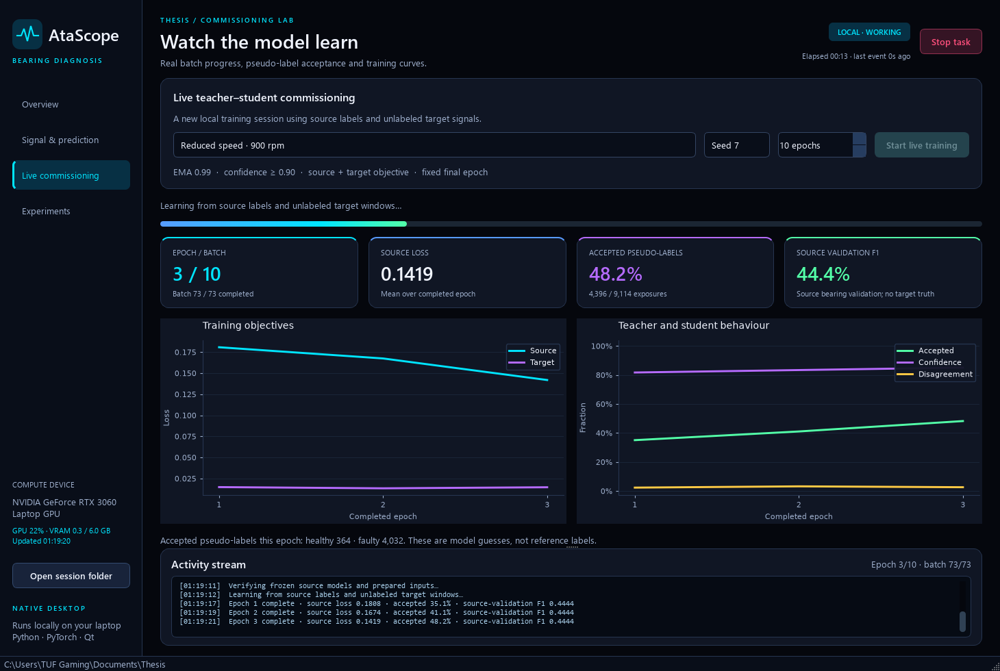

# AtaScope native desktop interface

Updated: 22 October 2026.

AtaScope is a native Qt Widgets application for this thesis. It opens as a normal
Windows desktop window, with a near-black background and cyan, green, purple and
amber highlights. It uses no web server, localhost page, HTML application or
browser engine. Matplotlib plots are embedded in the native window.

The current palette uses electric cyan, vivid violet, bright green, signal yellow
and blue against the black background. Active navigation, metric-card accents,
progress and plotted series share these colours. The product name is centralized
in `thesisui/branding.py`. The student selected AtaScope as the product name.







## Start it

Double-click **`Launch_AtaScope.bat`** in the project folder:

```text
C:\Users\TUF Gaming\Documents\Thesis\Launch_AtaScope.bat
```

The launcher uses the existing thesis environment. If the optional Qt dependency
is missing, it installs `requirements-desktop.txt` first. The frozen research
environment lock is retained; desktop dependencies are declared separately.
The earlier `Launch_Thesis_UI.bat` filename remains as a compatibility shortcut.

From a VS Code terminal, you can alternatively run:

```powershell
cd "C:\Users\TUF Gaming\Documents\Thesis"
.\.venv\Scripts\python.exe -m pip install -r requirements-desktop.txt
.\.venv\Scripts\python.exe scripts\desktop_app.py
```

## What each screen does

**Overview** shows the actual PyTorch/CUDA device, NVIDIA GPU utilization and
memory telemetry where available, the Paderborn audit count and saved experimental
metrics. Those study metrics are labeled as saved results. They do not animate
or change to impersonate a live training run.

**Signal & prediction** lets you choose a MATLAB recording and a model. Paderborn
uses the existing `vibration_1` loader and binary checkpoints. CWRU uses four-class
checkpoints, an explicit MATLAB channel and an explicitly supplied sample rate.
The healthy/faulty example buttons provide known collection members. Custom model
selection supports compatible trusted project checkpoints.

Press **Inspect signal** to load and check a recording without inference, or
**Run prediction** to preprocess it and execute the model. The app shows a
peak-preserving waveform overview, a first-window spectrum, per-window aggregate
fault scores and a recording-level decision. The prediction batches run on CUDA
when available. The displayed scores are model outputs, not calibrated failure
risks. The Paderborn window chart marks the fixed 0.5 threshold; CWRU retains its
four-class argmax recording decision.

**Play recording** moves a cursor through the loaded, already recorded waveform
using the nominal time base. It is clearly labeled recorded-data playback. It
does not pretend that a live accelerometer is attached. Embedded Paderborn timing
caveats remain applicable.

**Live commissioning** starts an actual new source-access teacher–student run.
Choose one target, a seed and 1–30 epochs. The default 10 epochs matches the
previous adaptation budget. The screen shows real completed source batches,
elapsed time, source/target losses, accepted pseudo-label counts, teacher
confidence, disagreement and source-validation F1. Curves update when an epoch
finishes; the progress bar updates on actual completed batches.

The source checkpoint, data preparation and implementation provenance are checked
before training. True target labels remain inaccessible through the same scoped
guard. Source-validation values are diagnostic only. The final teacher is saved;
the diagnostic student is also retained. These interactive runs do not perform
target-label evaluation and do not replace or add scientific claims to the
published fixed study.

**Experiments** displays all four methods by target condition with the original
recording-level means and seed standard deviations. Poor results and the matched
EMA comparison remain visible. This screen reads completed results, while the
live screen displays the current interactive session.

The **Activity stream** logs actual worker stages, epoch metrics, errors and
completion. The top-right clock shows elapsed time and how long it has been
since an event arrived, including while imports or provenance checks are running.

## Stop, close and saved files

Only one main worker task runs at once so GPU jobs cannot accidentally pile up.
The native interface remains responsive while the worker loads data or trains.
Use **Stop task** to request cancellation. Training checks the request between
Python training operations; if a worker is stuck during import or a GPU call,
the app stops that worker after a grace period. A cancelled run is marked as
cancelled and does not acquire a completed-model record. Closing during a task
asks whether to stop it first.

Every action gets a unique folder under:

```text
outputs/desktop_sessions/<timestamp>_<action>_<unique id>/
```

Use **Open session folder** to inspect it. Depending on the task, it contains
`events.jsonl`, `job.json`, a prediction report, window probabilities, training
histories, pseudo-label traces and teacher/student checkpoints. Existing frozen
experiment folders are never output destinations for interactive training.

## How live progress is connected

`QProcess` runs `scripts/desktop_worker.py` separately from the UI and streams
newline-delimited JSON events. The app does not import PyTorch into its window
process. NVIDIA telemetry is also queried asynchronously.

The frozen `train_run` function is left unchanged. A scoped Python trace observes
its completed source updates and appended history rows. It reads values for
display without changing tensors, random generators, losses or selection rules.
An end-to-end check compares the default observed run against the original saved
teacher state and source batch-sequence hash. It requires exact equality on the
installed software/GPU. Interactive changes to epoch count define a separate
demonstration run, not a reproduction of the original 10-epoch result.

## Validation

```powershell
.\.venv\Scripts\python.exe -m unittest discover -s tests -v
.\.venv\Scripts\python.exe scripts\check_desktop_ui.py
```

The desktop check operates the native Qt widgets offscreen, executes real healthy
and faulty inference, runs 10 real training epochs, checks every epoch's batch
events, verifies exact teacher tensors and source order, tests cancellation and
saves screenshots. It requires the local datasets and GPU.

Evidence and screenshots are written to `outputs/desktop_ui_checks/`. The
offscreen test registers Windows fonts explicitly so its rendering matches the
desktop style. It is an actual Qt render, not an HTML mockup.

If startup fails with no console, details are saved in
`outputs/desktop_startup_error.txt`. Reinstall the optional desktop dependency
and use the terminal command above to see the full error.

## Scope

This release provides a usable native desktop front end to the existing research
prototype. Continuous sensor acquisition, packaged standalone `.exe` installers
and industrial diagnostic certification are separate projects. The app currently
starts from the project and its `.venv`, using the supplied launcher.
