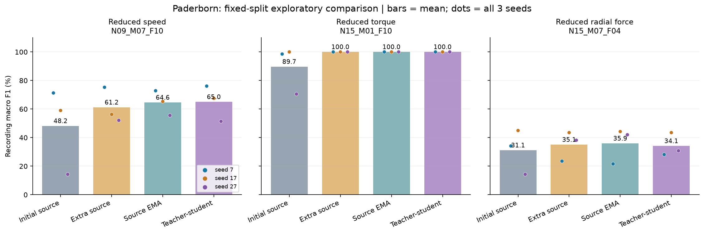
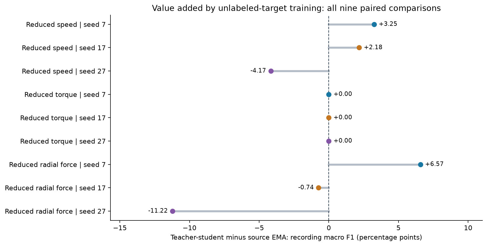
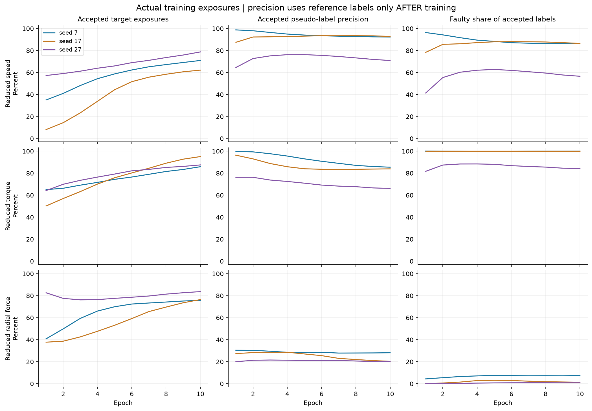
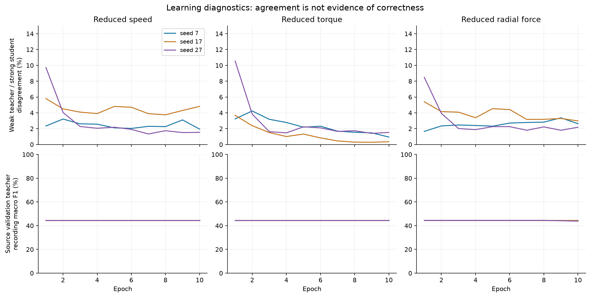
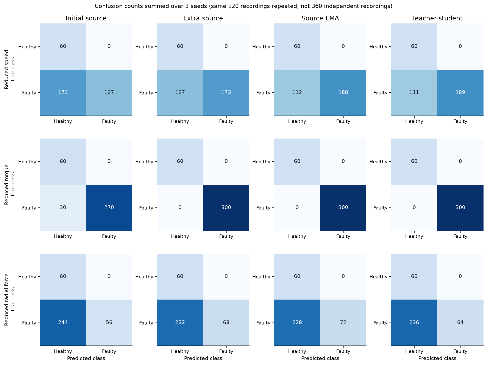
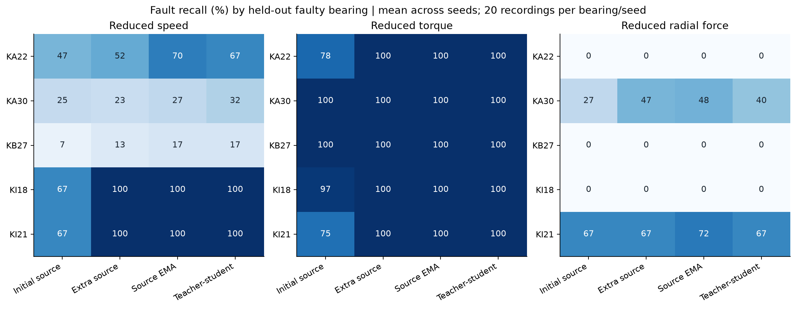

# Paderborn commissioning: measured results

Generated from frozen experiment evidence. Exploratory fixed-split study.

## Main result

Mean recording macro F1 across three targets and three seeds:

| Method | Mean macro F1 (%) |
|---|---:|
| Initial source | 56.34 |
| Extra source | 65.42 |
| Source EMA | 66.84 |
| Teacher-student | 66.38 |

Paired differences use teacher-student minus each control; unit is percentage points.

| Control | Mean difference | Improved / worse / tied (of 9) |
|---|---:|---:|
| Initial source | +10.04 | 6 / 2 / 1 |
| Extra source | +0.96 | 3 / 2 / 4 |
| Source EMA | -0.46 | 3 / 3 / 3 |

Source EMA is the primary comparator. Averaging these nine runs is descriptive; the same bearings
and seed-specific source models recur across conditions. It is not a population confidence interval.

## All target conditions

Values are mean ± sample SD across three seeds, in percent.

| Condition | Method | Macro F1 | Balanced accuracy | Fault recall | Healthy FPR | Accuracy |
|---|---|---:|---:|---:|---:|---:|
| N09_M07_F10 | Initial source | 48.19 ± 30.00 | 71.17 ± 18.82 | 42.33 ± 37.63 | 0.00 ± 0.00 | 51.94 ± 31.36 |
| N09_M07_F10 | Extra source | 61.19 ± 12.35 | 78.83 ± 8.50 | 57.67 ± 17.01 | 0.00 ± 0.00 | 64.72 ± 14.17 |
| N09_M07_F10 | Source EMA | 64.58 ± 8.66 | 81.33 ± 6.03 | 62.67 ± 12.06 | 0.00 ± 0.00 | 68.89 ± 10.05 |
| N09_M07_F10 | Teacher-student | 64.99 ± 12.54 | 81.50 ± 8.67 | 63.00 ± 17.35 | 0.00 ± 0.00 | 69.17 ± 14.46 |
| N15_M01_F10 | Initial source | 89.68 ± 16.62 | 95.00 ± 8.23 | 90.00 ± 16.46 | 0.00 ± 0.00 | 91.67 ± 13.72 |
| N15_M01_F10 | Extra source | 100.00 ± 0.00 | 100.00 ± 0.00 | 100.00 ± 0.00 | 0.00 ± 0.00 | 100.00 ± 0.00 |
| N15_M01_F10 | Source EMA | 100.00 ± 0.00 | 100.00 ± 0.00 | 100.00 ± 0.00 | 0.00 ± 0.00 | 100.00 ± 0.00 |
| N15_M01_F10 | Teacher-student | 100.00 ± 0.00 | 100.00 ± 0.00 | 100.00 ± 0.00 | 0.00 ± 0.00 | 100.00 ± 0.00 |
| N15_M07_F04 | Initial source | 31.14 ± 15.57 | 59.33 ± 8.81 | 18.67 ± 17.62 | 0.00 ± 0.00 | 32.22 ± 14.68 |
| N15_M07_F04 | Extra source | 35.07 ± 10.35 | 61.33 ± 6.17 | 22.67 ± 12.34 | 0.00 ± 0.00 | 35.56 ± 10.29 |
| N15_M07_F04 | Source EMA | 35.94 ± 12.49 | 62.00 ± 7.40 | 24.00 ± 14.80 | 0.00 ± 0.00 | 36.67 ± 12.33 |
| N15_M07_F04 | Teacher-student | 34.15 ± 8.21 | 60.67 ± 5.11 | 21.33 ± 10.21 | 0.00 ± 0.00 | 34.44 ± 8.51 |

## Actual pseudo-label decisions in the final epoch

Coverage and precision below count the repeated exposures used during training, not unique bearings.
Reference labels were joined only after every checkpoint was frozen. None of these numbers selected a model.

| Target | Seed | Accepted (%) | Accepted precision (%) | Accepted faulty share (%) | True healthy coverage (%) | True faulty coverage (%) |
|---|---:|---:|---:|---:|---:|---:|
| N09_M07_F10 | 7 | 71.00 | 92.32 | 86.28 | 30.71 | 79.03 |
| N09_M07_F10 | 17 | 62.22 | 92.84 | 86.48 | 28.21 | 69.07 |
| N09_M07_F10 | 27 | 78.76 | 70.95 | 56.63 | 68.92 | 80.72 |
| N15_M01_F10 | 7 | 85.83 | 85.40 | 99.95 | 75.68 | 87.85 |
| N15_M01_F10 | 17 | 95.04 | 83.87 | 100.00 | 92.90 | 95.46 |
| N15_M01_F10 | 27 | 87.46 | 66.10 | 84.04 | 94.86 | 85.99 |
| N15_M07_F04 | 7 | 75.83 | 28.15 | 7.46 | 94.21 | 72.15 |
| N15_M07_F04 | 17 | 76.47 | 20.36 | 1.35 | 88.17 | 74.16 |
| N15_M07_F04 | 27 | 83.73 | 20.29 | 0.86 | 97.95 | 80.90 |

## Figures

## How to interpret this experiment

A smaller training loss or more accepted pseudo-labels does not establish better diagnosis. Teacher and
student can become more consistent while reinforcing incorrect labels. Use the paired evaluation and
retrospective pseudo-label precision together. A high faulty-class share is not automatically collapse
because the adaptation collection is imbalanced; errors and bearing-level behavior must support that claim.

A matched source EMA removes much of the explanation due solely to extra source updates and weight averaging.
It does not isolate every component of the target objective: confidence masking, augmentation, loss weighting
and teacher feedback still require separate ablations. A positive pair is not proof of general superiority.

The source validation trajectories are logged diagnostics only. The fixed final epoch was used even if
validation worsened. A future stopping rule must be declared before new evaluation, not retrofitted to
pick the most favorable checkpoint from this study.

## Limits and verification

- This is binary source-access adaptation, not source-free adaptation, full CAT reproduction, or cross-machine validation.
- Baseline test results had already been inspected. Further development requires declared new versions and independent confirmation.
- Only six held-out bearings, including one healthy bearing, determine these results; windows do not increase specimen diversity.
- Nominal sampling rates and the original timestamp discrepancy remain documented in the baseline protocol.
- Target labels were blocked in training; the evaluator verifies frozen configuration, inputs, code and artifacts.
- Source index sequences and update budgets matched within each seed. See training_complete.json for provenance.
- A seed-7/low-speed replay checks exact tensors, histories and pseudo-label traces on the same machine.

## Evidence files

[All published evidence](../results/paderborn_commissioning_v1/) includes results_by_seed.csv, results_summary.csv,
paired_comparisons.csv, per_bearing_results.csv, training histories, pseudo-label traces, checkpoints and hash declarations.
See [the frozen protocol](PADERBORN_COMMISSIONING_PROTOCOL_V1.md) for settings and access boundaries.
